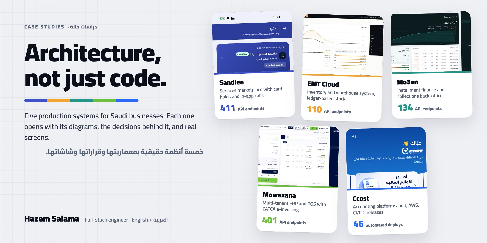

  
  
  
  

# Case Studies — Hazem Salama

Production systems I designed and built, mostly for the Saudi market. **The code belongs to my clients and stays private.** Each case study covers the problem, the architecture (with diagrams), the decisions behind it and real screens, in English and Arabic.

| Project | What it is | Tags | Read |
|---|---|---|---|
| [**Sandlee**](sandlee/README.md) | On-demand services marketplace: client app, provider app, admin dashboard and website on one backend. The card is held at quote acceptance and captured on job completion. In-app calls, Arabic-first, hosted in Riyadh. | `marketplace` `payments` `react-native` `node.js` `postgresql` `oracle-cloud` | [EN](sandlee/README.md) · [AR](sandlee/README.ar.md) |
| [**Mowazana**](mowazana/README.md) | Multi-tenant SaaS ERP and POS: sales, purchases, inventory, double-entry books, ZATCA Phase 2 e-invoicing with a per-tenant hash chain, subscription billing and an Arabic AI support assistant. | `saas` `erp` `zatca` `laravel` `react` `aws` | [EN](mowazana/README.md) · [AR](mowazana/README.ar.md) |
| [**Mo3an**](mo3an/README.md) | Installment finance and collections back-office. Contracts generate their own schedule and three Arabic PDFs, payments post in locked transactions, and the treasury balance is summed from the ledger. | `fintech` `ledger` `node.js` `prisma` `next.js` | [EN](mo3an/README.md) · [AR](mo3an/README.ar.md) |
| [**EMT Cloud**](emt-cloud/README.md) | Inventory and warehouse system for a trading company: receipt and issue vouchers, ledger-based stock balances, role privileges, and PDF reports printed from templates the customer designs. | `inventory` `asp.net-core` `sql-server` `next.js` | [EN](emt-cloud/README.md) · [AR](emt-cloud/README.ar.md) |
| [**Ccost**](ccost/README.md) *(consulting)* | Saudi financial-statements and accounting-services platform on iOS, Android, web and an admin. My role: code audit, AWS hosting, the CI/CD pipeline, a staging environment and release management. | `devops` `aws` `ci-cd` `laravel` | [EN](ccost/README.md) · [AR](ccost/README.ar.md) |

### What every case study includes
- **Architecture diagrams:** system, network and deployment, the key state machine, and one hard flow end to end.
- **A decision table:** each decision with what it was chosen over, why, and the trade-off accepted.
- **Real screens** from staging or demo environments, with no real customer data.
- **Numbers counted from the code** (endpoints, models, tests, screens), never estimated.

Want a walkthrough of any of them? **[HazemSalama108@gmail.com](mailto:HazemSalama108@gmail.com)**

---

# دراسات حالة — حازم سلامة

أنظمة حقيقية صممتها وبنيتها، أغلبها للسوق السعودي. **الشيفرة ملك لعملائي وليست منشورة.** كل دراسة تشرح المشكلة والمعمارية بالمخططات والقرارات خلفها وشاشات حقيقية، بالعربية والإنجليزية.

**سندلي:** منصة خدمات عند الطلب. تطبيق للعميل وتطبيق للمنشأة ولوحة إدارة وموقع على خادم واحد. يُحجز المبلغ عند قبول العرض ويُلتقط عند اكتمال الخدمة، مع مكالمات داخل التطبيق، والعربية أولاً، والاستضافة في الرياض. [اقرأ بالعربية](sandlee/README.ar.md)

**موازنة:** نظام ERP ونقاط بيع سحابي متعدد المنشآت. مبيعات ومشتريات ومخزون وقيود مزدوجة، وفوترة إلكترونية للمرحلة الثانية من هيئة الزكاة بسلسلة تجزئة لكل منشأة، واشتراكات، ومساعد ذكي بالعربية. [اقرأ بالعربية](mowazana/README.ar.md)

**مُعان:** نظام للتمويل بالتقسيط والتحصيل. العقد يولّد جدول أقساطه وثلاثة مستندات عربية، والدفعات تُقيَّد في معاملات مقفلة، ورصيد الخزينة يُجمع من دفتر الحركة. [اقرأ بالعربية](mo3an/README.ar.md)

**EMT Cloud:** نظام مخزون ومستودعات لشركة تجارية. سندات استلام وصرف، وأرصدة تُحسب من دفتر الحركات، وصلاحيات للأدوار، وتقارير PDF بقوالب يصممها العميل. [اقرأ بالعربية](emt-cloud/README.ar.md)

**Ccost (استشارة):** منصة سعودية لإعداد القوائم المالية والخدمات المحاسبية على iOS وAndroid والويب ولوحة إدارة. دوري: تدقيق الشيفرة، والاستضافة على AWS، ومسار النشر الآلي، وبيئة التجربة، وإدارة الإصدارات. [اقرأ بالعربية](ccost/README.ar.md)

