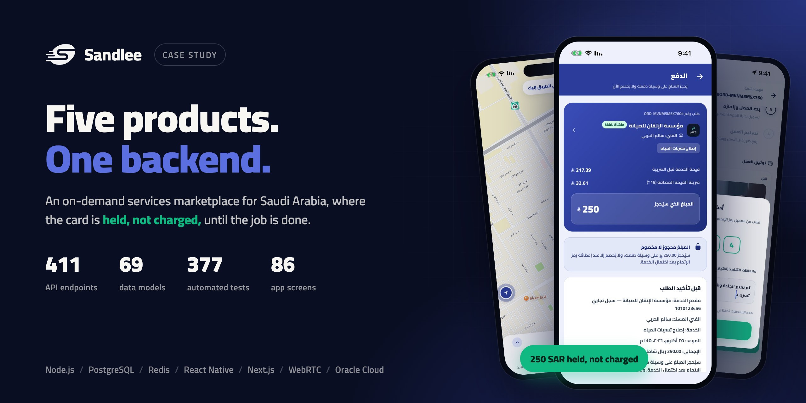

# Case Studies — Hazem Salama

Client systems I designed and built end to end. The code belongs to my clients and stays private; each case study covers the problem, the architecture and the engineering decisions behind it.

| Project | What it is | Read |
|---|---|---|
| **Sandlee** | On-demand services marketplace for Saudi Arabia: client app, provider app, admin dashboard and website on one backend. The card is held at quote acceptance and captured on job completion. In-app calls, Arabic-first, hosted in Riyadh. | [English](sandlee/README.md) · [العربية](sandlee/README.ar.md) |
| **EMT Cloud** | Inventory and warehouse system for a trading company: receipt and issue vouchers, ledger-based stock balances, role privileges, and PDF reports printed from templates the customer designs. ASP.NET Core 9 and Next.js, Arabic and English. | [English](emt-cloud/README.md) · [العربية](emt-cloud/README.ar.md) |
| **Mo3an** | Installment finance and collections back-office for Saudi Arabia. Contracts generate their own schedule and three Arabic PDFs, payments post in locked transactions, and the treasury balance is summed from the ledger. | [English](mo3an/README.md) · [العربية](mo3an/README.ar.md) |
| **Mowazana** | Multi-tenant SaaS ERP and POS for Saudi businesses: sales, purchases, inventory, double-entry books, ZATCA Phase 2 e-invoicing with a per-tenant hash chain, subscription billing, and an Arabic AI support assistant. | [English](mowazana/README.md) · [العربية](mowazana/README.ar.md) |
| **Ccost** *(consulting)* | Saudi financial-statements and accounting-services platform on iOS, Android, web and an admin. My role: code audit, AWS hosting, the CI/CD pipeline, a staging environment and release management. | [English](ccost/README.md) · [العربية](ccost/README.ar.md) |

Want a walkthrough? **[HazemSalama108@gmail.com](mailto:HazemSalama108@gmail.com)** · [LinkedIn](https://linkedin.com/in/hazem-salama-290310310) · [hazemsalama.dev](https://hazemsalama.dev)

---

# دراسات حالة — حازم سلامة

أنظمة صممتها وبنيتها كاملة لعملائي. الشيفرة ملك لهم وليست منشورة، وكل دراسة تشرح المشكلة والمعمارية والقرارات الهندسية خلفها.

**سندلي:** منصة خدمات عند الطلب في السعودية. تطبيق للعميل وتطبيق للمنشأة ولوحة إدارة وموقع على خادم واحد. يُحجز المبلغ عند قبول العرض ويُلتقط عند اكتمال الخدمة، مع مكالمات داخل التطبيق، والعربية أولاً، والاستضافة في الرياض. [اقرأ بالعربية](sandlee/README.ar.md)

**EMT Cloud:** نظام مخزون ومستودعات لشركة تجارية. سندات استلام وصرف، وأرصدة تُحسب من دفتر الحركات، وصلاحيات للأدوار، وتقارير PDF بقوالب يصممها العميل. [اقرأ بالعربية](emt-cloud/README.ar.md)

**مُعان:** نظام للتمويل بالتقسيط والتحصيل في السعودية. العقد يولّد جدول أقساطه وثلاثة مستندات عربية، والدفعات تُقيَّد في معاملات مقفلة، ورصيد الخزينة يُجمع من دفتر الحركة. [اقرأ بالعربية](mo3an/README.ar.md)

**موازنة:** نظام ERP ونقاط بيع سحابي متعدد المنشآت للسوق السعودي. مبيعات ومشتريات ومخزون وقيود مزدوجة، وفوترة إلكترونية للمرحلة الثانية من هيئة الزكاة بسلسلة تجزئة لكل منشأة، واشتراكات، ومساعد ذكي بالعربية. [اقرأ بالعربية](mowazana/README.ar.md)

**Ccost (استشارة):** منصة سعودية لإعداد القوائم المالية والخدمات المحاسبية على iOS وAndroid والويب ولوحة إدارة. دوري: تدقيق الشيفرة، والاستضافة على AWS، ومسار النشر الآلي، وبيئة التجربة، وإدارة الإصدارات. [اقرأ بالعربية](ccost/README.ar.md)

