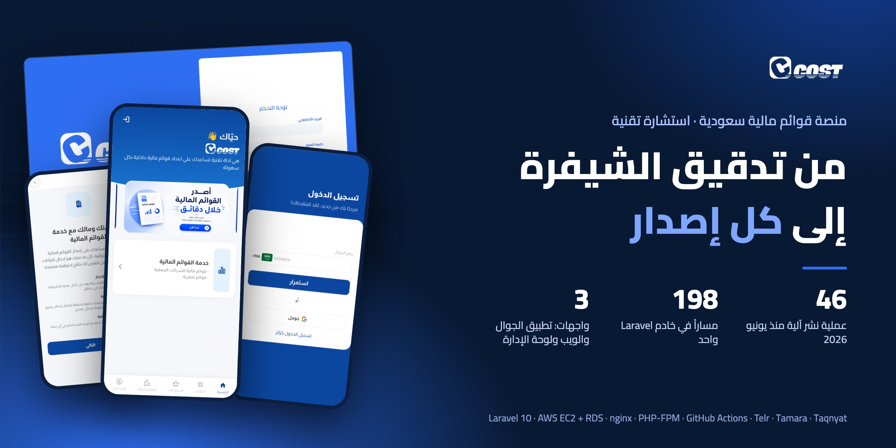
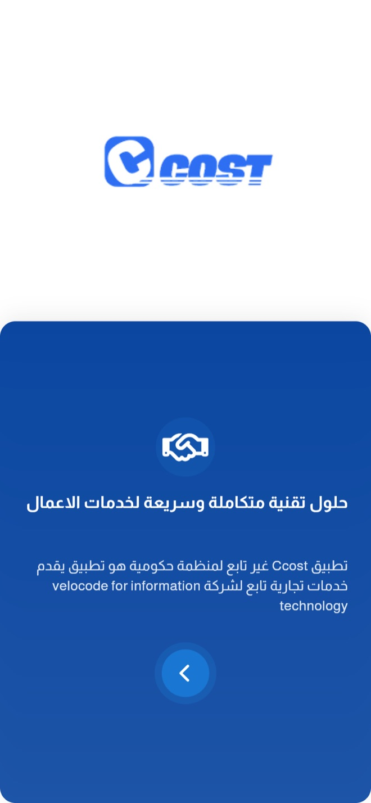
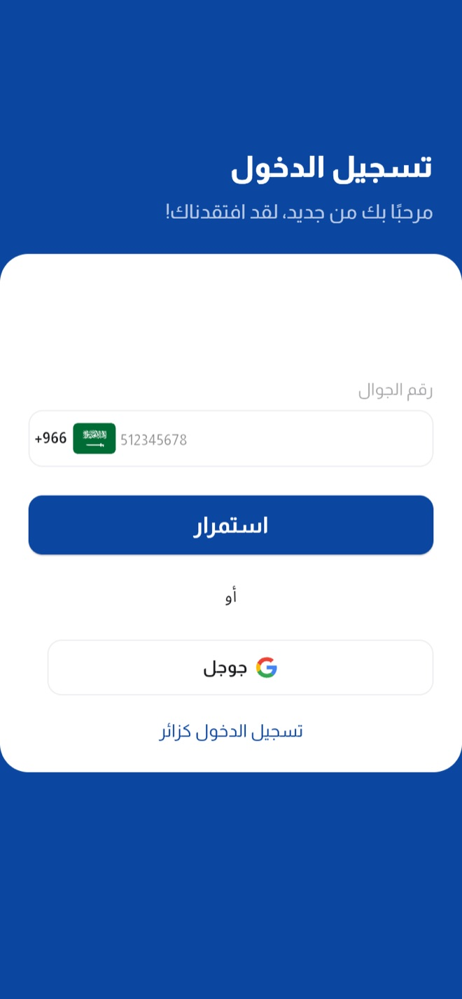
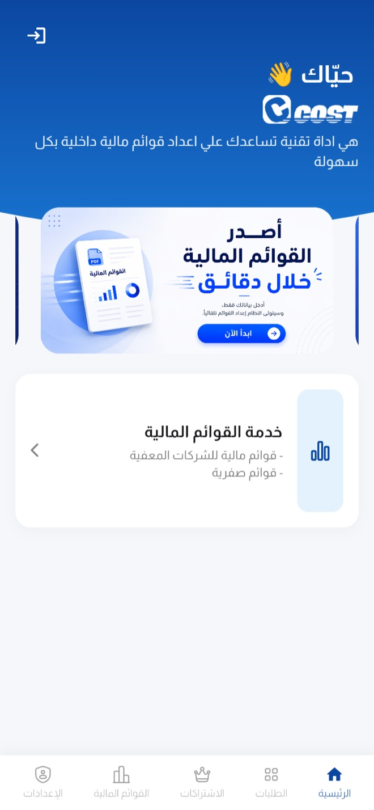
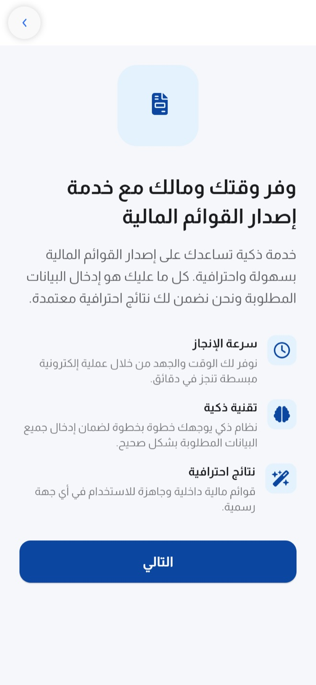
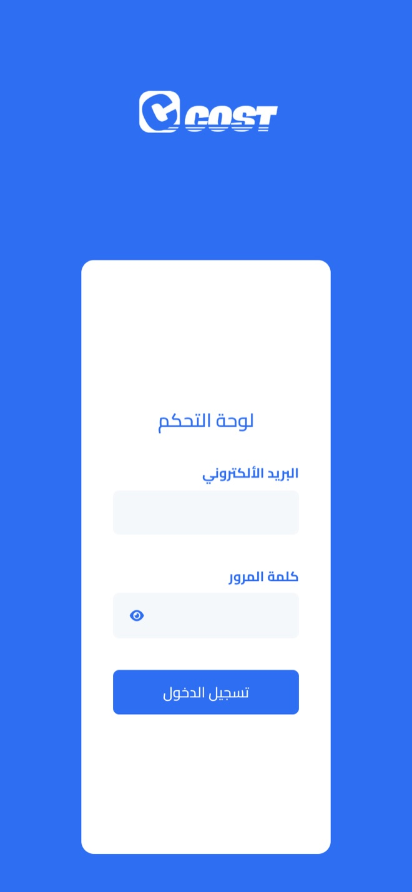
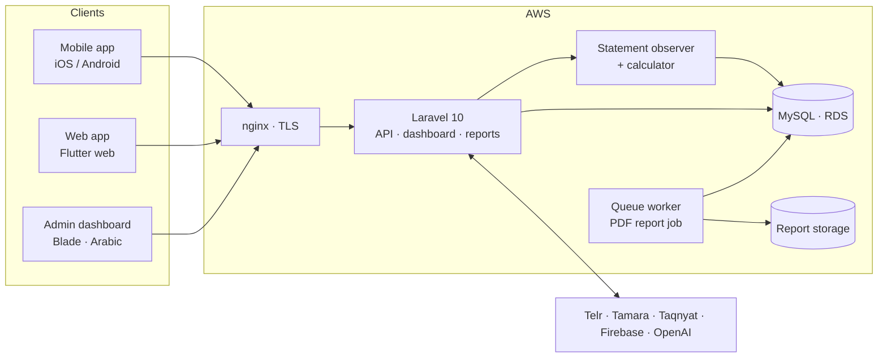
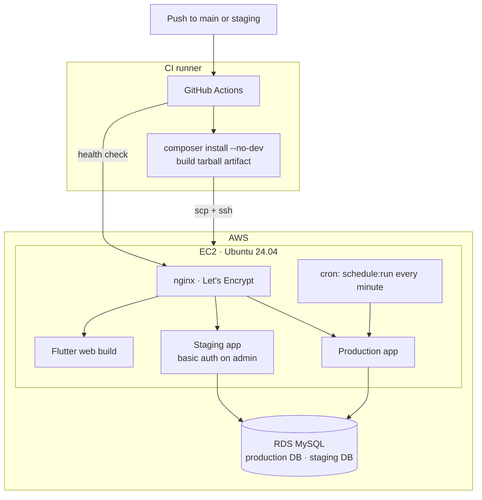
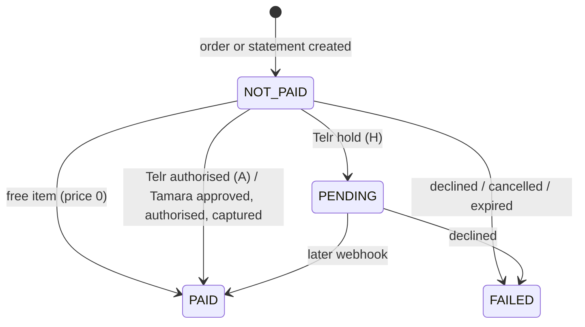
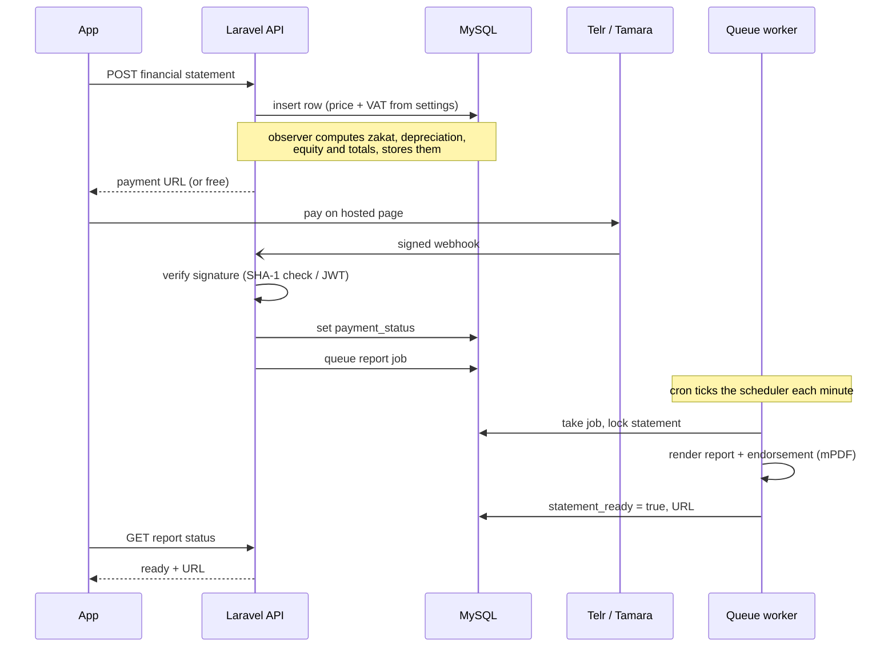

  <a href="README.md">English</a> · <b>العربية</b>

  
  
  
  
  
  
  

# Ccost: منصة القوائم المالية والخدمات المحاسبية في السعودية

**أدخل أرقامك واستلم قوائمك المالية.** يُدخل صاحب المنشأة رأس المال والمبيعات والمشتريات والأصول والالتزامات، فتحسب المنصة القوائم والزكاة والإهلاك، وتُصدر تقارير PDF جاهزة للاستخدام مع صفحة إقرار. وحول هذه النواة طلبات تسعير التكاليف، وصياغة العقود ومراجعتها، وطلبات مسك الدفاتر، وباقات الفوترة الإلكترونية، ويُدفع لها بالبطاقة عبر Telr أو بالتقسيط عبر Tamara.

[ccost-app.com](https://ccost-app.com) · iOS و Android والويب ولوحة الإدارة · العربية أولاً · **دوري: مستشار تقني للتدقيق والبنية التحتية وخط النشر وإدارة الإصدارات**

> **الشيفرة ملك للعميل وليست منشورة.** لم أكتب التطبيق، بل دقّقته ونقلته إلى الإنتاج وأدير إصداراته. يسعدني شرح الاستضافة أو خط النشر أو تصميم بيئة الاختبار:
> **[HazemSalama108@gmail.com](mailto:HazemSalama108@gmail.com)** · [LinkedIn](https://linkedin.com/in/hazem-salama-290310310) · [hazemsalama.dev](https://hazemsalama.dev)

  
  
  
  
  

شاشات حقيقية من الإنتاج، من الصفحات العامة فقط (وضع الزائر): الترحيب ← الدخول برقم الجوال ← الرئيسية ← خدمة القوائم المالية ← دخول لوحة الإدارة

---

## نظرة سريعة

| | |
|---|---|
| **المنتجات** | تطبيق جوال (iOS و Android) · تطبيق ويب على ccost-app.com · لوحة إدارة عربية · خادم Laravel واحد خلفها كلها |
| **الخدمات** | القوائم المالية (مبسّطة ومتقدمة، لسنة واحدة أو مقارنة) · تسعير التكاليف · العقود · طلبات مسك الدفاتر · باقات الفوترة الإلكترونية · مساعد ذكي |
| **النظام** | نحو 15.9 ألف سطر PHP · 198 مساراً (54 للواجهة البرمجية و144 للوحة والتقارير) · 24 نموذج بيانات على 35 جدولاً · 55 ترحيلاً · 22 وحدة في لوحة الإدارة |
| **التكاملات** | Telr للبطاقات · Tamara للتقسيط · Taqnyat لرسائل التحقق · Firebase للإشعارات · OpenAI للمساعد · mPDF لتقارير PDF العربية |
| **مهمتي** | تدقيق كامل للشيفرة · استضافة الإنتاج على AWS · خط نشر GitHub Actions · بيئة اختبار · الطابور والجدولة · التحقق من مزوّد الرسائل · إدارة الإصدارات المستمرة |
| **الإصدارات** | 46 عملية نشر آلية منذ يونيو 2026، نجحت منها 45 |
| **السحابة** | AWS: خادم EC2 (Ubuntu 24.04 و nginx و PHP-FPM 8.2) وقاعدة MySQL على RDS · شهادات Let's Encrypt على كل النطاقات |

أرقام الأسطر والمسارات والنماذج والوحدات تصف نظام العميل، وهي معدودة من الشيفرة وليست من إنتاجي.

---

## المعمارية

### النظام

**خادم Laravel واحد يخدم كل الواجهات.** يستدعي تطبيق الجوال وتطبيق الويب الواجهة البرمجية نفسها، ولوحة الإدارة صفحات Blade تُبنى على الخادم في الشيفرة نفسها. حفظ القائمة يطلق مراقباً يشغّل الحاسبة ويخزّن كل البنود المشتقة، ثم تُبنى ملفات PDF في مهمة على الطابور خارج مسار الطلب.

### الشبكة والنشر

- **الفرع يحدد الوجهة.** فرع `main` يُنشر إلى الإنتاج، وفرع `staging` إلى نسخة منفصلة بقاعدة بيانات خاصة.
- **الخادم لا يبني شيئاً.** تُثبَّت الحزم على مشغّل خط النشر وتُشحن حزمة واحدة، والخادم يفكّها ويربط التخزين ويمسح الذاكرة المؤقتة ويعيد تحميل PHP-FPM فقط.
- **لا ينجح النشر إلا إذا استجاب الموقع.** الخطوة الأخيرة تطلب صفحة دخول الإدارة، وتُفشل التشغيل عند أي حالة غير سليمة.

### حالة الدفع للطلب المدفوع

الحالات الأربع نفسها (غير مدفوع، معلّق، مدفوع، فاشل) تنطبق على طلبات التسعير وطلبات العقود والقوائم المالية، وتُربط حالات كل بوابة بها في موضع واحد لكل بوابة.

### من الأرقام المُدخلة إلى ملف PDF

---

## القرارات المعمارية

### معمارية النظام (راجعتها ووثّقتها في التدقيق)

| # | القرار | بدلاً من | السبب | الثمن المقبول |
|---|---|---|---|---|
| 1 | **خادم Laravel واحد للتطبيقات وتطبيق الويب ولوحة الإدارة** | خدمة واجهة برمجية منفصلة عن تطبيق الإدارة | شيفرة واحدة وقاعدة واحدة ونشر واحد لفريق صغير | الواجهة البرمجية واللوحة تُنشران معاً |
| 2 | **كل حسابات القوائم في حاسبة واحدة، بدالة لكل بند من بنود القائمة العربية** | معادلات موزّعة بين المتحكمات والقوالب | القواعد مأخوذة من جدول المحاسب، ودالة لكل بند تبقيها قابلة للتتبع إليه | صنف كبير مرتبط بتصميم الجدول |
| 3 | **البنود المشتقة تُحسب مرة واحدة عند الحفظ عبر مراقب للنموذج** | الحساب عند كل قراءة | التقارير والتطبيق واللوحة تقرأ الأرقام المخزّنة نفسها | كل تعديل يعيد تشغيل الحساب |
| 4 | **بناء PDF مهمة على الطابور مع قفل لكل قائمة** | البناء داخل الطلب | بناء تقرير متعدد الصفحات يُبقي الطلب مفتوحاً، والقفل يمنع مهمتين من كتابة الملف نفسه | التطبيق يسأل عن الحالة حتى يجهز التقرير |
| 5 | **أربعة قوالب للتقارير: مبسّطة أو متقدمة، لسنة أو مقارنة** | قالب واحد مليء بالشروط | لكل نوع مجموعة صفحات مختلفة | أربعة قوالب يجب أن تبقى متسقة |
| 6 | **سنوات المقارنة رابط إلى صف القائمة السابقة** | نسخ أرقام السنة الماضية في الصف الجديد | الأرصدة الافتتاحية والزكاة والإهلاك المتراكمان تُرحَّل من الصف السابق الحقيقي | القوائم سلسلة يجب أن تحترمها التعديلات |
| 7 | **بوابتا دفع خلف شكل `createTransaction` واحد، ومرجع الطلب يحمل اسم النموذج ومعرّفه** | معالج إشعار لكل نوع طلب | إشعار واحد يخدم القوائم وطلبات التسعير والعقود | يجب أن يحافظ المرجع على صيغته |
| 8 | **التحقق من توقيع الإشعار قبل أي تغيير في الحالة** (فحص SHA-1 في Telr و JWT في Tamara) | الوثوق بمحتوى الإشعار | أي أحد يستطيع استدعاء رابط إشعار عام | سرّ لكل بوابة يحتاج إدارة |
| 9 | **الأسعار ونسبة الضريبة يضبطها المشرفون في الإعدادات** | أسعار مكتوبة في الشيفرة | تغيير السعر دون إصدار جديد | يجب ملء الإعدادات قبل بيع أي خدمة |
| 10 | **الدخول برقم الجوال ورمز تحقق عبر Taqnyat** | البريد وكلمة المرور | هوية واحدة في التطبيق والويب مرتبطة برقم جوال سعودي | الاعتماد على توفر مزوّد الرسائل ورصيده |
| 11 | **مساعد ذكي على واجهتي Responses و Conversations من OpenAI مع مخزن متجهات** | بناء نظام استرجاع خاص | المزوّد يحفظ ملفات المعرفة وحالة المحادثة | اعتماد على جهة خارجية، مع حدّ لعدد رموز الرد |

### قرارات البنية التحتية والإصدار (قراراتي)

| # | القرار | بدلاً من | السبب | الثمن المقبول |
|---|---|---|---|---|
| 12 | **البناء على مشغّل خط النشر وشحن حزمة واحدة** | السحب من git وتثبيت الحزم على الخادم | الخادم لا يحتاج أدوات بناء ولا صلاحيات على المستودع، وكل نشر هو الحزمة نفسها | رفع أكبر في كل نشر |
| 13 | **نسخة احتياطية من الشيفرة العاملة قبل كل نشر للإنتاج** | الاعتماد على git للرجوع | الرجوع عملية فكّ واحدة حتى لو غيّر الإصدار ملفات خارج git | أرشيفات تحتاج تنظيفاً |
| 14 | **تشغيل الترحيلات فقط إذا غيّر الدفع مجلد `database/migrations`** | الترحيل دائماً أو يدوياً | لا يصل تغيير في القاعدة دون ترحيله، والدفعات العادية لا تلمس القاعدة | خطوة مقارنة في خط النشر، مع بقاء التشغيل اليدوي ممكناً |
| 15 | **مسح الذاكرة المؤقتة عند النشر بدل تخزين الإعدادات** | `config:cache` | تكاملات الدفع والرسائل تقرأ مفاتيحها من البيئة وقت التشغيل | تحميل الإعدادات أبطأ قليلاً |
| 16 | **إعادة تحميل PHP-FPM بهدوء، وفحص صحة يُفشل التشغيل** | إعادة تشغيل قسرية والأمل | تطبيقات أخرى تشارك مجموعة FPM نفسها، والإصدار الفاشل يجب أن يظهر أحمر | ثوانٍ من الانتظار في كل نشر |
| 17 | **بيئة الاختبار تطبيق ثانٍ على الخادم نفسه بقاعدة خاصة، والدفع في وضع الاختبار، والرسائل مطفأة بمفتاح** | خادم ثانٍ، أو الاختبار على الإنتاج | تكلفة إضافية شبه معدومة، ونسخة الاختبار لا تستطيع خصم بطاقة ولا مراسلة عميل | بيئة الاختبار تشارك الخادم معالجه وذاكرته |

---

## تفاصيل أعمق

<b>التدقيق</b>

- قراءة كاملة للشيفرة: المسارات والمتحكمات والنماذج والترحيلات وتكاملات الدفع والرسائل وحاسبة القوائم ومسار التقارير.
- تقرير مكتوب للعميل بالملاحظات مرتبةً حسب الأولوية.
- وأنتج التدقيق ملاحظات التشغيل التي لم تكن موجودة: مفاتيح البيئة التي يحتاجها كل تكامل، والمزوّد الذي يشترط إضافة عنوان الخادم إلى قائمة السماح، وسبب عدم تخزين الإعدادات.

<b>خط النشر</b>

- مسار عمل واحد في GitHub Actions يعمل عند الدفع إلى `main` أو `staging`، أو يدوياً مع خيار لفرض الترحيلات.
- الخطوات: سحب الشيفرة مع السجل ← كشف تغييرات الترحيلات ← PHP 8.2 مع ذاكرة Composer ← تثبيت الحزم دون حزم التطوير ← حزمة تستثني git والاختبارات والمفاتيح وملفات البيئة ← الرفع ← نسخة احتياطية للإنتاج ← الفكّ مع الإبقاء على ملف البيئة والتخزين وإعدادات التشغيل ← الصلاحيات ← رابط التخزين ← مسح الذاكرة المؤقتة ← إعادة تحميل FPM ← الترحيلات عند الحاجة ← فحص الصحة ← حذف المفتاح.
- مجموعة تزامن لكل فرع، فلا يُنشر دفعان إلى الفرع نفسه فوق بعضهما.
- كل إصلاح في خط النشر جاء من عطل حقيقي: تقارير مولّدة تعطي 404 بعد النشر (رابط التخزين)، ومدفوعات تفشل بعد تخزين الإعدادات (مسح الذاكرة المؤقتة)، وترحيل نُشر دون أن يُطبَّق (كشف التغييرات).

<b>بيئة الاختبار</b>

- نسخة ثانية من الخادم على الجهاز نفسه، تُنشر من فرع `staging` وتُرحَّل قاعدتها في كل نشر.
- قاعدة بيانات خاصة ومفتاح تطبيق خاص، و Telr و Tamara في وضع الاختبار بروابط رجوع خاصة بالبيئة.
- المفتاح `SMS_DISABLED` يرسل رمز التحقق إلى السجل بدلاً من Taqnyat، فلا تراسل نسخة الاختبار عميلاً حقيقياً أبداً، والإنتاج لا يضبطه.
- لوحة الإدارة خلف كلمة مرور، والواجهة البرمجية مفتوحة لتصل إليها نسخ الاختبار من التطبيق، وفحص الصحة يعدّ طلب كلمة المرور علامة على أن البيئة تعمل.
- البيئة مبنية وموصولة بخط النشر، وجارٍ تشغيلها.

<b>الطابور والجدولة والمراقبة</b>

- الطابور يعمل على قاعدة البيانات، فلا يحتاج خدمة إضافية على الخادم.
- جدولة التطبيق تفرّغ الطابور كل دقيقة، ومهمة cron في نظام التشغيل تشغّل الجدولة. سطر cron محفوظ في المستودع مع سكربت تثبيت لا يكرر نفسه، فيستعيده أي خادم يُعاد بناؤه بأمر واحد.
- Laravel Telescope يسجّل الطلبات والمهام والاستثناءات في الإنتاج، ويُنظَّف كل 48 ساعة.

<b>التكاملات في الإنتاج</b>

- **Taqnyat:** تحقق مباشر عبر واجهة رصيد الحساب بعد إضافة عنوان خروج الخادم إلى قائمة السماح.
- **Telr و Tamara:** مفاتيح الإنتاج والاختبار موثّقة أزواجاً منفصلة، ومتجر Telr الحي يشترط عنوان الخادم في قائمة السماح.
- **تطبيق الويب:** نسخة Flutter للويب تُخدم على النطاق الرئيسي عبر nginx مع توجيه الصفحة الواحدة، و `www` يُحوَّل إلى النطاق الرئيسي، وأُصلح طلب CORS التمهيدي ليستطيع المتصفح استدعاء الخادم. ودليل مكتوب يمكّن فريق التطبيق من نشر نسخ الويب الجديدة.

---

## ما توليته

- **التدقيق التقني:** قراءة كاملة للشيفرة وتقرير مكتوب للعميل بالملاحظات مرتبةً حسب الأولوية.
- **استضافة الإنتاج على AWS:** خادم EC2 مع nginx و PHP-FPM، وقاعدة MySQL على RDS، وشهادات TLS على كل النطاقات، وتطبيق Flutter للويب على النطاق الرئيسي.
- **خط النشر:** مسار GitHub Actions بحزمة بناء ونسخة احتياطية قبل النشر وكشف الترحيلات وفحص الصحة ووجهة لكل فرع.
- **بيئة الاختبار:** قاعدة بيانات منفصلة، ودفع في وضع الاختبار، ورسائل مطفأة بمفتاح، وكلمة مرور على لوحة الإدارة.
- **الطابور والجدولة:** طابور قاعدة البيانات ومهمة cron التي تشغّله، محفوظان في المستودع.
- **التحقق من مزوّد الرسائل** وملاحظات التشغيل لكل تكامل.
- **النشر والتشغيل المستمران،** ومعهما Telescope لرؤية ما يجري في الإنتاج.

---

<b>تريد النسخة الأعمق: خط النشر، أو تصميم بيئة الاختبار، أو كيف جرى التدقيق؟</b> 
<a href="mailto:HazemSalama108@gmail.com">HazemSalama108@gmail.com</a> · <a href="https://linkedin.com/in/hazem-salama-290310310">LinkedIn</a> · <a href="https://hazemsalama.dev">hazemsalama.dev</a>

