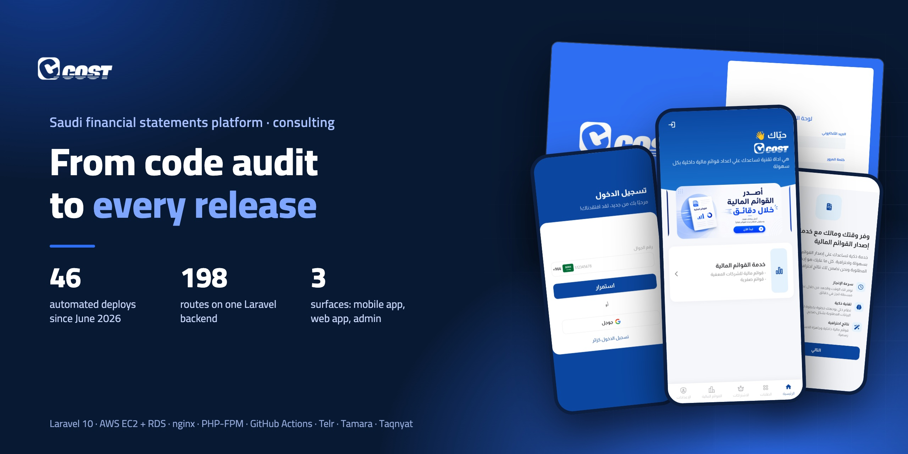
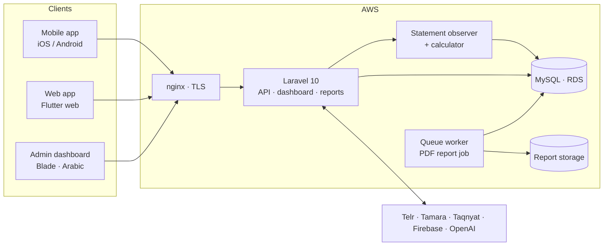
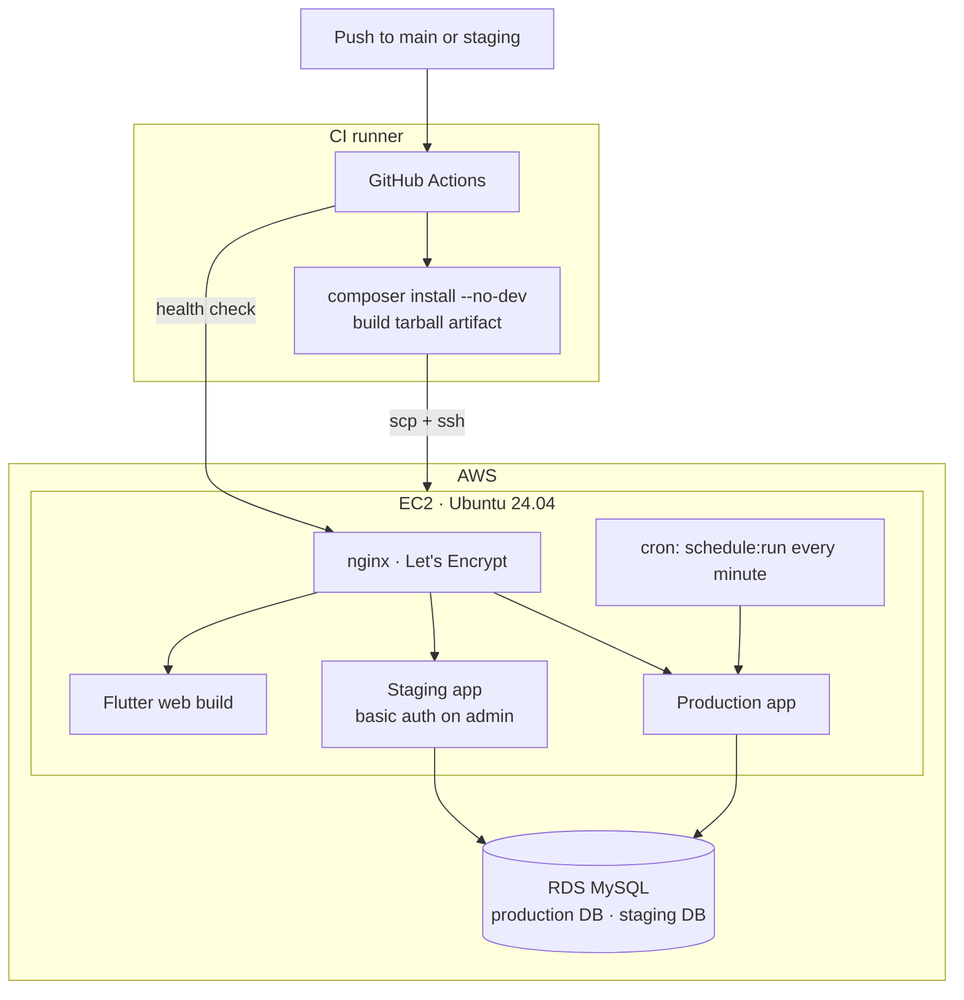
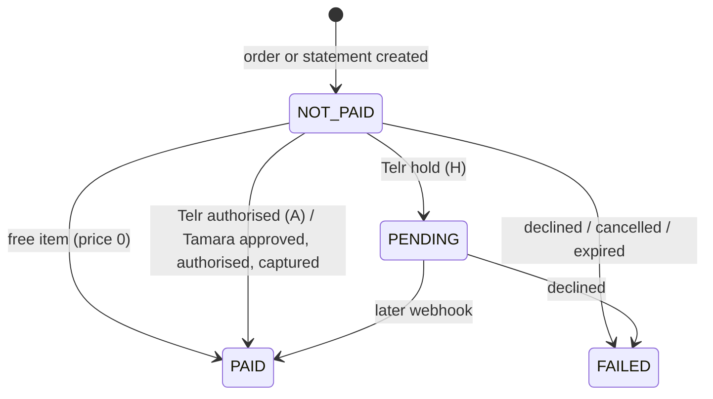
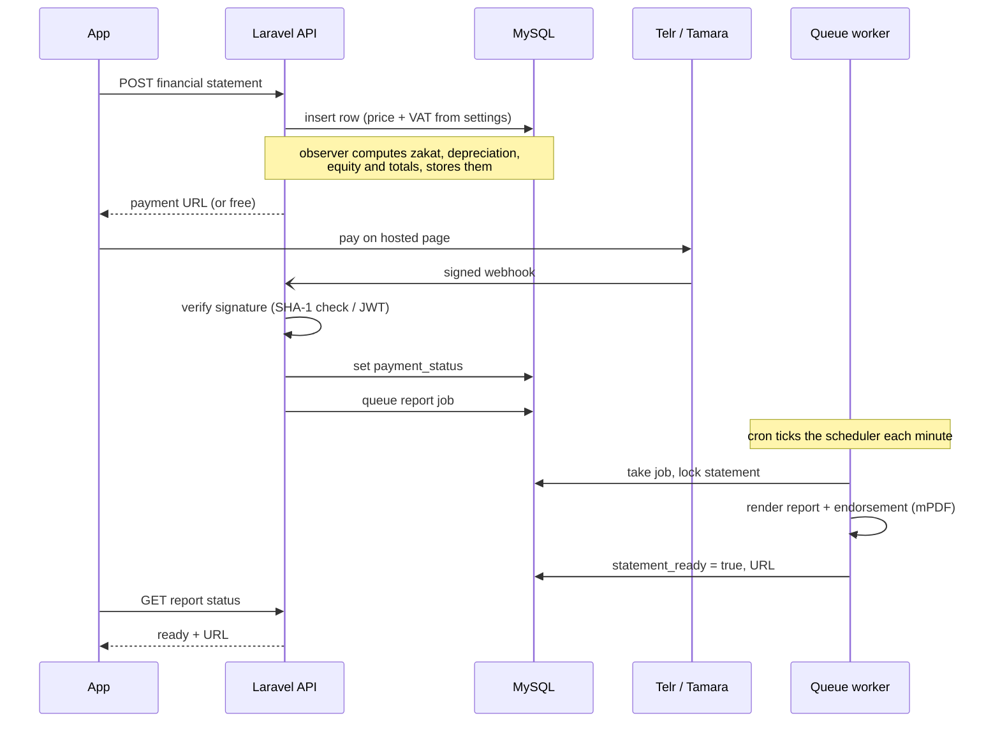

  <b>English</b> · <a href="README.ar.md">العربية</a>

  
  
  
  
  
  
  

# Ccost: financial statements and accounting services, Saudi Arabia

**Enter your figures, get your financial statements.** A business owner fills in capital, sales, purchases, assets and obligations. The platform computes the statements, the zakat and the depreciation, and returns ready-to-use PDF reports with an endorsement page. Around that core sit cost-pricing requests, contract drafting and review, bookkeeping orders and e-invoicing subscriptions, paid by card (Telr) or in instalments (Tamara).

[ccost-app.com](https://ccost-app.com) · iOS + Android + Web + admin dashboard · Arabic-first · **My role: technical consultant: audit, infrastructure, CI/CD and release management**

> **The code belongs to the client and is private.** I did not write the application; I audited it, put it into production and run its releases. Happy to walk through the hosting, the pipeline or the staging design:
> **[HazemSalama108@gmail.com](mailto:HazemSalama108@gmail.com)** · [LinkedIn](https://linkedin.com/in/hazem-salama-290310310) · [hazemsalama.dev](https://hazemsalama.dev)

  
  
  
  
  

Real screens from production, public pages only (guest mode): welcome → phone sign-in → home → financial statements service → admin dashboard sign-in

---

## At a glance

| | |
|---|---|
| **Products** | Mobile app (iOS, Android) · web app at ccost-app.com · Arabic admin dashboard · one Laravel backend behind all of them |
| **Services** | Financial statements (simplified and advanced, single year or comparative) · cost pricing · contracts · bookkeeping orders · e-invoicing packages · AI assistant |
| **The system** | ~15.9k lines of PHP · 198 routes (54 API, 144 dashboard and report) · 24 data models over 35 tables · 55 migrations · 22 admin modules |
| **Integrations** | Telr (card) · Tamara (instalments) · Taqnyat (SMS OTP) · Firebase (push) · OpenAI (assistant) · mPDF (Arabic PDF reports) |
| **My engagement** | Full code audit · AWS production hosting · GitHub Actions pipeline · staging environment · queue and scheduler · SMS provider verification · ongoing releases |
| **Releases** | 46 automated deploy runs since June 2026, 45 green |
| **Cloud** | AWS: EC2 (Ubuntu 24.04, nginx, PHP-FPM 8.2) and MySQL on RDS · Let's Encrypt TLS on every hostname |

The figures for lines, routes, models and modules describe the client's system. They are counted from the code, not my output.

---

## Architecture

### System

**One Laravel backend serves every surface.** The mobile app and the web app call the same `/api`. The admin dashboard is server-rendered Blade in the same codebase. Saving a statement triggers an observer that runs the calculator and stores every derived line. The PDF is then rendered by a queued job, off the request path.

### Network and deployment

- **The branch picks the target.** `main` deploys production; `staging` deploys a separate copy with its own database.
- **The server never builds.** Dependencies are installed on the runner and shipped as one artifact. The server only unpacks, links storage, clears caches and reloads PHP-FPM.
- **A deploy only passes if the site answers.** The last step requests the admin login page and fails the run on anything but a healthy status.

### Payment status of a paid order

The same four states (`not_paid`, `pending`, `paid`, `failed`) apply to pricing orders, contract orders and financial statements. Each gateway status is mapped onto them in one place per gateway.

### From submitted figures to a PDF

---

## Architecture decisions

### The system's architecture (reviewed and documented in the audit)

| # | Decision | Instead of | Why | Trade-off accepted |
|---|---|---|---|---|
| 1 | **One Laravel backend for the apps, the web app and the admin** | A separate API service and admin app | One codebase, one database, one deploy for a small team | API and dashboard release together |
| 2 | **All statement maths in one calculator, one method per Arabic statement line** | Formulas spread across controllers and views | The rules come from the accountant's spreadsheet; one method per line keeps them traceable to it | One large class tied to the spreadsheet's layout |
| 3 | **Derived lines computed once, on save, by a model observer** | Computing on every read | Reports, the app and the dashboard read the same stored figures | Every edit must re-run the computation |
| 4 | **PDF rendering as a queued job with a per-statement lock** | Rendering inside the request | Multi-page PDF rendering would hold the request open; the lock stops two jobs writing the same file | The app polls a status endpoint until the report is ready |
| 5 | **Four report templates: simplified or advanced, single year or comparative** | One template with conditionals | Each statement type has a different page set | Four templates to keep in step |
| 6 | **Comparative years as a link to the previous statement row** | Copying last year's figures into the new row | Opening balances, accumulated zakat and depreciation carry forward from the real prior row | Statements form a chain that edits must respect |
| 7 | **Two gateways behind one `createTransaction` shape; the order reference carries the model name and id** | One webhook handler per order type | One webhook serves statements, pricing and contract orders | References must keep that format |
| 8 | **Webhooks verified before any status change** (Telr SHA-1 check, Tamara JWT) | Trusting the callback body | Anyone can call a public webhook URL | A secret per gateway to manage |
| 9 | **Prices and VAT rate set by admins in settings** | Prices in code | Pricing changes without a release | Settings must be filled before a service can sell |
| 10 | **Phone number + SMS OTP sign-in through Taqnyat** | Email and password | One identity across app and web, tied to a Saudi mobile number | Depends on the SMS provider's uptime and balance |
| 11 | **AI assistant on OpenAI's Responses and Conversations APIs with a vector store** | A custom retrieval stack | The provider holds the knowledge files and the conversation state | An external dependency, with an output-token cap per reply |

### Infrastructure and release decisions (mine)

| # | Decision | Instead of | Why | Trade-off accepted |
|---|---|---|---|---|
| 12 | **Build on the CI runner, ship one tarball** | `git pull` and `composer install` on the server | The server needs no build tools or repo credentials, and every deploy is the same artifact | A larger upload per deploy |
| 13 | **Back up the running code before every production deploy** | Relying on git to roll back | A rollback is one unpack, even if the release changed files outside git | Backup archives to prune |
| 14 | **Run migrations only when the push changed `database/migrations`** | Always migrating, or migrating by hand | A schema change never ships without its migration, and ordinary pushes don't touch the schema | A diff step in the pipeline; manual runs still possible |
| 15 | **Clear caches on deploy instead of caching config** | `config:cache` | The payment and SMS integrations read their credentials from the environment at runtime | Slightly slower config loading |
| 16 | **Graceful PHP-FPM reload and a health check that fails the run** | A hard restart and hoping | Other apps share the FPM pool; a failed release must turn the run red | A few seconds of wait per deploy |
| 17 | **Staging as a second app on the same server, its own database, payments in test mode and SMS off by a flag** | A second server, or testing on production | Near-zero extra cost, and a test copy can never charge a card or text a customer | Staging shares the server's CPU and memory |

---

## Deep dives

<b>The audit</b>

- A full read of the codebase: routes, controllers, models, migrations, payment and SMS integrations, the statement calculator and the report pipeline.
- A written report for the client with prioritised findings.
- The audit also produced the operating notes that did not exist yet: which environment keys each integration needs, which provider requires the server's IP on an allowlist, and why config must not be cached.

<b>The deploy pipeline</b>

- One GitHub Actions workflow, triggered by a push to `main` or `staging`, or by hand with an option to force migrations.
- Steps: checkout with history → detect migration changes → PHP 8.2 with cached Composer → `composer install --no-dev` → tarball that excludes git, tests, keys and environment files → upload → backup (production) → unpack while keeping `.env`, storage and runtime settings → permissions → storage link → cache clears → FPM reload → migrations if needed → health check → key cleanup.
- A concurrency group per branch, so two pushes to the same branch never deploy over each other.
- Each fix to the pipeline came from a real failure: generated reports returning 404 after a deploy (storage link), payments failing after a cached config (cache clears), and a migration that deployed without being applied (change detection).

<b>Staging</b>

- A second copy of the backend on the same server, deployed from the `staging` branch, migrating on every deploy.
- Its own database and its own app key. Telr and Tamara run in test mode with staging callback URLs.
- `SMS_DISABLED` sends the OTP to the log instead of Taqnyat, so a test copy never messages a real customer. Production does not set it.
- The admin sits behind a password; the API stays open so the app's test builds can reach it. The pipeline's health check accepts the password prompt as "up".
- The environment is built and wired into the pipeline, and is being brought online.

<b>Queue, scheduler and observability</b>

- The queue uses the database driver, so it needs no extra service on the server.
- The app's scheduler drains the queue every minute; an OS cron entry ticks the scheduler. The cron line lives in the repo with an idempotent install script, so a rebuilt server gets it back in one command.
- Laravel Telescope records requests, jobs and exceptions in production, pruned to 48 hours.

<b>Integrations in production</b>

- **Taqnyat:** verified live against the account's balance endpoint after allowlisting the server's outbound IP.
- **Telr and Tamara:** live and test credentials documented as separate key pairs; Telr's live store requires the server IP on its allowlist.
- **Web app:** the Flutter web build is served at the root domain by nginx with an SPA fallback, `www` redirects to the root, and API CORS preflight was fixed so the browser can call the backend. A written guide lets the app team ship new web builds.

---

## What I owned

- **Technical audit:** a full read of the codebase and a written report with prioritised findings for the client.
- **Production hosting on AWS:** EC2 with nginx and PHP-FPM, MySQL on RDS, TLS on every hostname, the Flutter web app at the root domain.
- **CI/CD:** the GitHub Actions pipeline with build artifact, pre-deploy backup, migration detection, health check and per-branch targets.
- **Staging environment:** separate database, test-mode payments, SMS off by a flag, password on the admin.
- **Queue and scheduler:** the database queue and the cron that drives it, captured in the repo.
- **SMS provider verification** and the operating notes for every integration.
- **Ongoing deployment and operations,** including Telescope for production visibility.

---

<b>Want the deeper version: the pipeline, the staging design, or how the audit was run?</b> 
<a href="mailto:HazemSalama108@gmail.com">HazemSalama108@gmail.com</a> · <a href="https://linkedin.com/in/hazem-salama-290310310">LinkedIn</a> · <a href="https://hazemsalama.dev">hazemsalama.dev</a>

