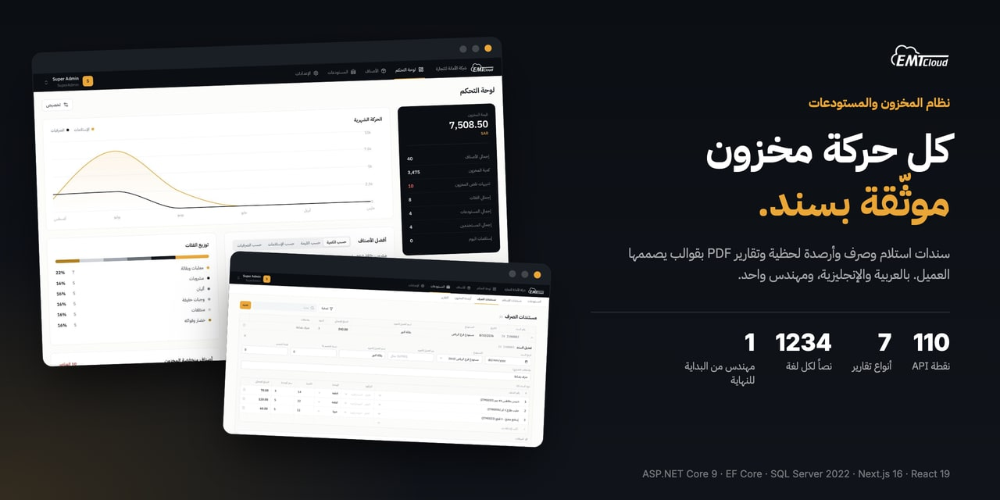
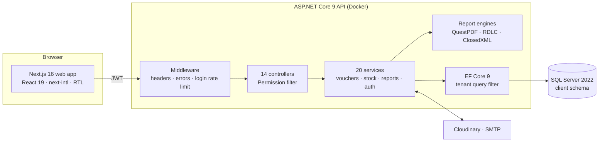
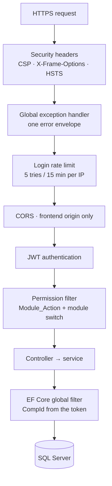
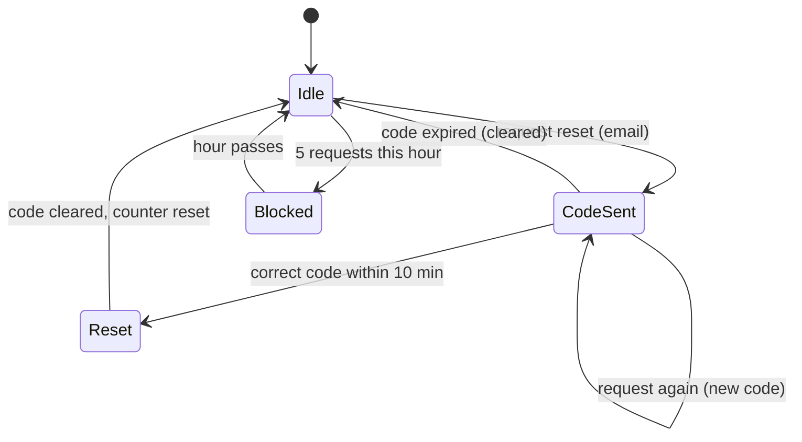
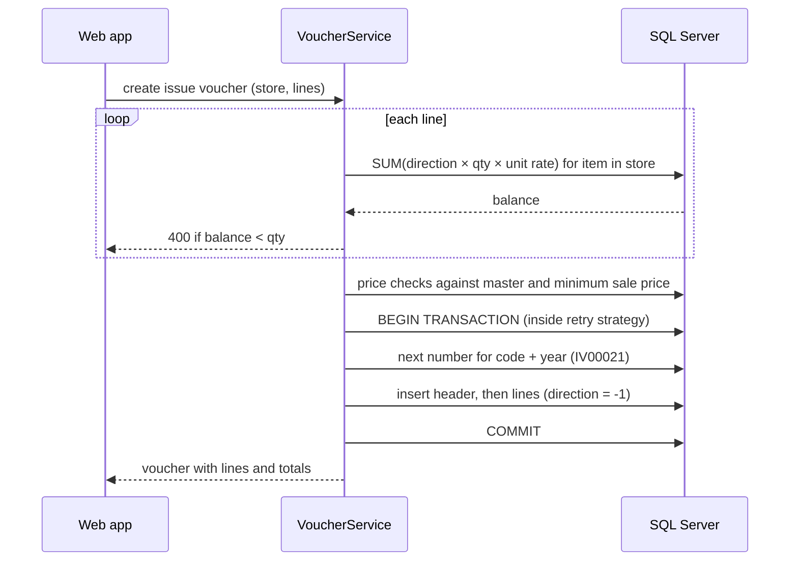

  <a href="README.md">English</a> · <b>العربية</b>

  
  
  
  
  
  
  

# EMT Cloud: نظام المخزون والمستودعات، العربية أولاً

**من سند الاستلام إلى التقرير المطبوع.** نظام ويب ثنائي اللغة لشركة تجارية يدير الأصناف والمستودعات وسندات الاستلام والصرف والمستخدمين وصلاحياتهم، ويطبع تقارير PDF بقوالب يصممها العميل بنفسه.

الويب · العربية والإنجليزية باتجاه كامل من اليمين إلى اليسار · **دوري: المهندس الوحيد للواجهة البرمجية وطبقة البيانات ومحرك التقارير وتطبيق الويب والنشر**

> **الشيفرة ملك للعميل وليست منشورة.** يسعدني شرح المعمارية أو نموذج البيانات أو أي قرار مما يلي:
> **[HazemSalama108@gmail.com](mailto:HazemSalama108@gmail.com)** · [LinkedIn](https://linkedin.com/in/hazem-salama-290310310) · [hazemsalama.dev](https://hazemsalama.dev)

  
  
  
  
  

شاشات حقيقية من إعادة التصميم في أغسطس 2026، تعمل محلياً على بيانات تجريبية: لوحة التحكم ← سند الصرف ← أرصدة المخزون ← الأدوار والصلاحيات ← مصمم التقارير

---

## نظرة سريعة

| | |
|---|---|
| **المنتج** | إدارة المخزون والمستودعات لشركة تجارية، بواجهة برمجية واحدة وتطبيق ويب واحد |
| **الوحدات** | الأصناف والأصناف الفرعية والتصنيفات والوحدات والمستودعات وسندات الاستلام والصرف والأرصدة والحركات والمستخدمون والأدوار وإعدادات الشركة ولوحة التحكم والتقارير ومصمم التقارير |
| **الخادم** | ASP.NET Core 9 · 110 نقطة API في 14 متحكماً · 20 فئة خدمة · نحو 23 ألف سطر C# مكتوبة يدوياً |
| **البيانات** | مبني على قاعدة SQL Server القائمة لدى العميل (167 جدولاً استُخرجت بـ EF Core)، مع 6 جداول و4 ترحيلات من تصميمي |
| **التقارير** | 7 أنواع تقارير بصيغتي PDF و Excel، أربعة منها تُطبع بقوالب يصممها العميل |
| **الويب** | Next.js 16 و React 19 · 20 مساراً · نحو 22 ألف سطر TypeScript · 1234 نصاً مترجماً في كل من العربية والإنجليزية |
| **الأمان** | JWT مع رموز تجديد · صلاحيات الأدوار على 84 نقطة · عزل بيانات كل شركة · حدّ لمحاولات الدخول · استعادة كلمة المرور برمز لمرة واحدة |
| **التسليم** | خطة بناء من 30 يوماً · تسليم النسخة الأولى في يناير 2026 · إعادة تصميم كاملة للواجهة في أغسطس 2026 · الخادم صورة Docker بإعداد Render، والويب على Vercel |

---

## المعمارية

### النظام

**معمارية نظيفة في أربعة مشاريع:** الواجهة البرمجية والتطبيق والنواة والبنية التحتية. المتحكمات خفيفة، وقواعد العمل في خدمات خلف واجهات، و EF Core هو الطريق الوحيد إلى قاعدة البيانات. كل استعلام يمر عبر مرشّح الشركة، فلا تستطيع خدمة أن تقرأ بيانات شركة أخرى خطأً.

### مسار الطلب

- **كل طبقة ترفض مبكراً.** الطلب بلا رمز صالح لا يصل إلى أي متحكم، والمستخدم بلا صلاحية لا يصل إلى أي خدمة.
- **الشركة تُؤخذ من الرمز لا من الطلب.** يقرأ المرشّح العام قيمة `CompId` من الرمز، ويُختم بها كل صف جديد عند الحفظ.
- **الاتصال بقاعدة البيانات يعيد المحاولة عند الأعطال العابرة** حتى 5 مرات، وكل كتابة لسند تجري داخل هذه الاستراتيجية في معاملة واحدة.

### استعادة كلمة المرور برمز لمرة واحدة

الرمز من ستة أرقام، و**يُشفَّر بـ BCrypt قبل تخزينه**، فلا تكشفه قراءة قاعدة البيانات. ينتهي بعد 10 دقائق، ويُستخدم مرة واحدة، ولا يطلب المستخدم أكثر من 5 رموز في الساعة.

### صرف المخزون دون أن يصبح الرصيد سالباً

لا يوجد رصيد مخزّن يحتاج إلى تحديث. بنود سند الصرف **هي** حركة المخزون نفسها، فلا يمكن أن ينفصل الرصيد عن المستندات.

---

## القرارات المعمارية

| # | القرار | بدلاً من | السبب | الثمن المقبول |
|---|---|---|---|---|
| 1 | **البناء على قاعدة SQL Server القائمة لدى العميل** | تصميم مخطط جديد | سلّم العميل قاعدته ومخططها، وكان على الواجهة أن تعمل عليها كما هي | أسماء قديمة وأحجام أعمدة تتسرب إلى الشيفرة، وطبقة DTO تبعدها عن عقد الواجهة |
| 2 | **المخزون دفتر حركات: الرصيد = مجموع (الاتجاه × الكمية × معامل الوحدة) على بنود السندات** | عمود رصيد مخزّن لكل صنف ومستودع | مصدر واحد للحقيقة، ولا شيء يحتاج إلى مطابقة بعد تعديل أو حذف | يُحسب الرصيد عند كل قراءة |
| 3 | **الاستلام والصرف في جداول السندات نفسها، ويميزهما الرمز (RV / IV) واتجاه ±1** | جدول لكل نوع سند | يطابق مخطط العميل، واستعلام واحد يحسب أي رصيد | كل استعلام يجب أن يرشّح بالرمز |
| 4 | **عزل الشركات بمرشّح عام في EF Core يُبنى بالانعكاس على كل كيان يحمل `CompId`** | شرط `WHERE CompId` في كل استعلام | شرط منسيّ واحد يكشف بيانات شركة أخرى | SQL الخام يتجاوز المرشّح، لذلك لا يوجد في الخدمات |
| 5 | **ختم رقم الشركة تلقائياً عند الحفظ** | ضبطه في كل خدمة | لا يُكتب صف جديد باسم شركة خاطئة | سلوك خفي يجب أن يعرفه كل مطوّر جديد |
| 6 | **الصلاحيات نصوص بصيغة `Module_Action` داخل الدور، مع `*` و `Module_*`** | سياسات ASP.NET مترجمة | يعدّل المسؤول الأدوار أثناء التشغيل من شاشة المصفوفة دون نشر | استعلام صلاحيات لكل طلب محمي |
| 7 | **تفعيل الوحدات لكل شركة، ويُفحص داخل مرشّح الصلاحيات نفسه** | إخفاء عناصر القائمة في الواجهة فقط | الوحدة المعطلة مغلقة في الخادم أيضاً، والمسؤول الأعلى يتجاوزها | استعلام إضافي في كل فحص |
| 8 | **فحص الرصيد لكل بند قبل كتابة سند الصرف** | السماح بالرصيد السالب ثم التصحيح | لا يصرف المستودع ما لا يملكه | الفحص يقرأ الأرصدة المعتمدة، والصرف المتزامن الكثيف يحتاج إلى أقفال صفوف |
| 9 | **حارس أسعار على كل بند:** حدود مطلقة، وحد أدنى لسعر البيع في الصرف، وسقف 500% فوق السعر الأساسي | الثقة بالأسعار القادمة من الواجهة | يمنع الأخطاء والتلاعب من الوصول إلى تقارير التقييم | الزيادة الكبيرة الحقيقية تتطلب تحديث السعر الأساسي أولاً |
| 10 | **السند كاملاً في معاملة واحدة داخل استراتيجية إعادة المحاولة** | حفظ الرأس والبنود منفصلين | انقطاع الاتصال لا يترك رأساً بلا بنود | إعادة المحاولة تكرر الوحدة كاملة |
| 11 | **قوالب التقارير بصيغة JSON، تُرسم في الخادم بـ QuestPDF** | تصميم ثابت لكل تقرير | يغيّر العميل الشعار والأعمدة والتخطيط دون إصدار جديد | محرك رسم من نحو 2200 سطر يحتاج إلى صيانة |
| 12 | **ربط القوالب بأنواع التقارير، مع قالب افتراضي لكل نوع، و4 قوالب أولية** | اختيار القالب عند كل طباعة | يضغط المستخدم PDF فيحصل على تصميم شركته | قواعد ربط يجب أن تبقى متسقة |
| 13 | **ثلاثة محركات: RDLC لثلاثة تقارير ثابتة، و QuestPDF للقوالب، و ClosedXML لملفات Excel** | محرك واحد لكل شيء | كل مخرَج بالأداة المناسبة له | مكتبتان لملفات PDF في شيفرة واحدة |
| 14 | **تقارير عربية من اليمين إلى اليسار مع سلسلة خطوط احتياطية (Noto Sans Arabic و KACST و DejaVu) مثبتة في صورة Docker** | تضمين خط واحد | تتشكل الحروف العربية صحيحة على أي خادم | صورة تشغيل أكبر |
| 15 | **رموز الاستعادة مشفّرة بـ BCrypt، صالحة 10 دقائق، لمرة واحدة، و5 في الساعة** | روابط استعادة بالبريد | يُكتب الرمز في مسار الدخول نفسه، والجدول المسرّب لا يحوي رموزاً صالحة | يعتمد على وصول البريد |
| 16 | **حدّ لمحاولات الدخول: 5 محاولات كل 15 دقيقة لكل عنوان IP، ثم إيقاف 30 دقيقة** | عدم التقييد | يبطئ تخمين كلمات المرور على صفحة الدخول | العدادات في الذاكرة ولكل نسخة على حدة |
| 17 | **تحرير السجلات في مكانها كجدول بيانات، بلا نوافذ منبثقة** | نموذج منبثق لكل سجل | الموظفون يُدخلون البيانات في جداول طوال اليوم، فتقل النقرات لكل سجل | الحقول المركّبة تحتاج إلى صف تحرير موسّع |

---

## تفاصيل أعمق

<b>السندات والمخزون</b>

- **سندات الاستلام** تزيد المخزون و**سندات الصرف** تنقصه. لكل سند بنود متعددة ومستودع ومورد أو عميل وخصم على البند وعلى السند وملاحظات ومرفقات.
- **الترقيم** لكل شركة ولكل رمز سند ولكل سنة (`RV00014` و `IV00021`)، ويُولَّد داخل معاملة الكتابة.
- **الوحدات:** يحفظ كل بند وحدته ومعاملها، فتحرّك الكرتونة ذات 24 علبة والعلبة الواحدة الرصيد نفسه بدقة.
- **أرقام التشغيلات وتواريخ الانتهاء** تُسجَّل على كل بند وتظهر في سجل الحركات.
- **سجل الحركات** يعرض كل بند مع رصيده التراكمي محسوباً بترتيب التاريخ.
- **المخزون المنخفض** يُنبَّه إليه حين يبلغ الرصيد حد إعادة الطلب.
- **المرفقات** (حتى 10 ميجابايت للملف) تُرفع إلى Cloudinary وتُربط بالسند.

<b>مصمم التقارير</b>

- القالب ملف JSON: حجم الصفحة وهوامشها، والأقسام (الترويسة والمتن والتذييل)، والعناصر: نص وجدول بيانات وشكل وخط وصورة ورقم صفحة.
- النصوص تقبل متغيرات تُملأ من بيانات التقرير ومن متغيرات النظام مثل اسم الشركة وشعارها.
- يرسم الخادم القالب نفسه إلى PDF بـ QuestPDF، من اليمين إلى اليسار حين يكون عربياً.
- المعاينة تعمل على بيانات تجريبية، فيرى المصمم التخطيط قبل وجود أي تقرير حقيقي.
- المصمم في الواجهة لوحة رسم مع صندوق أدوات ولوحة خصائص ومحرر أعمدة للجداول (نحو 3500 سطر React).
- تُربط القوالب بأنواع التقارير (السندات وقائمة الأصناف والأرصدة الافتتاحية وأرصدة الأصناف)، ولكل نوع قالب افتراضي واحد.

<b>الأمان</b>

- **كلمات المرور ورموز الاستعادة** مشفّرة بـ BCrypt.
- **رموز الوصول** تنتهي بعد 60 دقيقة وتُجدَّد برمز تجديد.
- **كل نقطة محمية** تعلن صلاحيتها (`[Permission("Vouchers", "Create")]`)، بمجموع 84 إعلاناً في المتحكمات.
- **ترويسات أمان** على كل استجابة: CSP و `X-Frame-Options: DENY` و `nosniff` و HSTS عبر HTTPS.
- **غلاف أخطاء موحّد** من معالج الاستثناءات العام، فلا يصل تتبع المكدس إلى العميل.
- **CORS** يقبل أصل الواجهة فقط.

<b>العربية والإنجليزية من الطرف إلى الطرف</b>

- لكل سجل أساسي (الأصناف والتصنيفات والوحدات والمستودعات) اسم عربي واسم إنجليزي.
- يقرأ تطبيق الويب اللغة من ملف تعريف الارتباط ويقلب التخطيط كله، والأنماط تستخدم الخصائص المنطقية (البداية والنهاية) لا اليسار واليمين.
- 1234 مفتاح ترجمة لكل لغة.
- الخطوط: IBM Plex Sans Arabic للعربية و Inter للإنجليزية.
- تقارير PDF من اليمين إلى اليسار بخطوط تدعم العربية.

<b>الواجهة</b>

- Next.js 16 بموجّه التطبيقات مع React 19 و Tailwind CSS 4.
- وسيط يفحص رمز الوصول في ملف تعريف الارتباط ويعيد التوجيه قبل عرض أي صفحة محمية.
- استبدلت إعادة التصميم في أغسطس 2026 القائمة الجانبية بتنقل علوي من مستويين (شريط الوحدات وتبويبات فرعية)، فتحتفظ الجداول العريضة بعرضها.
- صفحات البيانات تعمل كجدول بيانات: الخلايا تُحرَّر في مكانها، و Enter يحفظ و Esc يلغي، والسجل الجديد يُكتب في صف إضافة، والحذف يفتح شريط تأكيد داخل الصف.
- بنود السند جدول صغير داخل صف السند، مع البحث بالباركود والتعبئة التلقائية للوحدة والسعر واختيار التشغيلة.

---

## ما توليته

- **المعمارية:** تقسيم المشاريع الأربعة ونموذج الشركات ومخطط الصلاحيات.
- **طبقة البيانات:** استخراج مخطط العميل وربطه بواجهة نظيفة، والجداول الجديدة للأصناف الفرعية ووحدات الشركة وقوالب التقارير وتفضيلات المستخدم.
- **الخادم:** المصادقة والمستخدمون والأدوار والأصناف والمستودعات والسندات والأرصدة والحركات ولوحة التحكم والتقارير.
- **التقارير:** تقارير RDLC و QuestPDF وتصدير Excel ومحرك القوالب خلف مصمم التقارير.
- **الواجهة:** كل صفحات تطبيق Next.js بما فيها مصمم التقارير، بالعربية والإنجليزية.
- **التسليم:** صورة Docker بخطوط عربية، والنشر على Render و Vercel، وتوثيق Swagger ومجموعة Postman للعميل.

---

<b>تريد النسخة الأعمق: استعلامات دفتر الحركات أو صيغة القوالب أو طريقة ربط المخطط القديم؟</b> 
<a href="mailto:HazemSalama108@gmail.com">HazemSalama108@gmail.com</a> · <a href="https://linkedin.com/in/hazem-salama-290310310">LinkedIn</a> · <a href="https://hazemsalama.dev">hazemsalama.dev</a>

