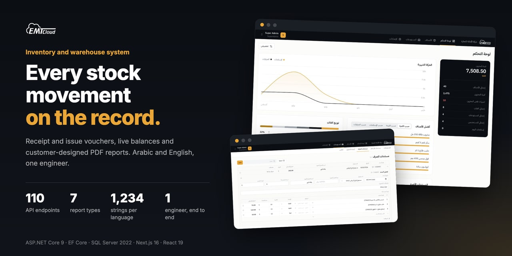
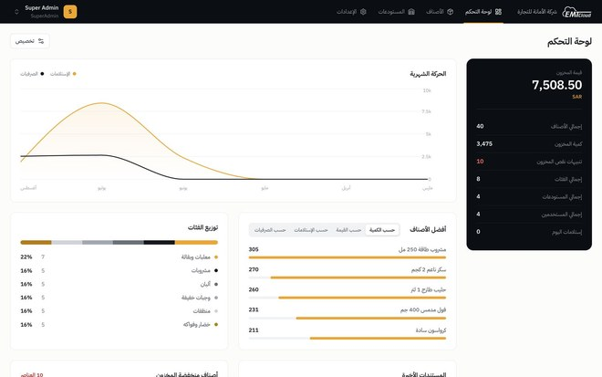
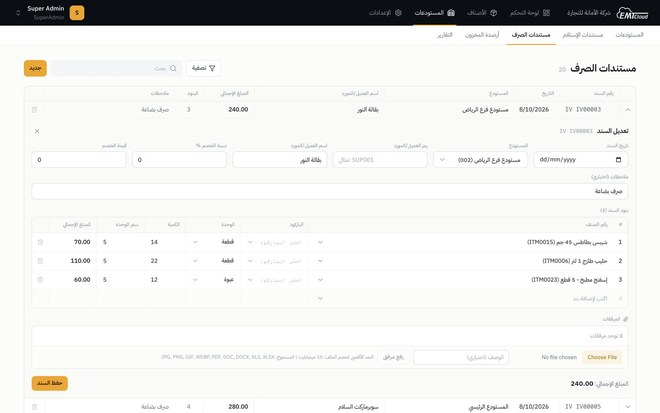
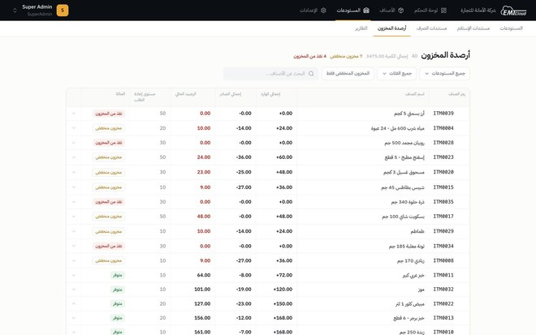
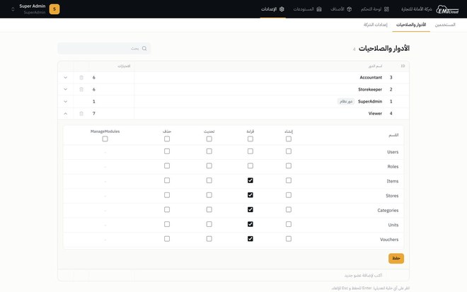
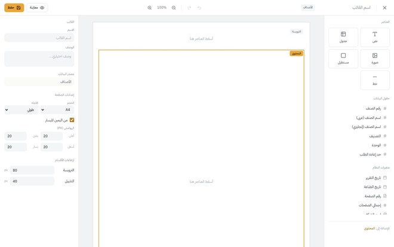
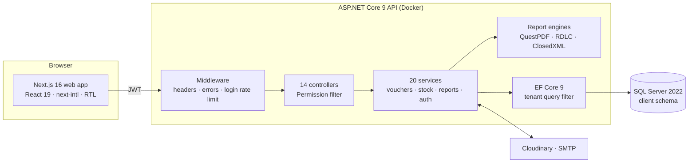
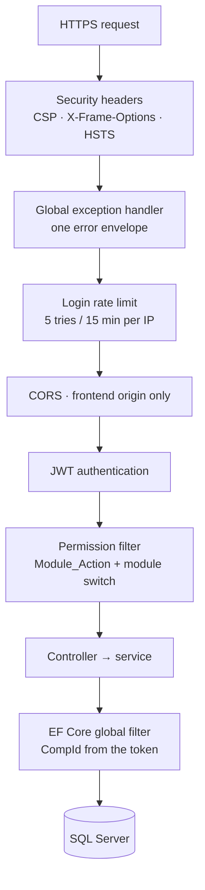
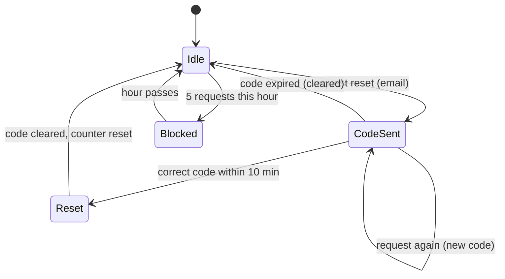
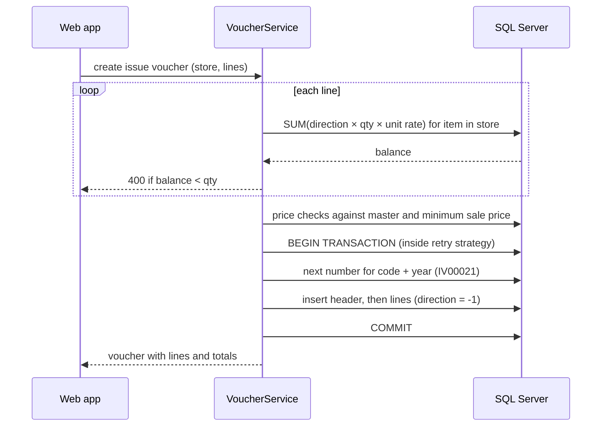

  <b>English</b> · <a href="README.ar.md">العربية</a>

  
  
  
  
  
  
  

# EMT Cloud — inventory and warehouse system, Arabic-first

**From the receipt voucher to the printed report.** A bilingual web system for a trading company: items, warehouses, stock-in and stock-out vouchers, users and their permissions, and PDF reports printed from templates the customer designs.

Web · Arabic and English with full RTL · **My role: sole engineer — backend API, data layer, reporting engine, web frontend and deployment**

> **The code belongs to the client and is private.** I'm happy to walk through the architecture, the data model or any decision below:
> **[HazemSalama108@gmail.com](mailto:HazemSalama108@gmail.com)** · [LinkedIn](https://linkedin.com/in/hazem-salama-290310310) · [hazemsalama.dev](https://hazemsalama.dev)

  
  
  
  
  

Real screens from the August 2026 redesign, running locally with seeded demo data: dashboard → issue voucher → stock balances → roles and privileges → report designer

---

## At a glance

| | |
|---|---|
| **Product** | Inventory and warehouse management for a trading company, as one API and one web app |
| **Modules** | Items and sub-items, categories, units, stores, receipt and issue vouchers, stock and movements, users, roles, company settings, dashboard, reports, report designer |
| **Backend** | ASP.NET Core 9 · 110 API endpoints across 14 controllers · 20 service classes · ~23k hand-written lines of C# |
| **Data** | Built on the client's existing SQL Server schema (167 tables, scaffolded with EF Core), plus 6 tables and 4 migrations of my own |
| **Reports** | 7 report types as PDF and Excel; 4 of them print from customer-designed templates |
| **Web** | Next.js 16 + React 19 · 20 routes · ~22k lines of TypeScript · 1,234 translated strings in each of Arabic and English |
| **Security** | JWT with refresh tokens · role privileges on 84 endpoints · per-company data isolation · rate-limited login · OTP password reset |
| **Delivery** | 30-day build plan · first version delivered January 2026 · full frontend redesign August 2026 · API packaged as a Docker image (Render config), web on Vercel |

---

## Architecture

### System

**Clean Architecture in four projects:** API, Application, Core and Infrastructure. Controllers stay thin. Business rules live in services behind interfaces, and EF Core is the only path to the database. Every query passes through a tenant filter, so a service can't read another company's rows by mistake.

### Request pipeline

- **Each layer refuses early.** A request without a valid token never reaches a controller. A user without the privilege never reaches a service.
- **The company comes from the token, not the request.** The global query filter reads `CompId` from the JWT claims, and new rows get it stamped on save.
- **The database connection retries transient failures** (up to 5 times), and every voucher write runs inside that retry strategy as one transaction.

### Password reset by one-time code

The six-digit code is **hashed with BCrypt before it is stored**, so a database read can't reveal it. It expires after 10 minutes, works once, and a user can request at most 5 codes an hour.

### Issuing stock without going negative

There is no stored balance to update. The issue voucher's lines **are** the stock change, so the balance can't drift away from the documents.

---

## Architecture decisions

| # | Decision | Instead of | Why | Trade-off accepted |
|---|---|---|---|---|
| 1 | **Database-first on the client's existing SQL Server schema** | Designing a new schema | The client supplied the database and its schema; the API had to run on it as is | Legacy names and column sizes leak in; DTOs keep them out of the API contract |
| 2 | **Stock as a ledger: balance = SUM(direction × quantity × unit rate) over voucher lines** | A stored balance column per item and store | One source of truth; nothing to reconcile after an edit or delete | Balances are aggregated on every read |
| 3 | **Receipts and issues share the existing voucher tables, told apart by code (RV / IV) and a ±1 direction** | Separate tables per voucher type | Matches the client's schema, and one query computes any balance | Every query has to filter by code |
| 4 | **Tenant isolation as an EF Core global filter, built by reflection over every entity with a `CompId`** | A `WHERE CompId = …` in each query | One forgotten filter would leak another company's data | Raw SQL bypasses the filter, so there is none in the services |
| 5 | **Company ID stamped automatically on save** | Setting it in each service | New rows can't be written to the wrong company | Hidden behaviour that new developers need to know about |
| 6 | **Privileges as `Module_Action` strings in the role, with `*` and `Module_*` wildcards** | Compiled ASP.NET policies | Admins edit roles at runtime from a matrix screen, with no deploy | One privilege lookup per protected request |
| 7 | **Module switches per company, checked inside the same permission filter** | Hiding menu items in the UI only | A disabled module is closed at the API too; super admins bypass it | An extra query on each check |
| 8 | **Stock validated per line before an issue voucher is written** | Allowing negative stock and correcting later | Warehouses can't issue what they don't hold | The check reads committed balances, so heavy concurrent issuing would need row locks |
| 9 | **Price guard on every voucher line:** absolute limits, minimum sale price on issues, at most 500% above the master price | Trusting prices from the client | Stops typos and manipulation from reaching valuation reports | A real large markup needs the master price updated first |
| 10 | **Whole voucher in one transaction inside EF Core's retry strategy** | Saving header and lines separately | A dropped connection can't leave a header without lines | Retries replay the whole unit |
| 11 | **Customer report templates as JSON, rendered server-side with QuestPDF** | One hard-coded layout per report | The customer changes logos, columns and layout without a release | A renderer of about 2,200 lines to maintain |
| 12 | **Templates assigned to report types, one default per type, 4 defaults seeded** | A template picker on every print | Users press "PDF" and get the company's chosen layout | Assignment rules to keep consistent |
| 13 | **Three report engines: RDLC for 3 fixed reports, QuestPDF for templated ones, ClosedXML for Excel** | One engine for everything | Each output gets the tool that fits it | Two PDF stacks in one codebase |
| 14 | **Arabic PDFs: right-to-left pages plus a font fallback chain (Noto Sans Arabic, KACST, DejaVu) installed in the Docker image** | Embedding one font | Arabic shapes correctly on any host | A larger runtime image |
| 15 | **OTP reset codes hashed with BCrypt, 10-minute expiry, single use, 5 per hour** | Emailed reset links | The code is typed into the same sign-in flow, and a leaked table holds no live codes | Depends on email delivery |
| 16 | **Login rate limit in middleware: 5 attempts per 15 minutes per IP, then a 30-minute lockout** | No throttling | Slows password guessing against the single public login | Counters live in memory, per instance |
| 17 | **Frontend edits records in place, spreadsheet style, with no modal dialogs** | A form dialog per record | Staff enter data in tables all day; fewer clicks per record | Complex fields need an expanded editor row |

---

## Deep dives

<b>Vouchers and stock</b>

- **Receipt vouchers** add stock and **issue vouchers** remove it. Both carry multiple lines, a store, a supplier or customer, line and header discounts, notes and attachments.
- **Numbering** is per company, per voucher code, per year (`RV00014`, `IV00021`), generated inside the write transaction.
- **Units:** each line stores its unit and a unit rate, so a carton of 24 and a single can move the same balance correctly.
- **Batch numbers and expiry dates** are recorded on each line and shown in the movement history.
- **Movement history** returns each line with its running balance, computed in date order.
- **Low stock** is flagged when a balance falls to the item's reorder level.
- **Attachments** (up to 10 MB each) go to Cloudinary, linked to the voucher.

<b>The report designer</b>

- A template is JSON: page size and margins, sections (header, body, footer) and elements: text, data table, shape, line, image and page number.
- Text supports placeholders filled from the report's data and system variables such as the company name and logo.
- The server renders the same JSON to PDF with QuestPDF, right-to-left when the template is Arabic.
- Preview runs on sample data, so a designer sees the layout before any real report exists.
- The frontend designer is a canvas with a toolbox, a property panel and a table-column editor (about 3,500 lines of React).
- Templates are assigned to report types (vouchers, items list, opening balances, item balances), and each type has one default.

<b>Security</b>

- **Passwords and reset codes** are hashed with BCrypt.
- **Access tokens** expire after 60 minutes and are renewed with a refresh token.
- **Every protected endpoint** declares its privilege (`[Permission("Vouchers", "Create")]`): 84 declarations across the controllers.
- **Security headers** on every response: CSP, `X-Frame-Options: DENY`, `nosniff` and HSTS over HTTPS.
- **One error envelope** from the global exception handler, so stack traces never reach the client.
- **CORS** accepts the frontend origin only.

<b>Arabic and English, end to end</b>

- Every master record (items, categories, units, stores) has an Arabic and an English name.
- The web app reads the locale from a cookie and flips the whole layout. Styles use logical properties (start and end), not left and right.
- 1,234 translation keys per language.
- Fonts: IBM Plex Sans Arabic for Arabic, Inter for English.
- PDFs are right-to-left with Arabic-capable fonts.

<b>Frontend</b>

- Next.js 16 App Router with React 19 and Tailwind CSS 4.
- Middleware checks the access-token cookie and redirects before a protected page renders.
- The August 2026 redesign replaced the sidebar with a two-tier top navigation (module bar and sub-tabs), so wide tables keep their width.
- Data pages work like a spreadsheet: cells edit in place, Enter saves, Esc cancels, new rows are typed into a composer row, and a delete arms an inline confirm strip.
- Voucher lines are a mini grid inside the voucher row, with barcode lookup, unit and price auto-fill, and batch selection.

---

## What I owned

- **Architecture:** the four-project layout, the tenant model and the permission scheme.
- **Data layer:** scaffolding the client's schema, mapping it to a clean API, and the new tables for sub-items, company modules, report templates and user preferences.
- **Backend:** authentication, users and roles, items, stores, vouchers, stock and movements, dashboard and reports.
- **Reporting:** the RDLC and QuestPDF reports, Excel exports, and the template renderer behind the report designer.
- **Frontend:** every page of the Next.js app, including the report designer, in Arabic and English.
- **Delivery:** Docker image with Arabic fonts, Render and Vercel deployment, Swagger documentation and a Postman collection for the client.

---

<b>Want the deeper version: the ledger queries, the template format, or how the legacy schema was mapped?</b> 
<a href="mailto:HazemSalama108@gmail.com">HazemSalama108@gmail.com</a> · <a href="https://linkedin.com/in/hazem-salama-290310310">LinkedIn</a> · <a href="https://hazemsalama.dev">hazemsalama.dev</a>

