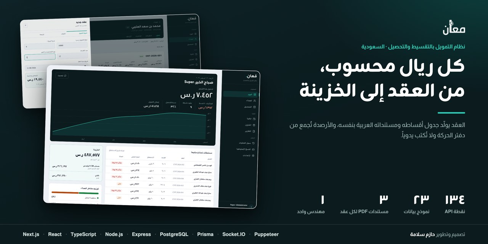
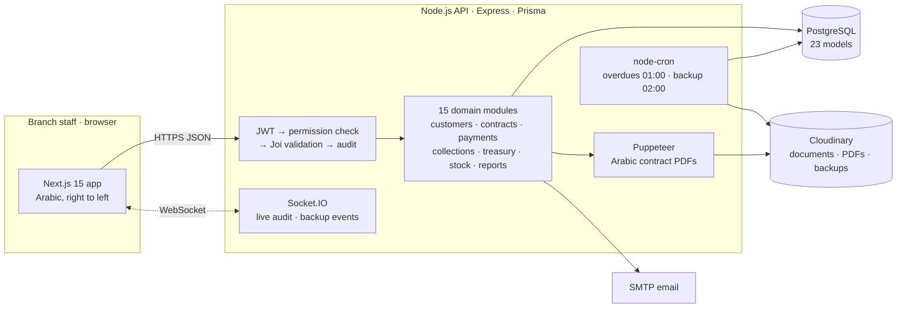
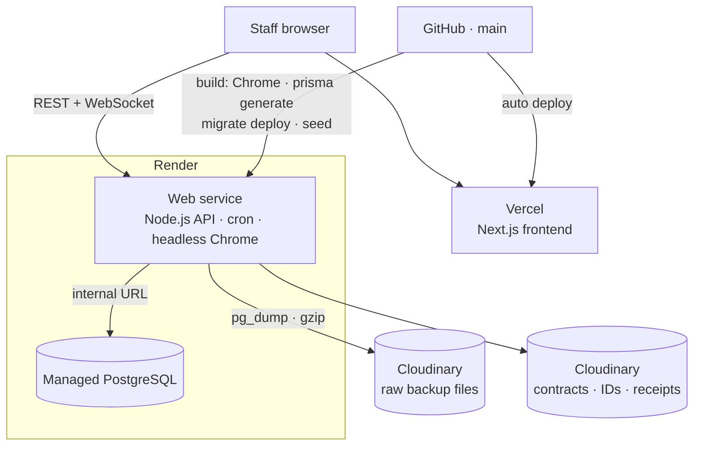
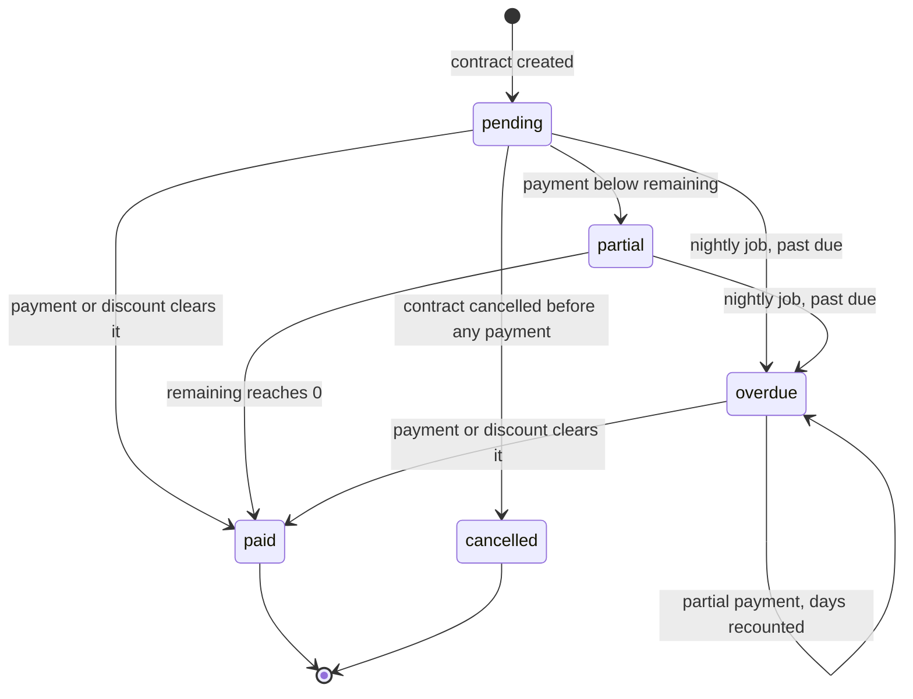
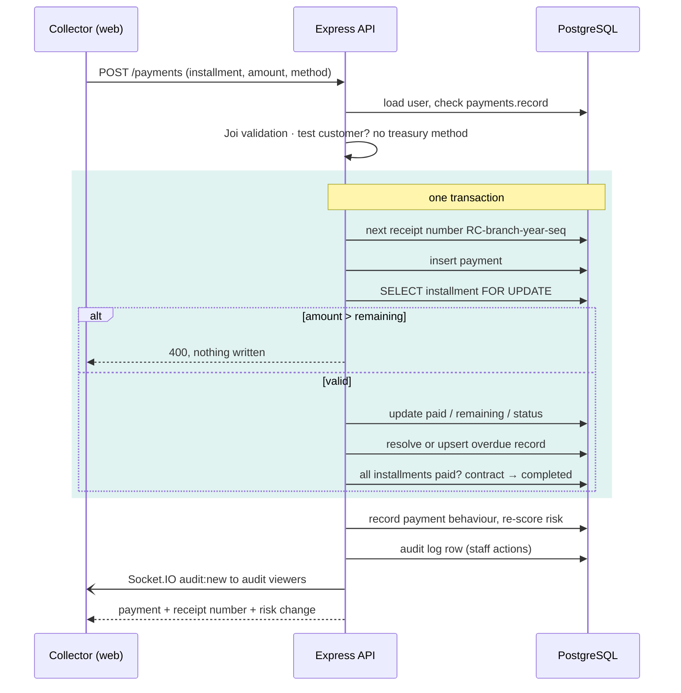

  <a href="README.md">English</a> · <b>العربية</b>

  
  
  
  
  
  

# مُعان: نظام التمويل بالتقسيط والتحصيل في السعودية

**مكتب تمويل كان يعمل بالجداول وذاكرة موظفيه.** مُعان نظام إدارة لشركة تبيع بالتقسيط الشهري. العقد يولّد جدول أقساطه ومستنداته القانونية العربية بنفسه. كل دفعة ومصروف وحركة مخزون وتحويل تُقيَّد في دفتر حركة، ورصيد الخزينة المعروض يُجمع من هذا الدفتر ولا يُكتب يدوياً.

**التمويل قائم على البيع بالأجل لا على القرض. الثمن يُحدَّد عند توقيع العقد ولا يتغير، والنظام لا يحتسب أي فائدة ولا أي غرامة تأخير على الأقساط المتأخرة.**

تطبيق ويب · العربية أولاً من اليمين إلى اليسار · نُشر في بيئة الإنتاج وسُلّم للعميل في نوفمبر 2025 · **دوري: المهندس الوحيد لنموذج البيانات والخادم والواجهة والمستندات والنشر**

> **الشيفرة ملك للعميل وليست منشورة.** يسعدني شرح المعمارية أو قاعدة البيانات أو أي قرار مما يلي:
> **[HazemSalama108@gmail.com](mailto:HazemSalama108@gmail.com)** · [LinkedIn](https://linkedin.com/in/hazem-salama-290310310) · [hazemsalama.dev](https://hazemsalama.dev)

  
  
  

  
  

شاشات حقيقية من بيئة محلية ببيانات تجريبية لعملاء وهميين: لوحة اليوم ← عقد جديد ← سداد قسط ← قائمة المتأخرات ← المالية والخزينة

---

## نظرة سريعة

| | |
|---|---|
| **المستخدمون** | موظفو الفرع من محصّلين ومحاسبين ومديرين ومدير نظام، يرى كلٌّ منهم ما تسمح به صلاحياته فقط |
| **صيغة التمويل** | **بيع بالأجل: ثمن ثابت عند التوقيع، بلا فائدة ولا غرامات تأخير** |
| **يغطي** | العملاء وتقييم المخاطر · العقود وجداول الأقساط · الدفعات والخصومات والإيصالات · المتأخرات والتحصيل · الخزينة لكل صندوق نقدي وحساب بنكي · مخزون البطاقات · المصروفات · التقارير · سجل العمليات · النسخ الاحتياطية |
| **الخادم** | نحو 21 ألف سطر Node.js · 134 نقطة API · 15 وحدة مجال · 24 صنف خدمة · 23 نموذج بيانات · 7 ترحيلات |
| **الصلاحيات** | 45 صلاحية و4 قوالب أدوار، تُفحص من قاعدة البيانات عند كل طلب |
| **المستندات** | 3 مستندات PDF عربية لكل عقد: عقد البيع وعقد التحصيل وسند الأمر |
| **المهام الخلفية** | كشف المتأخرات كل ليلة الساعة 01:00 · نسخة احتياطية كاملة لقاعدة البيانات كل ليلة الساعة 02:00 |
| **الواجهة** | Next.js 15 · العربية أولاً من اليمين إلى اليسار · نحو 11 ألف سطر TypeScript |
| **السحابة** | الخادم وPostgreSQL على Render · الواجهة على Vercel · الملفات والنسخ الاحتياطية على Cloudinary |

---

## المعمارية

### النظام

**واجهة برمجية واحدة وقاعدة بيانات واحدة، عن قصد.** تسجيل دفعة يغيّر القسط وسجل المتأخرة وحالة العقد والخزينة. وإنشاء عقد يغيّر جدول الأقساط ومخزون البطاقات والمستندات. هذه التغييرات يجب أن تُعتمد معاً، لذلك تعيش في تطبيق Express واحد فوق قاعدة PostgreSQL واحدة، مقسّم إلى 15 وحدة بحسب المجال. وكل طلب يمر بالسلسلة نفسها: الهوية ثم الصلاحية ثم التحقق من المدخلات ثم منطق العمل ثم سجل العمليات.

### النشر

- **الخادم خدمة تعمل باستمرار لا دوال عند الطلب.** يحمل اتصالات WebSocket، ويشغّل المهام الليلية داخل العملية نفسها، ويفتح متصفح Chrome بلا واجهة لتوليد المستندات.
- **كل بناء يرحّل قاعدة البيانات.** يعمل `prisma migrate deploy` مع كل نشر، والتهيئة الأولية لا تكرر نفسها، فتقوم أي بيئة جديدة بفرعها ومديرها.
- **النسخ الاحتياطية تخرج من المزوّد.** النسخة الليلية تُرفع إلى Cloudinary، فيبقى لدى العميل نسخة خارج مزوّد قاعدة البيانات.

### دورة حياة القسط

القسط هو الوحدة التي يدور حولها النظام كله. لا أحد يعلّم قسطاً بالتأخر يدوياً: المهمة الليلية تنقل الأقساط التي تجاوزت استحقاقها إلى حالة التأخر وتفتح لها سجل متأخرة، والدفعة التي تسددها تغلق ذلك السجل في المعاملة نفسها.

### تسجيل دفعة

---

## القرارات المعمارية

| # | القرار | بدلاً من | السبب | الثمن المقبول |
|---|---|---|---|---|
| 1 | **رصيد الخزينة يُجمع من دفتر الحركة:** الدفعات المؤكدة ناقص المصروفات المعتمدة ناقص مشتريات المخزون زائد التسويات المسجّلة | حقل رصيد يحرّره الموظف | كل ريال في الشاشة يعود إلى قيد | استعلامات تجميع عند كل قراءة للخزينة |
| 2 | **الدفعة والقسط والمتأخرة وحالة العقد في معاملة واحدة، مع قفل صف القسط** (`SELECT … FOR UPDATE`) | تحديث كل جدول وحده | محصّلان يسددان القسط نفسه لا يمكن أن تُحتسب دفعتاهما معاً | استعلام SQL مباشر داخل شيفرة ORM |
| 3 | **رفض الدفعة التي تتجاوز المتبقي من القسط** | ترحيل الفائض إلى القسط التالي | دفعة واحدة لقسط واحد بإيصال واحد، فتطابق الإيصالات الجدول دائماً | الدفعة الكبيرة تُدخل على عدة دفعات |
| 4 | **الشروط المالية مقفلة بعد إنشاء العقد:** مخطط التعديل لا يقبل إلا الضامن والملاحظات والحالة | مبالغ ونسب قابلة للتعديل | جدول الأقساط وُلّد والمستندات وُقّعت على هذه الشروط | العقد الخاطئ يُلغى ويُنشأ من جديد |
| 5 | **خصم مخزون البطاقات داخل معاملة العقد** (عدد البطاقات = أصل التمويل ÷ سعر البطاقة، مقرّباً للأعلى) | مطابقة المخزون لاحقاً | العقود والمخزون لا يفترقان، ولا عقد بلا مخزون | إنشاء العقد يفشل حين ينخفض المخزون |
| 6 | **الإلغاء يقيّد حركة مخزون معاكسة،** ولا يُسمح به إلا قبل أي دفعة | حذف حركة الصرف | دفتر المخزون يحتفظ بتاريخه كاملاً | العقود التي عليها دفعات تحتاج مساراً آخر |
| 7 | **المخاطر مصفوفة نقاط:** شرائح الراتب ونسبة الالتزامات إلى الدخل تحدد واحداً من ثلاثة مستويات تمويل، يُفحص أصل التمويل مقابله عند إنشاء العقد | الموافقة حالةً بحالة | القاعدة نفسها لكل موظف، ويمكن شرحها للعميل | الحدود في ثوابت الشيفرة، فتغيير السياسة يحتاج نشراً |
| 8 | **سلوك السداد يحرّك التقييم:** يُسجَّل السداد المبكر والمنتظم والمتأخر ويُعاد تقييم العميل | تقييم ثابت منذ التسجيل | التقييم يعكس كيف يسدد العميل فعلاً | كتابات إضافية مع كل دفعة |
| 9 | **المستندات العربية يرسمها Chrome بلا واجهة من HTML باتجاه اليمين إلى اليسار** | الرسم بمكتبة PDF | المتصفح يتولى تشكيل الحروف العربية والنصوص مختلطة الاتجاه، والقوالب تبقى HTML | متصفح Chrome على الخادم وبناء أثقل |
| 10 | **حالة التأخر تملكها مهمة ليلية واحدة** | تعليم الأقساط المتأخرة يدوياً | جهة واحدة تقرر التأخر، وشاشة التحصيل تفتح كل صباح على قائمة عمل جاهزة | قد تتأخر الحالة يوماً للأقساط التي لم تُلمس |
| 11 | **الصلاحيات تُقرأ من قاعدة البيانات مع كل طلب** (45 صلاحية و4 قوالب) | الوثوق بما يحمله رمز JWT | سحب صلاحية أو إيقاف مستخدم يسري من النقرة التالية | استعلام إضافي لكل طلب |
| 12 | **رموز دخول قصيرة العمر ورموز تجديد محفوظة في قاعدة البيانات** | رموز طويلة العمر وحدها | تسجيل الخروج والإلغاء ينهيان الجلسة فعلاً | جدول رموز يحتاج صيانة |
| 13 | **علامة العميل التجريبي:** دفعاته بلا وسيلة دفع، ولا يراه إلا مدير النظام | بيئة تدريب منفصلة | يتدرب الموظفون على النظام الحقيقي دون المساس بالدفاتر | كل استعلام عملاء يجب أن يطبّق المرشح |
| 14 | **وسائل الدفع مسندة إلى المستخدمين** | أن يرى كل مستخدم كل الحسابات | لكل صندوق نقدي وحساب بنكي أصحاب معروفون، والمحصّل يختار من حساباته فقط | على المدير صيانة الإسناد |
| 15 | **النسخ الاحتياطي مهمة داخل الخادم:** `pg_dump` ثم ضغط ثم رفع إلى Cloudinary، مع سجل وإشعار عبر Socket.IO | الاعتماد على لقطات المزوّد وحدها | نسخة يملكها العميل خارج مزوّد قاعدة البيانات، وظاهرة داخل التطبيق | حارس التشغيل الواحد يفترض نسخة خادم واحدة |

---

## تفاصيل أعمق

<b>عقود تكتب أوراقها بنفسها</b>

- يُدخل الموظف أصل التمويل ونسبة الربح وعدد الأقساط وتاريخ البداية ويوم التحصيل. وتعرض الواجهة القسط الشهري والإجمالي وأول الاستحقاقات قبل أي حفظ.
- عند الحفظ تتحقق معاملة واحدة من حد التمويل، وترقّم العقد (`CNT-السنة-التسلسل` لكل فرع)، وتنشئ جدول الأقساط، وتخصم مخزون البطاقات.
- تقع الاستحقاقات على يوم التحصيل المختار، وتُضبط على آخر أيام الشهر إن لم يوجد اليوم، فالعقد المحصّل يوم 31 له قسط في فبراير أيضاً.
- يولّد Chrome بلا واجهة ثلاثة مستندات عربية من قوالب HTML: عقد البيع وعقد التحصيل وسند الأمر. تُرفع إلى Cloudinary وتُربط بالعقد. وإن فشل توليد مستند سُجّل الخطأ ولم يُلغَ العقد.
- للعميل عقد نشط واحد في الوقت نفسه.

<b>الخزينة والمخزون والتحويلات دفاتر حركة</b>

- لكل وسيلة دفع، صندوقاً نقدياً كانت أو حساباً بنكياً، رصيد يُحسب من قيودها: التحصيل داخل، والمصروفات خارجة، ومشتريات المخزون خارجة، ثم التحويلات والتسويات اليدوية.
- التحويل بين الحسابات يجري في معاملة ويترك قيد `Transfer`. والإضافة أو الخصم اليدوي يترك قيد `BalanceAdjustment` بمن نفّذه وكم وملاحظة.
- أرقام الحسابات تُخفى إلا آخر أربعة أرقام في استجابات الخزينة.
- مخزون البطاقات بالمنطق نفسه: قيود وارد للشراء والاسترجاع، وقيود صادر مربوطة برقم العقد، والمتاح هو الفرق.

<b>تقييم المخاطر وحدود التمويل</b>

- يُقيَّم العميل الفرد بشرائح الراتب وشرائح نسبة الالتزامات إلى الدخل. ويحدد المجموع مستوى المخاطر منخفضاً أو متوسطاً أو مرتفعاً، ولكل مستوى درجة تمويل: كامل أو متوسط أو شهري فقط.
- عند إنشاء العقد يُفحص **أصل التمويل** لا الإجمالي مع الربح، مقابل حد العميل لهذا النوع من العقود.
- كل دفعة تسجّل تأخرها عن الاستحقاق. والسداد المبكر والمنتظم والمتأخر يحرّك نقاط العميل، وتغيّر مستوى المخاطر يُنشئ تنبيهاً.

<b>الصلاحيات وسجل العمليات</b>

- 45 صلاحية مجمّعة بحسب الوحدة، مع أربعة قوالب (مدير نظام ومدير وموظف ومشاهد) نقطةَ بداية. كل مسار يعلن الصلاحية التي يحتاجها.
- فحص الصلاحية يقرأ المستخدم من قاعدة البيانات في كل مرة، فيُرفض الحساب الموقوف حتى لو كان رمزه ما زال صالحاً.
- تُسجَّل عمليات الموظفين في سجل يحفظ المستخدم والوحدة والعملية والوصف وعنوان الشبكة وسجل تفاصيل، وتُبث لحظياً عبر Socket.IO لمن يملك صلاحية `audit.view`. واتصال Socket.IO يُوثَّق برمز JWT نفسه.
- أمام كل مسارات الواجهة البرمجية Helmet وقائمة سماح صريحة للنطاقات وتحديد لمعدل الطلبات.

<b>التحصيل</b>

- تعرض شاشة التحصيل الأقساط بحسب الحالة (متأخر، مستحق اليوم، قادم، جزئي، مدفوع)، الأقدم استحقاقاً أولاً، مع بحث وتصدير Excel.
- كل صف يفتح صفحة العميل، ويفتح واتساب برسالة تذكير جاهزة فيها رقم القسط والمبلغ وأيام التأخر.
- التقارير تغطي التحصيل والمصروفات لفترة محددة، والمتأخرات الحالية، ومخاطر العملاء، وتُصدَّر PDF أو CSV.

---

## ما توليته

- **نموذج البيانات:** 23 نموذجاً تغطي العملاء والعقود والأقساط والدفعات والمتأخرات والخزينة والمخزون والمصروفات والسجل والنسخ الاحتياطية.
- **الخادم:** الوحدات الخمس عشرة كلها، وقواعد المعاملات والأقفال، وتقييم المخاطر، والصلاحيات، والمهام المجدولة، والنسخ الاحتياطي.
- **توليد المستندات العربية:** مستندات العقد الثلاثة وقوالبها.
- **الواجهة:** تطبيق Next.js بالعربية أولاً ومن اليمين إلى اليسار.
- **النشر:** Render للخادم وقاعدة البيانات، وVercel للواجهة، وCloudinary للملفات والنسخ الاحتياطية.
- **تحويل سياسة الائتمان وأوراق العميل إلى شيفرة.**

---

<b>تريد النسخة الأعمق: قاعدة البيانات، أو معاملة الدفع، أو كيف تعمل مصفوفة المخاطر؟</b> 
<a href="mailto:HazemSalama108@gmail.com">HazemSalama108@gmail.com</a> · <a href="https://linkedin.com/in/hazem-salama-290310310">LinkedIn</a> · <a href="https://hazemsalama.dev">hazemsalama.dev</a>

