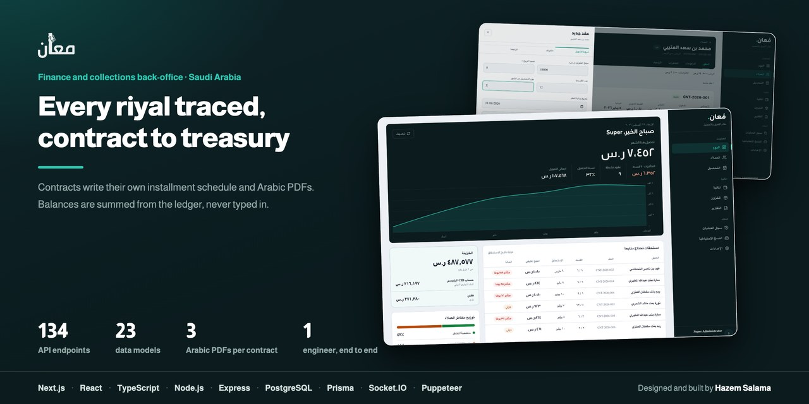
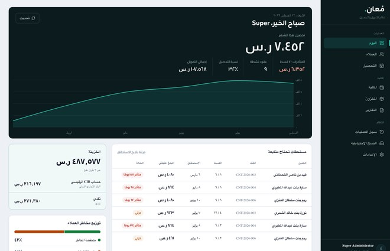
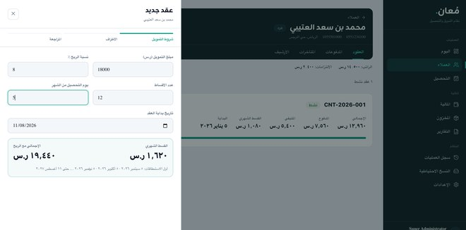
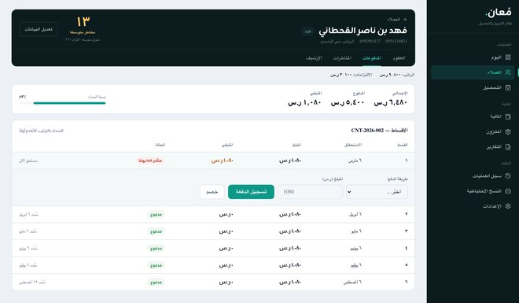
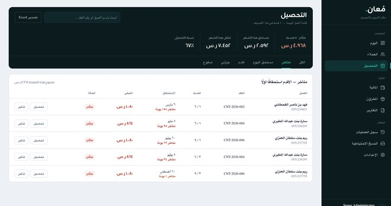
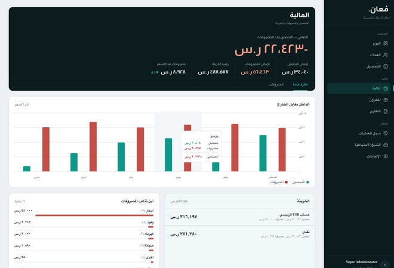
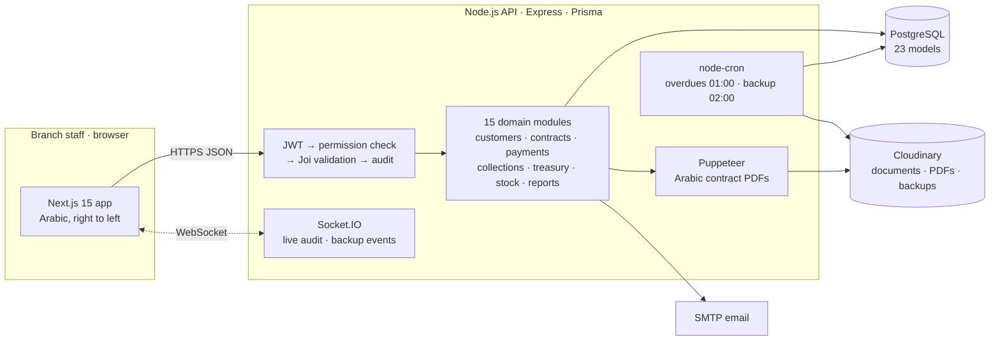
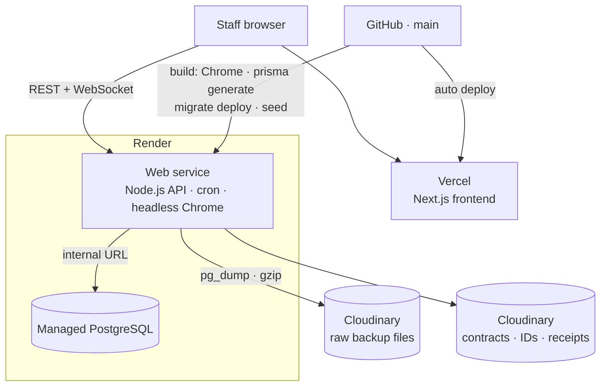
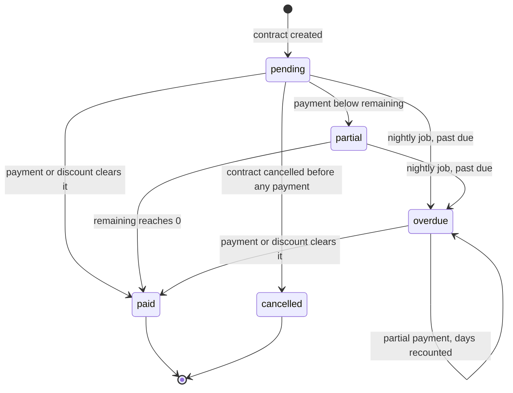
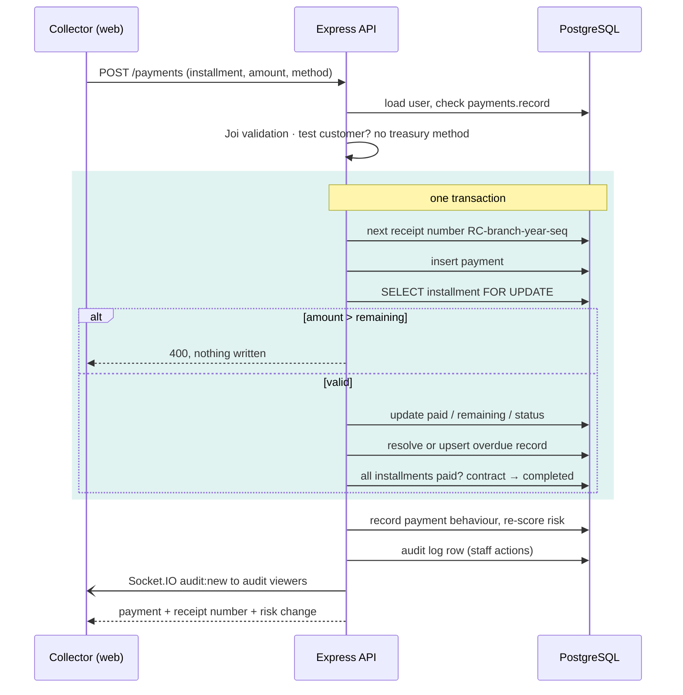

  <b>English</b> · <a href="README.ar.md">العربية</a>

  
  
  
  
  
  

# Mo3an — installment finance and collections, Saudi Arabia

**A finance office that used to run on spreadsheets and memory.** Mo3an (مُعان) is the back-office for a company that sells on monthly installments. A contract writes its own installment schedule and its Arabic legal documents. Every payment, expense, stock movement and transfer lands in a ledger. The treasury balance on screen is summed from that ledger, never typed in.

**The financing is a deferred-price sale (بيع بالأجل), not a loan. The price is fixed when the contract is signed, and the system charges no interest and no late fees on overdue installments.**

Web app · Arabic-first, right to left · Deployed to production and handed over in November 2025 · **My role: sole engineer — data model, backend, frontend, PDFs, deployment**

> **The code belongs to the client and is private.** I'm happy to walk through the architecture, the schema or any decision below:
> **[HazemSalama108@gmail.com](mailto:HazemSalama108@gmail.com)** · [LinkedIn](https://linkedin.com/in/hazem-salama-290310310) · [hazemsalama.dev](https://hazemsalama.dev)

  
  
  

  
  

Real screens from a local environment with seeded demo data (fictional customers): today's dashboard → new contract → paying an installment → overdue worklist → finance and treasury

---

## At a glance

| | |
|---|---|
| **Users** | Branch staff: collectors, accountants, managers and an admin, each seeing only what their permissions allow |
| **Financing model** | **Deferred-price sale: the price is fixed at signing, with no interest and no late fees** |
| **Covers** | Customers and risk scoring · contracts and installment schedules · payments, discounts and receipts · overdues and collections · treasury per cash box and bank account · card stock · expenses · reports · audit log · backups |
| **Backend** | ~21k lines of Node.js · 134 API endpoints · 15 domain modules · 24 service classes · 23 data models · 7 migrations |
| **Access control** | 45 permissions, 4 role presets, checked against the database on every request |
| **Documents** | 3 Arabic PDFs generated per contract: sale contract, collection contract, promissory note |
| **Background work** | Overdue detection every night at 01:00 · full database backup every night at 02:00 |
| **Frontend** | Next.js 15 · Arabic-first, right to left · ~11k lines of TypeScript |
| **Cloud** | API and PostgreSQL on Render · frontend on Vercel · files and backups on Cloudinary |

---

## Architecture

### System

**One API, one database, on purpose.** Recording a payment touches the installment, the overdue record, the contract's status and the treasury. Creating a contract touches the schedule, the card stock and the documents. Those changes have to commit together, so they live in one Express app over one PostgreSQL database, split into 15 domain modules. Every request goes through the same chain: identity, permission, validation, business logic, audit.

### Deployment

- **The API is an always-on service, not serverless.** It holds WebSocket connections, runs the nightly jobs in process and launches headless Chrome for PDFs.
- **Every build migrates the schema.** `prisma migrate deploy` runs on each deploy, and the seed is idempotent, so a fresh environment comes up with its branch and admin.
- **Backups leave the host.** The nightly dump goes to Cloudinary, so the client keeps a copy outside the database provider.

### Installment life cycle

The installment is the unit everything else hangs on. Nobody marks one late by hand: the nightly job moves past-due installments to `overdue` and opens an overdue record, and a payment that clears it resolves that record in the same transaction.

### Recording a payment

---

## Architecture decisions

| # | Decision | Instead of | Why | Trade-off accepted |
|---|---|---|---|---|
| 1 | **Treasury balance summed from the ledger:** confirmed payments − approved expenses − stock purchases + logged adjustments | A balance field staff can edit | Every riyal on screen traces back to a row | Aggregate queries on every treasury read |
| 2 | **Payment, installment, overdue and contract status in one transaction, with the installment row locked** (`SELECT … FOR UPDATE`) | Separate updates per table | Two collectors paying the same installment can't both apply | Raw SQL inside ORM code |
| 3 | **A payment above the installment's remaining amount is rejected** | Spilling the excess into the next installment | One payment, one installment, one receipt: receipts always match the schedule | A large payment is entered as several |
| 4 | **Financial terms are locked once a contract exists:** the update schema only accepts guarantor, notes and status | Editable amounts and rates | The schedule is generated and the PDFs are signed against those terms | A wrong contract is cancelled and recreated |
| 5 | **Card stock deducted inside the contract transaction** (cards = principal ÷ card price, rounded up) | Reconciling stock later | Contracts and inventory can't drift apart; no stock, no contract | Contract creation fails when stock runs low |
| 6 | **Cancelling posts a compensating stock IN** and is allowed only before any payment | Deleting the OUT movement | The stock ledger keeps its full history | Contracts with payments need a different path |
| 7 | **Risk as a points matrix:** salary bands + debt-to-income → one of three funding tiers, checked against the principal at contract creation | Case-by-case approval | Same rule for every officer, and explainable to the customer | Thresholds live in code; a policy change is a deploy |
| 8 | **Payment behaviour moves the score:** early, on-time and late payments are recorded and re-score the customer | A score fixed at onboarding | The score reflects how the customer actually pays | More writes on every payment |
| 9 | **Arabic PDFs rendered by headless Chrome from right-to-left HTML** | Drawing with a PDF library | The browser handles Arabic shaping and mixed-direction text, and templates stay HTML | Chrome on the server and a heavier build |
| 10 | **Overdue status owned by one nightly job** | Flagging late installments by hand | One place decides "late"; collections opens each morning on a ready worklist | Status can be up to a day behind for untouched installments |
| 11 | **Permissions read from the database on every request** (45 permissions, 4 presets) | Trusting claims inside the JWT | Revoking access or deactivating a user takes effect on the next click | One extra query per request |
| 12 | **Short-lived access tokens with refresh tokens stored in the database** | Long-lived tokens only | Logout and revocation actually end a session | A token table to maintain |
| 13 | **A test-customer flag:** its payments carry no payment method and it is hidden from non-admins | A separate training environment | Staff can practise on the real system without touching the books | Every customer query has to apply the filter |
| 14 | **Payment methods assigned to users** | Every user seeing every account | Each cash box and bank account has named owners, and collectors pick only their own | Admin has to maintain the assignments |
| 15 | **Backups as an in-process job:** `pg_dump` → gzip → Cloudinary, logged and announced over Socket.IO | Relying on the host's snapshots alone | A client-owned copy outside the database provider, visible in the app | The single-flight guard assumes one API instance |

---

## Deep dives

<b>Contracts that write their own paperwork</b>

- The operator enters the principal, profit rate, number of installments, start date and collection day. The frontend shows the monthly installment, the total and the first due dates before anything is saved.
- On save, one transaction validates the funding limit, numbers the contract (`CNT-year-sequence` per branch), creates the schedule, and deducts card stock.
- Due dates land on the chosen collection day and clamp to the month's last day, so a contract collected on the 31st still has a February installment.
- Three Arabic documents are generated from HTML templates by headless Chrome: the sale contract, the collection contract and the promissory note. They are uploaded to Cloudinary and attached to the contract. A failed PDF is logged and doesn't roll back the contract.
- A customer can hold one active contract at a time.

<b>Treasury, stock and transfers as ledgers</b>

- Each payment method (a cash box or a bank account) has a balance computed from its rows: collections in, expenses out, stock purchases out, plus transfers and manual adjustments.
- Transfers between accounts run in a transaction and leave a `Transfer` row. Manual add and deduct operations leave a `BalanceAdjustment` row with who, how much and a note.
- Account numbers are masked to their last four digits in treasury responses.
- Card stock works the same way: `IN` rows for purchases and refunds, `OUT` rows tied to a contract number. Available stock is the difference.

<b>Risk scoring and funding limits</b>

- Individual customers are scored from salary bands and debt-to-income bands. The total maps to low, medium or high risk, and each class maps to a funding level: full, moderate or monthly only.
- Contract creation validates the **principal**, not the total with profit, against the customer's limit for that contract type.
- Every payment records its delay against the due date. Early, on-time and late behaviour moves the customer's points, and a change of risk class raises a risk alert.

<b>Access control and audit</b>

- 45 permissions grouped by module, with four presets (admin, manager, employee, viewer) as starting points. Each route declares the permission it needs.
- The permission check reads the user from the database each time, so a deactivated account is refused even while its token is still valid.
- Staff actions are written to an audit log with user, module, action, description, IP and a details record, and pushed live over Socket.IO to users who hold `audit.view`. The socket connection is authenticated with the same JWT.
- Helmet, an explicit CORS allowlist and rate limiting sit in front of every API route.

<b>Collections</b>

- The collections screen lists installments by status (overdue, due today, upcoming, partial, paid), oldest due date first, with search and Excel export.
- Each row links to the customer and opens WhatsApp with a reminder already written: the installment number, the amount and the days overdue.
- Reports cover collections and expenses for a date range, current overdues, and client risk, exported as PDF or CSV.

---

## What I owned

- **The data model:** 23 models covering customers, contracts, installments, payments, overdues, treasury, stock, expenses, audit and backups.
- **The backend:** all 15 modules, the transaction and locking rules, risk scoring, permissions, scheduled jobs and backups.
- **Arabic document generation:** the three contract PDFs and their templates.
- **The frontend:** the Next.js app, Arabic-first and right to left.
- **Deployment:** Render for the API and database, Vercel for the frontend, Cloudinary for files and backups.
- **Turning the client's credit policy and paperwork into code.**

---

<b>Want the deeper version: the schema, the payment transaction, or how the risk matrix works?</b> 
<a href="mailto:HazemSalama108@gmail.com">HazemSalama108@gmail.com</a> · <a href="https://linkedin.com/in/hazem-salama-290310310">LinkedIn</a> · <a href="https://hazemsalama.dev">hazemsalama.dev</a>

