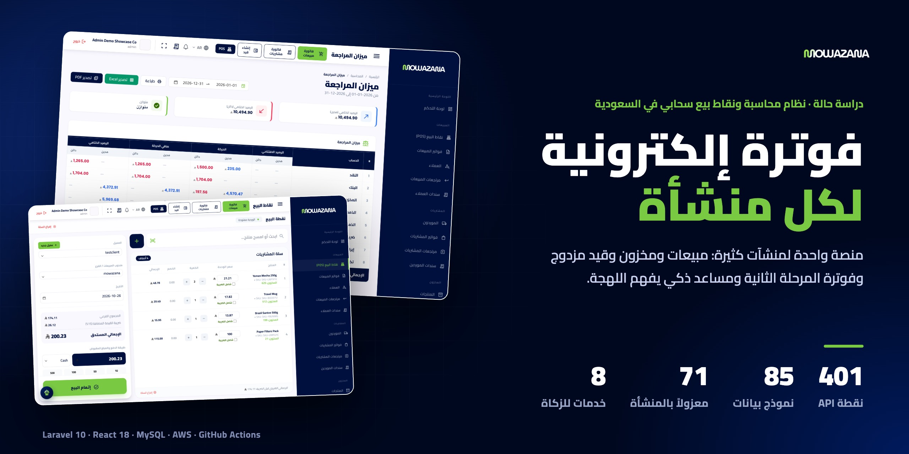
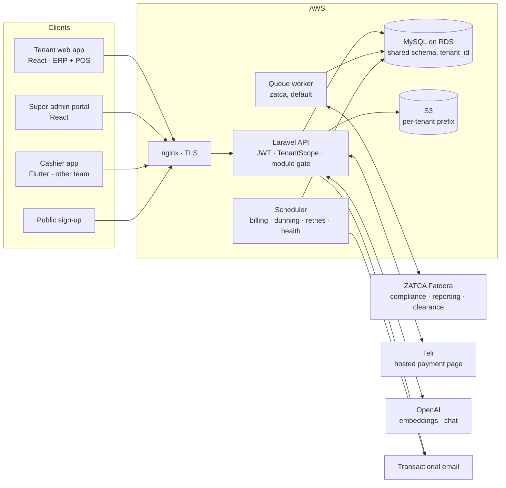
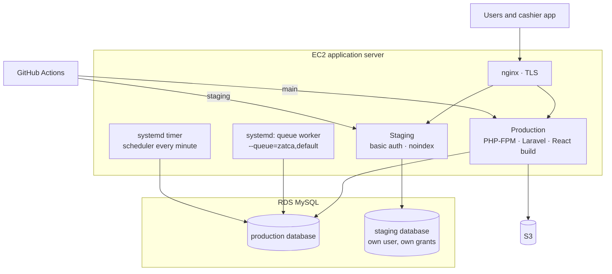
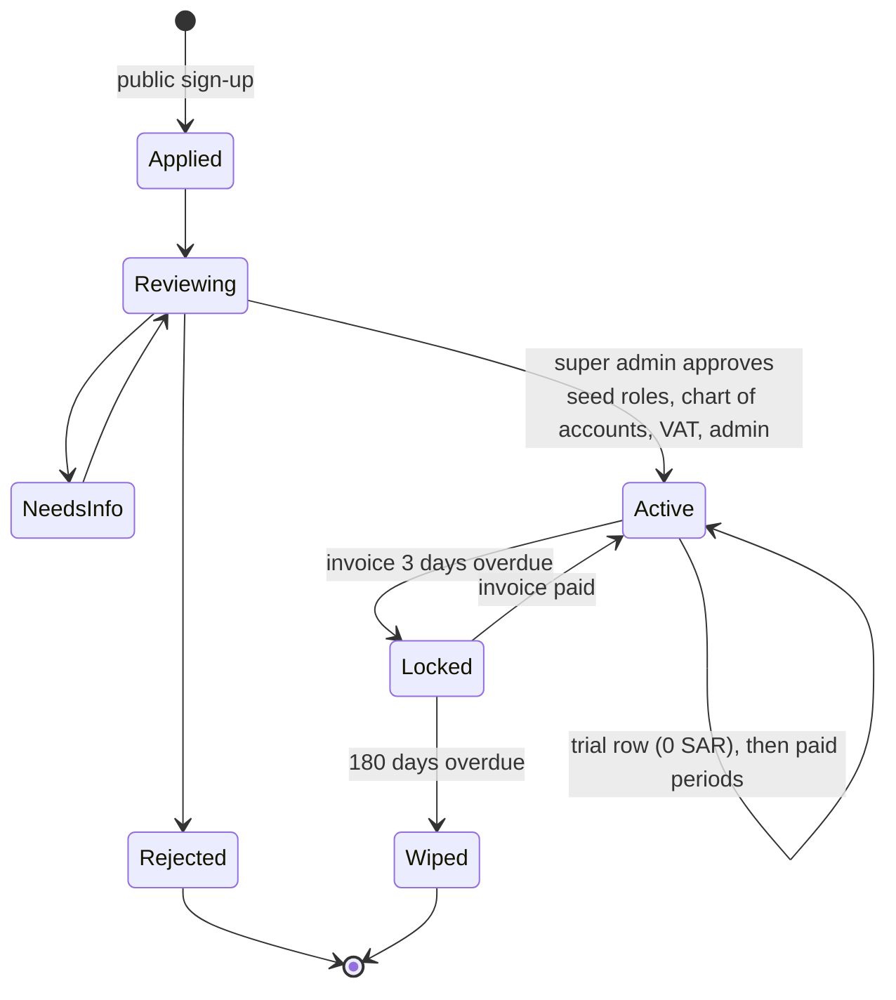
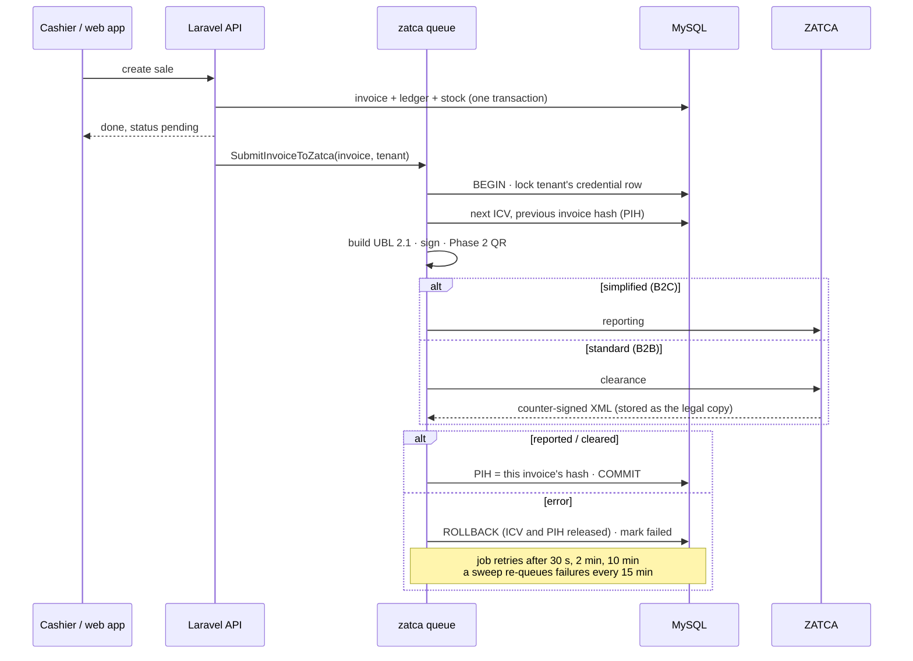

  <a href="README.md">English</a> · <b>العربية</b>

  
  
  
  
  
  
  

# موازنة: نظام محاسبة ونقاط بيع سحابي متعدد المنشآت في السعودية

**منصة واحدة لمنشآت كثيرة، وكل فاتورة موقّعة لهيئة الزكاة.** يسجّل المتجر أو المقهى أو الشركة التجارية، فيحصل على دفاتره وكاشيره ومخزونه وتقارير ضريبته. وكل عملية بيع تُوقَّع وتُربط بسلسلة وتُرسل إلى هيئة الزكاة والضريبة والجمارك دون أن ينتظرها الكاشير.

[app.mowazana-pos.com](https://app.mowazana-pos.com) · [mowazana.sa](https://mowazana.sa) · تطبيق ويب وواجهة برمجية لتطبيق الكاشير · العربية أولاً · **دوري: المهندس الوحيد. استلمت شيفرة نظام ERP قائماً لمنشأة واحدة، وبنيت فوقه المنصة السحابية: تعدد المنشآت، والمرحلة الثانية من الفوترة الإلكترونية، وفوترة الاشتراكات، وواجهة نقاط البيع، والمساعد الذكي راجح، والواجهة المعاد تصميمها، والبنية على AWS وخط النشر.**

> **الشيفرة ملك للعميل وليست منشورة.** يسعدني شرح المعمارية أو قاعدة البيانات أو أي قرار مما يلي:
> **[HazemSalama108@gmail.com](mailto:HazemSalama108@gmail.com)** · [LinkedIn](https://linkedin.com/in/hazem-salama-290310310) · [hazemsalama.dev](https://hazemsalama.dev)

  
  
  
  
  

شاشات حقيقية من بيئة الاختبار (منشأة تجريبية وبيانات نموذجية): لوحة التحكم ← نقطة البيع ← ميزان المراجعة ← الربط بهيئة الزكاة ← المساعد راجح

---

## نظرة سريعة

| | |
|---|---|
| **المنتج** | نظام ERP ونقاط بيع سحابي باشتراك: منصة مشتركة واحدة، ولكل منشأة بياناتها ومستخدموها وأدوارها وخطتها |
| **الوحدات** | نقاط البيع · المبيعات · المشتريات · المخزون · المحاسبة بالقيد المزدوج · الضريبة وهيئة الزكاة · الموارد البشرية · التجارة الإلكترونية، وتُفعَّل بحسب الخطة |
| **الواجهات** | تطبيق المنشأة على الويب · بوابة المشرف العام · التسجيل العام · واجهة برمجية لتطبيق كاشير بـ Flutter (يبنيه فريق آخر) |
| **الخادم** | Laravel 10 و PHP 8.2 · نحو 40 ألف سطر في `app/` · 401 نقطة API · 85 نموذج بيانات (71 منها معزولة بالمنشأة) · 129 ترحيلاً · 53 صنف خدمة |
| **الواجهة** | React 18 و Vite · نحو 120 ألف سطر في 675 ملفاً · 155 مساراً · العربية والإنجليزية، من اليمين إلى اليسار أولاً |
| **الفوترة الإلكترونية** | المرحلة الثانية: الربط (طلب الشهادة وشهادتا الامتثال والإنتاج)، و UBL 2.1، والتوقيع، ورمز QR، والإبلاغ والاعتماد، عبر 8 خدمات مخصصة |
| **الذكاء الاصطناعي** | راجح: مساعد دعم بالعربية يجيب من 68 مقالة عن المنتج، مع بوابة إسناد ومسار اختياري لأرقام المنشأة نفسها |
| **الجودة** | 134 ملف اختبار PHPUnit، وقواعد المال والضريبة مغطاة باختبارات وحدة |
| **السحابة** | AWS (EC2 و RDS MySQL و S3) · نشر من GitHub Actions على الفرعين `main` و `staging` · عامل طوابير ومجدول عبر systemd |

---

## المعمارية

### النظام

**نظام موحّد مقسّم إلى وحدات فوق قاعدة بيانات مشتركة.** كل المنشآت في مخطط MySQL واحد، يفصل بينها عمود `tenant_id` ونطاق عام في Eloquent يُربط من الرمز الموقّع في كل طلب. المبيعات والمخزون والقيود والضريبة يجب أن تتغير معاً في معاملة واحدة، والشيفرة الأصلية تطبيق Laravel لمنشأة واحدة، فكان المخطط الواحد مع عمود المنشأة أقصر طريق آمن إلى المنصة السحابية. الأعمال البطيئة أو الخارجية (الإرسال للهيئة وإصدار فواتير الاشتراك والتذكيرات) تعمل على الطوابير والمجدول بالشيفرة نفسها.

### الشبكة والنشر

- **الفرع يحدد الوجهة.** الدفع إلى `staging` ينشر نسخة الاختبار ويشغّل الترحيلات، والدفع إلى `main` ينشر الإنتاج، ولا تُشغَّل ترحيلاته إلا بطلب صريح.
- **كل نشر:** بناء الحزمة ورفعها وفكّها، وتخزين الإعدادات والمسارات، وإعادة تحميل PHP-FPM، وإعادة تشغيل عامل الطوابير، وتحديث قاعدة معرفة المساعد، ثم فحص صحة على الواجهة الحية.
- **ملفات الخدمات محفوظة في المستودع** (`infra/systemd/`) مع سكربت تثبيت آمن عند التكرار، فلا تنحرف قائمة طوابير العامل على الخادم.

### دورة حياة المنشأة

المنشأة الموقوفة تستطيع الدخول وقراءة كل شيء: دفاترها وفواتيرها وتقاريرها. الممنوع هو الكتابة فقط. والتذكيرات تتصاعد في الأيام 3 و15 و30 و45 و90 و120 و150 و179 قبل الحذف في اليوم 180، وكل تذكير يُرسل مرة واحدة.

### فاتورة واحدة إلى هيئة الزكاة دون كسر سلسلة التجزئة

---

## القرارات المعمارية

| # | القرار | بدلاً من | السبب | الثمن المقبول |
|---|---|---|---|---|
| 1 | **مخطط مشترك مع `tenant_id` ونطاق عام في Eloquent** | قاعدة بيانات لكل منشأة | تحويل تطبيق لمنشأة واحدة: مخطط واحد يُرحَّل، ومكان واحد يضاف فيه العزل، والمنشآت صغيرة | العزل يعتمد على مرور الاستعلامات عبر النماذج، والاستعلامات الخام تُصفّى يدوياً |
| 2 | **معرّف المنشأة داخل رمز JWT الموقّع، ويُربط في كل طلب** | نطاق فرعي لكل منشأة | رابط واحد لكل المنشآت، والواجهة نفسها تخدم تطبيق الكاشير | الرمز يحمل المنشأة، فتبديلها يعني دخولاً جديداً |
| 3 | **المنشأة المتأخرة تُوقف للقراءة فقط في الطبقة الوسيطة** | منع الدخول | المنشأة المتأخرة في اشتراكها ما زالت تحتاج فواتيرها ودفاترها | كل واجهة تتعامل مع رفض الكتابة برسالة واضحة |
| 4 | **وحدات الخطة تُفرض على الخادم (`module:sales`)** | إخفاء الوحدات غير المدفوعة من القائمة | الإخفاء لا يمنع النداء المباشر للواجهة البرمجية | كل مجموعة مسارات تحمل بوابتها، والقائمة الفارغة تعني بلا قيود للمنشآت القديمة |
| 5 | **قفل صف على شهادة المنشأة من رقم العداد إلى تجزئة الفاتورة السابقة** | عدّاد متفائل | فاتورتان تقرآن التجزئة السابقة نفسها تكسران السلسلة، والهيئة ترفض ذلك | فواتير المنشأة الواحدة تُرسل واحدة تلو الأخرى، والقفل يمتد أثناء نداء الهيئة |
| 6 | **الإرسال للهيئة على طابور خاص، مع إعادة متدرجة ومسح دوري** | الإرسال داخل طلب البيع | الكاشير لا ينتظر الهيئة، وتعطّلها لا يوقف البيع | الفاتورة تظهر «قيد الإرسال» لحظات، وفحص صحة يراقب الطابور كل 5 دقائق |
| 7 | **فواتير المنشآت إلى الاعتماد، وفواتير الأفراد إلى الإبلاغ، مع حفظ النسخة الموقّعة من الهيئة** | مسار إرسال واحد لكل الفواتير | هذه قاعدة المرحلة الثانية، والنسخة المعتمدة من الهيئة هي المستند النظامي لا النسخة المحلية | مساران للاختبار، وملفات XML أكثر لكل فاتورة |
| 8 | **مكتبة للتوقيع، وبناء UBL والربط والإرسال بشيفرتي** | وسيط فوترة خارجي | لا رسوم لكل فاتورة، ولا طرف إضافي يحمل شهادات المنشآت | متابعة تغييرات مواصفات الهيئة علينا |
| 9 | **المال أعداد صحيحة بالهللة، والسطر الشامل للضريبة يُشتق من الإجمالي** | الأعداد العشرية والتقريب من الصافي | 400.00 تُكتب عند الكاشير يجب أن تُطبع 400.00 لا 399.99 | في مبالغ قليلة تختلف الضريبة عن تقريب الصافي × 15% بهللة واحدة، وهذا موثّق في الشيفرة |
| 10 | **التقارير تُحسب لحظياً من قيود الدفتر** | أرصدة جارية مخزّنة | ميزان المراجعة وقائمة الدخل والميزانية لا تختلف عن دفتر اليومية أبداً | كل تقرير استعلام على الفترة لا قراءة مباشرة |
| 11 | **الحسابات تُحدَّد بالاسم لكل منشأة، ونوع المنتج يختار الحساب** | أرقام حسابات ثابتة | لكل منشأة دليل حسابات خاص بها، والسلعة والخدمة والتكلفة تُقيَّد بطرق مختلفة | نداء إضافي عند كل قيد |
| 12 | **Telr: طلب دفع جديد عند كل ضغطة، والإشعار يطلق فحصاً للحالة فقط** | الوثوق بمحتوى الإشعار | صفحة الدفع تُستخدم مرة واحدة، والإشعار قد يُزوَّر أو يتأخر، ويجب أن يطابق المبلغ | نداء إضافي لكل عملية دفع |
| 13 | **الاشتراك سلسلة فترات مع محفظة** | حالة وتاريخ تجديد فقط | الفترة التجريبية وتغيير الخطة في منتصف الفترة ورصيد الأيام غير المستخدمة كلها صفوف عادية | منطق أكثر لحساب وضع المنشأة الحالي |
| 14 | **راجح يبحث في فهرس أعداد مضغوط داخل PHP** | قاعدة بيانات متجهات | نحو ألفي مقطع: المسح الكامل يستغرق عشرات المللي ثانية، دون خدمة إضافية تحتاج تشغيلاً | مع مكتبة معرفة أكبر بكثير سيلزم فهرس حقيقي |
| 15 | **قاموس يحوّل اللهجة الخليجية إلى الفصحى، وتُضمَّن الصيغتان** | إعادة صياغة السؤال بنموذج لغوي | قياس فعلي: سؤال باللهجة سجّل 0.283 مع مقالته، وصيغته الفصحى أكثر من 0.50، بينما تصل الأسئلة الخارجة عن الموضوع إلى 0.349 | قائمة كلمات تحتاج صيانة |
| 16 | **لا إجابة دون إسناد، وأرقام المنشأة عبر مقاييس محددة سلفاً فقط** | محادثة مفتوحة أو تحويل النص إلى SQL | السؤال المرفوض يصبح تذكرة دعم، والإجابة المختلقة تصبح قراراً تجارياً خاطئاً | بعض الأسئلة الصحيحة تُرفض حتى تغطيها مقالة |
| 17 | **نشر بحسب الفرع مع قاعدة بيانات اختبار منفصلة** | النشر اليدوي إلى الإنتاج | كل تغيير يُختبر على بيئة الاختبار قبل أن يصل إلى المنشآت المشتركة | بيئة الاختبار تشارك خادم الإنتاج، فتبقى خفيفة (طوابير متزامنة وتخزين محلي) |

---

## تفاصيل أعمق

<b>المرحلة الثانية من الفوترة الإلكترونية من البداية إلى النهاية</b>

- **الربط لكل منشأة:** إنشاء طلب شهادة على منحنى secp256k1، ثم استبداله برمز OTP من بوابة فاتورة بشهادة امتثال، ثم اجتياز فواتير الامتثال الست (القياسية والمبسطة × فاتورة وإشعار دائن وإشعار مدين)، ثم طلب شهادة الإنتاج.
- **لكل فاتورة:** رقم العداد التالي، وتجزئة الفاتورة السابقة، ومعرّف فريد، ثم ملف UBL 2.1، ثم التوقيع ورمز QR بتسعة حقول، ثم الإبلاغ أو الاعتماد.
- **السلسلة لا تنكسر.** صف شهادة المنشأة مقفل طوال الخطوة، وعند الفشل تُلغى المعاملة فيتحرر رقم العداد والتجزئة لتأخذهما الفاتورة التالية.
- **الأخطاء ظاهرة.** يُحفظ الخطأ وعدد المحاولات خارج المعاملة الملغاة، فيرى المستخدم ما حدث. ومهمة مجدولة تعيد الفواتير الفاشلة إلى الطابور كل 15 دقيقة، حتى ثلاث محاولات.
- **النهائي نهائي.** قبل ربط المنشأة ببيئة الإنتاج يمكن حذف الفاتورة مع عكس قيودها ومخزونها. بعد الربط لا تصحيح إلا بمرتجع.

<b>تحويل نظام لمنشأة واحدة إلى منصة سحابية</b>

- سمة `TenantScope` على 71 نموذجاً من 85 تصفّي كل قراءة بالمنشأة الحالية، وتضع `tenant_id` في كل إدخال. والجداول العامة القليلة (الخطط وطلبات التسجيل وقاعدة معرفة المساعد) عامة عن قصد.
- الطبقة الوسيطة للتفويض تفك الرمز، وتربط المنشأة للطلب، وتطبق قاعدة القراءة فقط على المنشأة الموقوفة، وتحمّل صلاحيات الدور. والمشرف العام بلا منشأة، فهو خارج النطاق.
- أرقام الحسابات الثابتة في الشيفرة الأصلية استُبدلت ببحث بالاسم لكل منشأة، وكل سطر دفع يجب أن يُقيَّد على حساب تملكه المنشأة.
- **المنشأة الجديدة:** طلب عام، ثم مراجعة المشرف العام، ثم خطوة واحدة تنشئ المنشأة وتزرع أدوارها وصلاحياتها ودليل حساباتها وطرق الدفع والعملة ونسب الضريبة (15% و0%) والمدير الأول، وترسل بيانات دخول لمرة واحدة.
- **الحذف:** الجداول الفرعية أولاً، ثم مجلد المنشأة على S3، مع ملخص في سجل النشاط.

<b>فوترة الاشتراكات والتحصيل</b>

- الخطط تحمل الوحدات وحدود المقاعد (مثل عدد الكاشيرات)، ويستطيع المشرف العام تحديد سعر خاص لكل منشأة.
- الدورات شهرية أو ربع سنوية أو نصف سنوية أو سنوية، والسنوية تُحتسب عشرة أشهر.
- فاتورة كل فترة تصدر يوم بدايتها. المحفظة تسدد الفواتير المفتوحة أولاً، الأقدم فالأحدث. وتغيير الخطة أو الدورة في منتصف الفترة قد يضيف الجزء غير المستخدم إلى المحفظة، بالأيام أو بالأشهر أو بالأيام المستخدمة.
- الدفع بالبطاقة عبر صفحة Telr المستضافة. يُتحقق من الإشعار، ثم يُعاد فحص الطلب لدى Telr ويُقارن المبلغ قبل اعتبار الفاتورة مدفوعة. والدفع يرفع الإيقاف عن المنشأة فوراً.
- سلّم التذكيرات يعمل يومياً، وكل درجة تُسجَّل فلا تُرسل مرتين.

<b>راجح، المساعد الذكي بالعربية</b>

- **المسار:** البوابة (المفتاح والمنشأة والتفعيل وطول السؤال والمواضيع الممنوعة وحدود المعدل والسقف الشهري للرموز) ← التحويل للدعم ← مسار البيانات الاختياري ← استرجاع أفضل 6 مقاطع ← فحص الإسناد ← الإجابة ← سجل التدقيق.
- **قاعدة المعرفة:** 68 مقالة Markdown، وكل قسم `##` مقطع واحد، والجداول لا تُقسم. كل نشر يعيد تضمين المقاطع التي تغيرت تجزئتها SHA-256 فقط، في معاملة واحدة. ويضيف المشرف العام مدخلات من البوابة دون نشر.
- **الاسترجاع:** المتجهات مطبّعة إلى طول واحد ومضغوطة في كتلة ثنائية واحدة، محفوظة في الذاكرة وعلى القرص، ولها إصدار بحسب حالة المكتبة. والتشابه حاصل ضرب نقطي بسيط.
- **اللهجة:** الأسئلة باللهجة الخليجية («شلون» و«وين» و«ابغى») تُحوَّل إلى فصحى المقالات للاسترجاع فقط. كلمات المستخدم نفسها هي ما يراه النموذج وما يُسجَّل.
- **أرقام المنشأة (اختياري):** يحتاج التفعيل وموافقة المنشأة وصلاحية المستخدم لذلك المقياس. النموذج يختار معرّفاً واحداً من 10 مقاييس ويملأ التواريخ فقط، ولا يكتب SQL أبداً، ولا يصله إلا الرقم النهائي.
- **حلقة الفريق:** تبويب في البوابة يعرض الأسئلة بلا إجابة وغير المرضية، ومختبر يعرض ما سيسترجعه راجح ودرجاته، وأمر معايرة يساعد في ضبط الحد الأدنى للتشابه.

<b>الواجهة البرمجية خلف تطبيق الكاشير</b>

- فريق آخر يبني تطبيق الكاشير بـ Flutter، وأنا مسؤول عن الواجهة البرمجية التي يستخدمها: الدخول بحد معدل خاص، والمنتجات، والورديات، والطلبات، والمشتريات، والإيصالات (A4 و80 مم، وكلاهما برمز QR للهيئة).
- **الخادم هو المرجع في السعر.** يرسل التطبيق السعر المحصَّل وسعر القائمة الذي بدأ منه، وسعر القائمة الذي لا يطابق المنتج يُرفض، فلا يمكن إخفاء تعديل السعر عن مدير المنشأة.
- **الخصم يتبع إعداد المنشأة.** إذا كان الخصم معطلاً يرفض الخادم أي سطر يحمله.
- **مقاعد الكاشير بحسب الخطة:** بلا حد، أو لا شيء، أو N على الأكثر، ولا شيء إطلاقاً دون وحدة نقاط البيع.
- مواصفات الواجهة مكتوبة لتكفي وحدها، لأن فريق التطبيق يعمل منها دون الوصول إلى الخادم.

---

## ما توليته

- **المعمارية ونموذج البيانات متعدد المنشآت**، مبنيين فوق الشيفرة الأصلية لمنشأة واحدة.
- **الخادم:** تعدد المنشآت، والصلاحيات وبوابات الخطط، والمبيعات، والمشتريات، والسندات، وترحيل القيود، وحساب الضريبة، والربط الكامل بالمرحلة الثانية، وفوترة الاشتراكات، ومدفوعات Telr، والتحصيل.
- **راجح:** الاسترجاع، والإسناد، ومعالجة اللهجة، ومسار المقاييس، والتغذية، وأدوات المشرف العام.
- **الواجهة:** تطبيق المنشأة ونقطة البيع بعد إعادة التصميم، وبوابة المشرف العام، ومسار التسجيل، من اليمين إلى اليسار أولاً بالعربية والإنجليزية.
- **الواجهة البرمجية لتطبيق الكاشير**، مع مواصفات يبني عليها الفريق الآخر.
- **السحابة:** EC2 و RDS و S3 على AWS، و nginx، وخدمات systemd، وبيئة الاختبار، وخطوط GitHub Actions.

---

<b>تريد النسخة الأعمق: نموذج تعدد المنشآت، أو مسار الفوترة الإلكترونية، أو كيف يقرر راجح ما يعرفه؟</b> 
<a href="mailto:HazemSalama108@gmail.com">HazemSalama108@gmail.com</a> · <a href="https://linkedin.com/in/hazem-salama-290310310">LinkedIn</a> · <a href="https://hazemsalama.dev">hazemsalama.dev</a>

