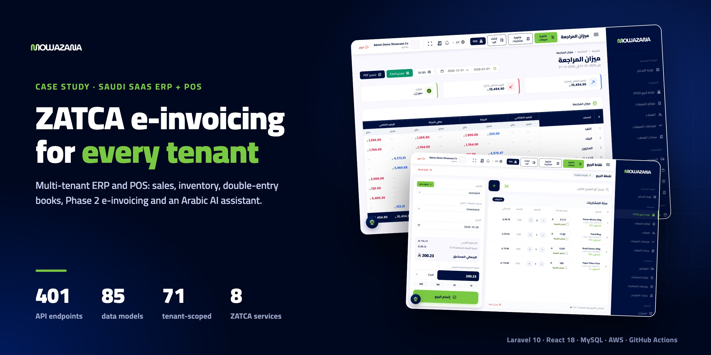
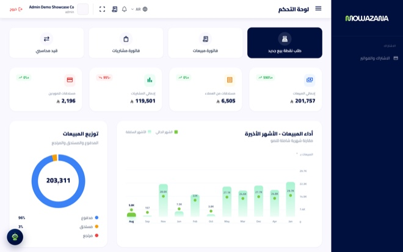
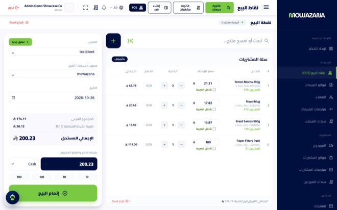
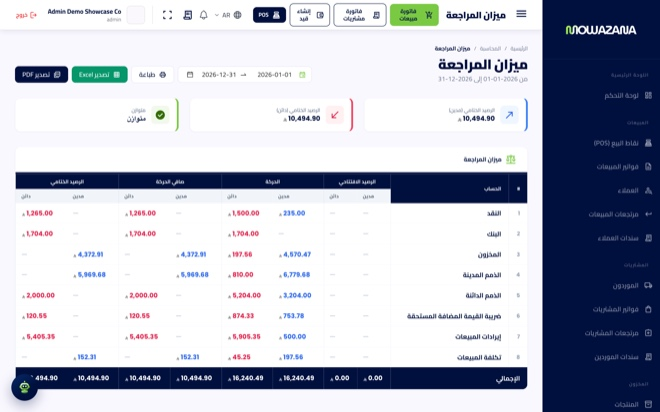
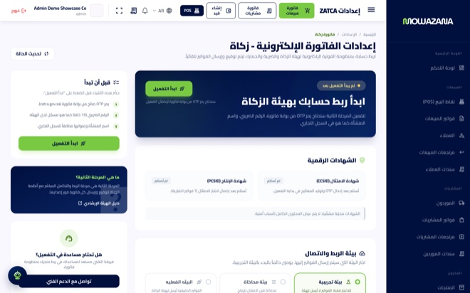
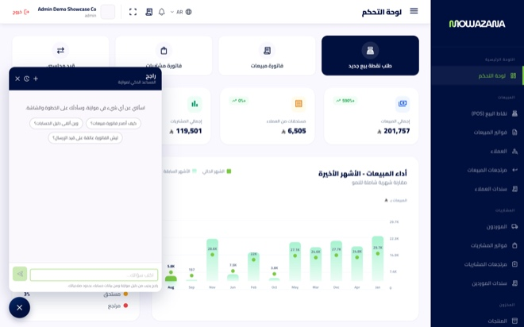
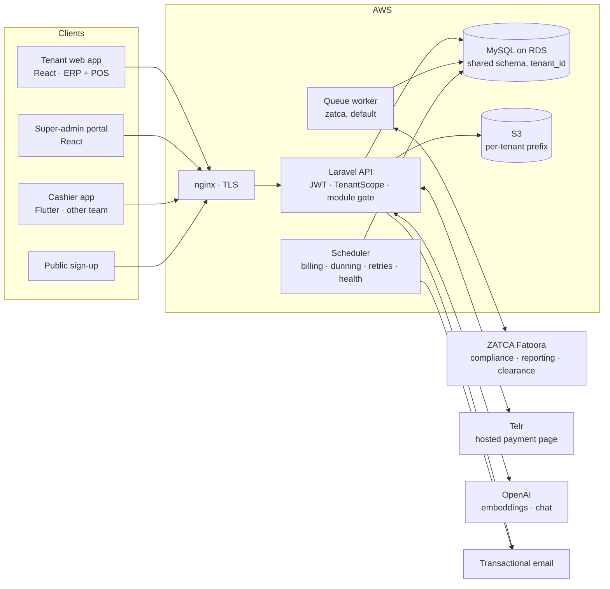
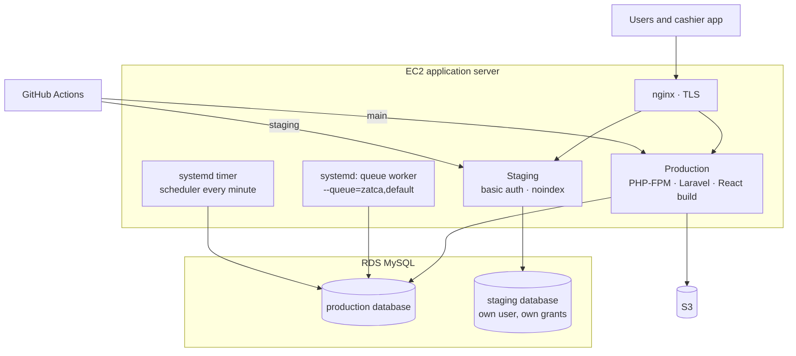
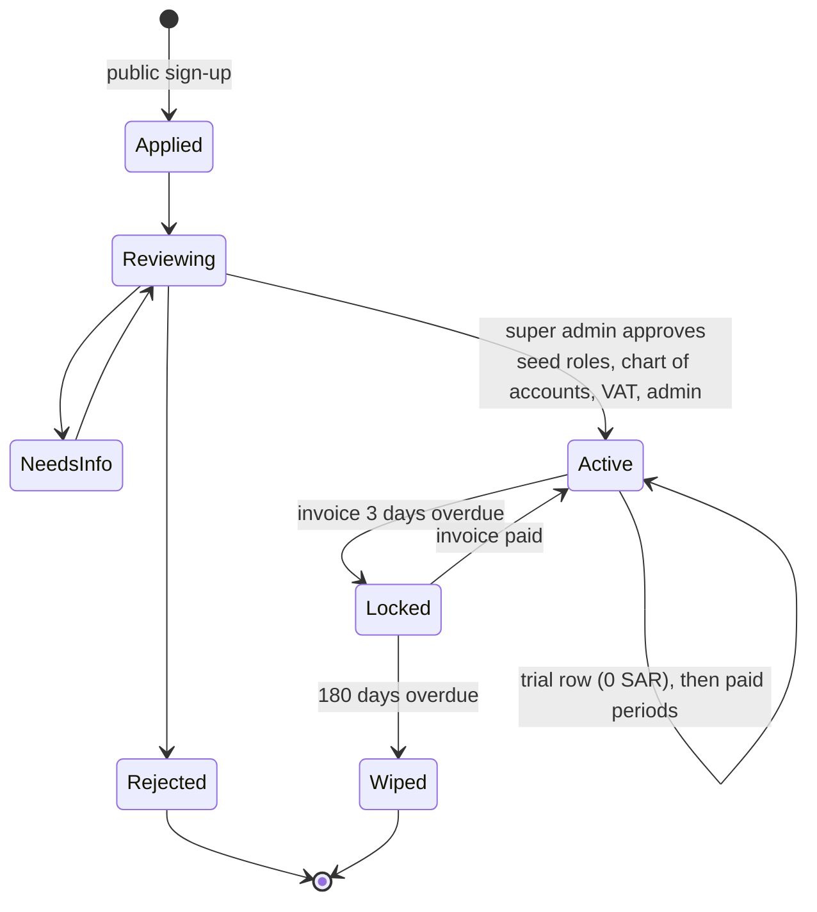
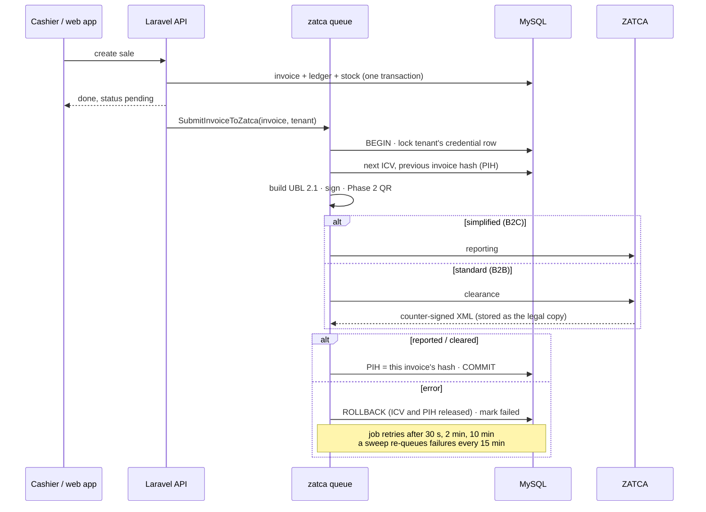

  <b>English</b> · <a href="README.ar.md">العربية</a>

  
  
  
  
  
  
  

# Mowazana (موازنة): multi-tenant ERP and POS for Saudi businesses

**One platform, many businesses, every invoice signed for the tax authority.** A shop, a café or a trading company signs up, gets its own books, cashier, stock and VAT reports, and every sale is signed, chained and sent to ZATCA (the Saudi Zakat, Tax and Customs Authority) without the cashier waiting for it.

[app.mowazana-pos.com](https://app.mowazana-pos.com) · [mowazana.sa](https://mowazana.sa) · Web app + cashier app API · Arabic-first · **My role: sole engineer. I took an existing single-company ERP codebase and built the SaaS platform on top of it: multi-tenancy, ZATCA Phase 2, subscription billing, the POS API, the Rajih AI assistant, the redesigned UI, AWS infrastructure and CI/CD.**

> **The code belongs to the client and is private.** I'm happy to walk through the architecture, the schema or any decision below:
> **[HazemSalama108@gmail.com](mailto:HazemSalama108@gmail.com)** · [LinkedIn](https://linkedin.com/in/hazem-salama-290310310) · [hazemsalama.dev](https://hazemsalama.dev)

  
  
  
  
  

Real screens from the staging environment (demo tenant, sample data): dashboard → point of sale → trial balance → ZATCA onboarding → Rajih assistant

---

## At a glance

| | |
|---|---|
| **Product** | Cloud ERP + POS sold as a subscription: one shared platform, each business a tenant with its own data, users, roles and plan |
| **Modules** | POS · sales · purchases · inventory · double-entry accounting · VAT and ZATCA · HR · e-commerce, switched on per plan |
| **Surfaces** | Tenant web app · super-admin portal · public sign-up · API for a Flutter cashier app (the app itself is built by another team) |
| **Backend** | Laravel 10 / PHP 8.2 · ~40k lines in `app/` · 401 API endpoints · 85 data models (71 tenant-scoped) · 129 migrations · 53 service classes |
| **Frontend** | React 18 + Vite · ~120k lines across 675 files · 155 routes · Arabic and English, RTL-first |
| **E-invoicing** | ZATCA Phase 2: onboarding (CSR, compliance and production certificates), UBL 2.1, signing, QR, reporting and clearance, through 8 dedicated services |
| **AI** | Rajih: Arabic support assistant answering from 68 product articles, with a grounding gate and an opt-in path to the tenant's own figures |
| **Quality** | 134 PHPUnit test files, with the money and VAT rules covered by unit tests |
| **Cloud** | AWS (EC2, RDS MySQL, S3) · GitHub Actions deploys from `main` and `staging` · systemd queue worker and scheduler |

---

## Architecture

### System

**A modular monolith on one shared database.** Every tenant lives in the same MySQL schema, separated by a `tenant_id` column and an Eloquent global scope that is bound from the signed token on each request. Sales, stock, ledger and VAT must change together in one transaction, and the original codebase was a single-company Laravel app, so one schema with a tenant column was the shortest safe path to SaaS. Slow or external work (ZATCA submission, billing runs, reminders) runs on the queue and the scheduler, on the same codebase.

### Network and deployment

- **Branch decides the target.** A push to `staging` deploys the staging copy and runs migrations; a push to `main` deploys production, where migrations run only when explicitly requested.
- **Each deploy:** build artifact, upload, extract, cache config and routes, reload PHP-FPM, restart the queue worker, refresh the assistant's knowledge base, then a health check against the live API.
- **Unit files live in the repo** (`infra/systemd/`) with an idempotent install script, so the worker's queue list cannot drift on the server.

### Tenant life cycle

A locked tenant can still sign in and read everything (its books, invoices and reports). Only writes are refused. Reminders escalate at days 3, 15, 30, 45, 90, 120, 150 and 179 before the wipe on day 180, and each one fires once.

### One invoice through ZATCA, without forking the hash chain

---

## Architecture decisions

| # | Decision | Instead of | Why | Trade-off accepted |
|---|---|---|---|---|
| 1 | **Shared schema with `tenant_id` and a global Eloquent scope** | A database per tenant | Retrofitting a single-company app: one schema to migrate, one place to add tenancy, small tenants | Isolation depends on queries going through the models; raw queries must filter by hand |
| 2 | **Tenant id inside the signed JWT, bound per request** | A subdomain per tenant | One app URL for every business, and the same API serves the cashier app | The token carries the tenant, so switching business means signing in again |
| 3 | **Overdue tenants are locked read-only in middleware** | Blocking sign-in | A business that is late on its subscription still needs its invoices and books | Every client has to handle a 403 on writes with a clear message |
| 4 | **Plan modules enforced on the server (`module:sales`)** | Hiding unpaid modules in the sidebar | Hidden menus do not stop direct API calls | Each route group carries its gate; an empty module list means unrestricted for older tenants |
| 5 | **Row lock on the tenant's ZATCA credential from ICV to PIH** | An optimistic counter | Two invoices reading the same previous hash would fork the chain, which ZATCA rejects | A tenant's submissions run one at a time, and the lock spans the HTTP call |
| 6 | **ZATCA submission on its own queue, with backoff and a retry sweep** | Submitting inside the checkout request | The cashier must not wait on the tax authority, and its outages must not stop sales | Invoices show "pending" for a moment, and a health check watches the queue every 5 minutes |
| 7 | **B2B goes to clearance, B2C to reporting; the counter-signed XML is kept** | One submission path for every invoice | That is the Phase 2 rule, and the cleared XML, not the local one, is the legal document | Two flows to test, and more stored XML per invoice |
| 8 | **A ZATCA library for signing, my own UBL builder, onboarding and submission** | A third-party e-invoicing middleman | No per-invoice fee and no extra party holding tenants' certificates | Keeping up with ZATCA spec changes is on us |
| 9 | **Money as integer halalas; VAT-inclusive lines derived from the gross** | Floats and net-first rounding | 400.00 typed at the till must print as 400.00, never 399.99 | For a few grosses the tax differs from round(net × 15%) by one halala, documented in code |
| 10 | **Reports computed live from ledger rows** | Stored running balances | Trial balance, income statement and balance sheet can never disagree with the journal | Each report is a query over the period, not a lookup |
| 11 | **Accounts resolved by name per tenant; product type picks the posting** | Hard-coded account ids | Each tenant has its own seeded chart of accounts; stock, service and cost lines post differently | A resolver call on every posting |
| 12 | **Telr: a fresh hosted order per click; the IPN only triggers a status check** | Trusting the IPN body | Hosted pages are single-use, and a callback can be forged or stale; the amount must also match | One extra API call per payment |
| 13 | **Subscription as a chain of periods with a wallet** | A status flag and a next-billing date | Trials, plan changes mid-period and credit for unused days all become plain rows | More logic to compute "where does this tenant stand" |
| 14 | **Rajih searches a packed float32 index in PHP** | A vector database | About two thousand chunks: a full scan is tens of milliseconds, with no extra service to run | Past a much larger corpus, a real index is needed |
| 15 | **Gulf dialect mapped to formal Arabic by a lexicon; both versions embedded** | Rewriting the question with an LLM | Measured: a dialect question scored 0.283 against its article, the formal version above 0.50, while off-topic questions reach 0.349 | A word list to maintain |
| 16 | **No grounding, no answer; tenant figures only through whitelisted metrics** | An open chatbot or text-to-SQL | A refused question becomes a support ticket; an invented answer becomes a wrong business decision | Some valid questions are refused until an article covers them |
| 17 | **Branch-driven deploys with a separate staging database** | Manual deploys to production | Every change is tested on staging before it reaches paying tenants | Staging shares the production host, so it is kept light (synchronous queue, local disk) |

---

## Deep dives

<b>ZATCA Phase 2 end to end</b>

- **Onboarding per tenant:** generate a CSR on secp256k1, exchange it with an OTP from the Fatoora portal for a compliance certificate, pass the six compliance invoices (standard and simplified × invoice, credit note, debit note), then request the production certificate.
- **Per invoice:** next ICV, previous invoice hash, UUID; UBL 2.1 XML; signature and the 9-tag Phase 2 QR; then reporting or clearance.
- **The chain never forks.** The tenant's credential row is locked for the whole step. On failure the transaction rolls back, so the ICV and PIH slot are released and the next invoice takes them.
- **Failures are visible.** The error and retry count are saved outside the rolled-back transaction, so the user sees what went wrong. A scheduled job re-queues failed invoices every 15 minutes, up to three tries.
- **Final means final.** Before a tenant is linked to ZATCA production, an invoice can be deleted and its ledger and stock entries unwound. After that, the only correction is a return.

<b>Turning a single-company ERP into SaaS</b>

- A `TenantScope` trait on 71 of the 85 models filters every read by the current tenant and stamps `tenant_id` on every insert. The few global tables (plans, applications, the assistant's knowledge base) are global on purpose.
- The authorization middleware decodes the token, binds the tenant for the request, applies the read-only rule for locked tenants and loads the role's permissions. Super admins have no tenant and sit outside the scope.
- Fixed account ids from the original code were replaced by name lookups per tenant, and payment lines must post to an account the tenant owns.
- **New tenant:** a public application, super-admin review, then one step that creates the tenant and seeds its roles and permissions, chart of accounts, payment methods, currency, VAT rates (15% and 0%) and root admin, and emails one-time credentials.
- **Wipe:** child tables first, then the tenant's S3 prefix, with a summary in the activity log.

<b>Subscription billing and dunning</b>

- Plans carry modules and seat caps (for example, how many cashiers). Super admins can also set a custom price per tenant.
- Cycles are monthly, quarterly, semi-annual or annual; annual is billed as ten months.
- Each period's invoice is issued on the day it starts. The wallet pays open invoices first, oldest first. A plan or cycle change mid-period can credit the unused part to the wallet, by days, months or used days.
- Card payments go through Telr's hosted page. The callback is verified, then the order is re-checked with Telr and the amount compared before the invoice is marked paid. Payment unlocks a locked tenant at once.
- The reminder ladder runs daily, and each step is recorded so it is never sent twice.

<b>Rajih, the Arabic support assistant</b>

- **Pipeline:** gate (key, tenant, switch, length, blocked topics, rate limits, monthly token cap) → support hand-off → optional data path → retrieve the top 6 chunks → grounding check → answer → audit row.
- **Knowledge base:** 68 Markdown articles, one `##` section per chunk, tables never split. Each deploy re-embeds only chunks whose SHA-256 changed, in one transaction. Super admins can add entries in the portal without a deploy.
- **Retrieval:** vectors are unit-normalised and packed into one binary blob, cached in memory and on disk, versioned by the corpus state. Similarity is a plain dot product.
- **Dialect:** questions in Gulf dialect («شلون», «وين», «ابغى») are mapped to the formal Arabic of the articles for retrieval only. The user's own words are what the model sees and what is logged.
- **Tenant figures (opt-in):** needs the switch, the tenant's consent and the user's permission for that metric. The model only picks one of 10 metric ids and fills in dates. It never writes SQL, and only the final number reaches it.
- **The team's loop:** a portal tab lists unanswered and disliked questions, a tester shows what Rajih would retrieve and the scores, and a calibration command helps set the threshold.

<b>The API behind the cashier app</b>

- A separate team builds the Flutter cashier app. I own the API it uses: login with its own rate limit, products, shifts, orders, purchases and receipts (A4 and 80 mm, both with the ZATCA QR).
- **The server is the authority on price.** The app sends the price charged and the list price it started from. A list price that does not match the product is rejected, so a price override can't be hidden from the tenant's admin.
- **Discounts follow the tenant's setting.** When discounts are off, the server refuses any line that still carries one.
- **Cashier seats follow the plan:** no limit, none, or at most N, and none at all without the POS module.
- The API specs are written to stand on their own, because the app team works from them without access to the backend.

---

## What I owned

- **Architecture and the multi-tenant data model**, retrofitted onto the original single-company codebase.
- **Backend:** tenancy, permissions and plan gating, sales, purchases, vouchers, ledger posting, VAT math, the full ZATCA Phase 2 integration, subscription billing, Telr payments and dunning.
- **Rajih:** retrieval, grounding, dialect handling, the metrics path, ingestion and the super-admin tooling.
- **Frontend:** the redesigned tenant app and POS, the super-admin portal and the sign-up flow, RTL-first in Arabic and English.
- **API for the cashier app**, with specs the other team builds against.
- **Cloud:** AWS EC2, RDS and S3, nginx, systemd units, the staging environment and the GitHub Actions pipelines.

---

<b>Want the deeper version: the tenancy model, the ZATCA pipeline, or how Rajih decides what it knows?</b> 
<a href="mailto:HazemSalama108@gmail.com">HazemSalama108@gmail.com</a> · <a href="https://linkedin.com/in/hazem-salama-290310310">LinkedIn</a> · <a href="https://hazemsalama.dev">hazemsalama.dev</a>

