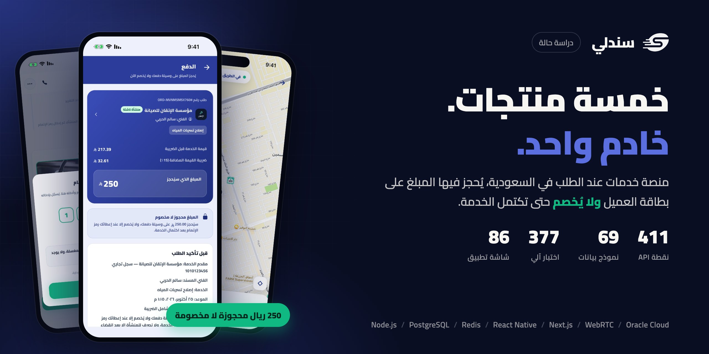
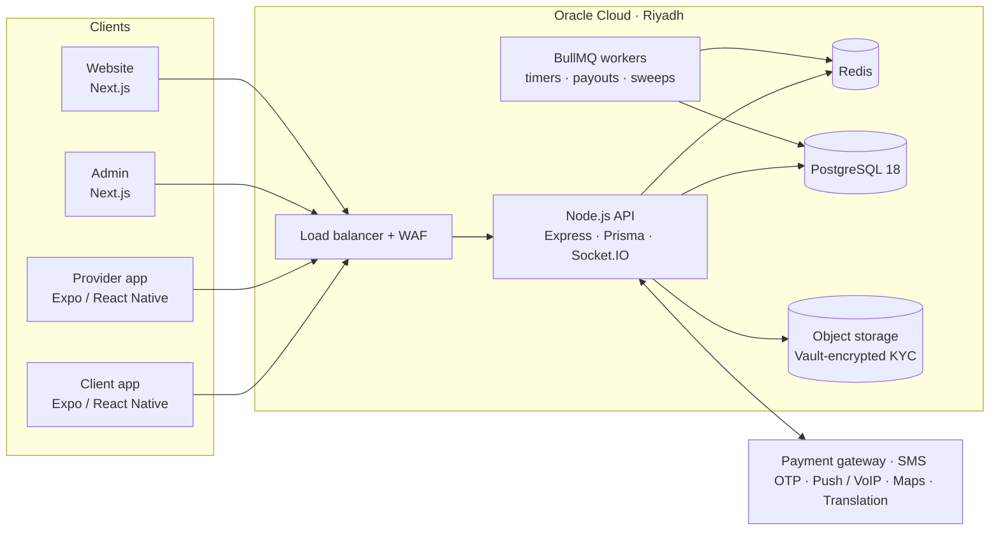
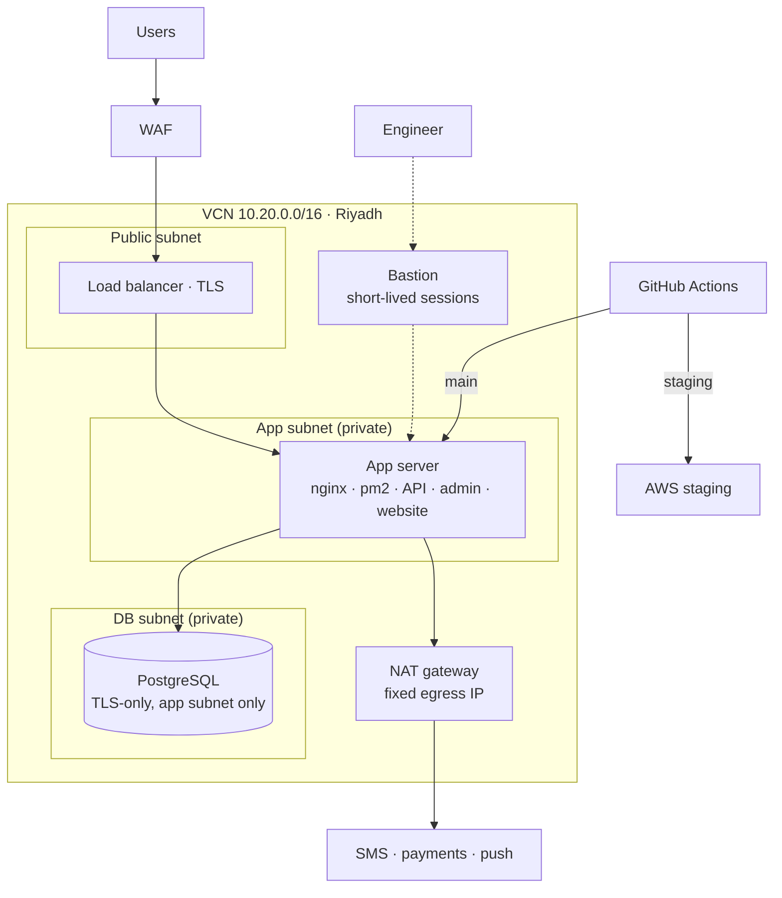
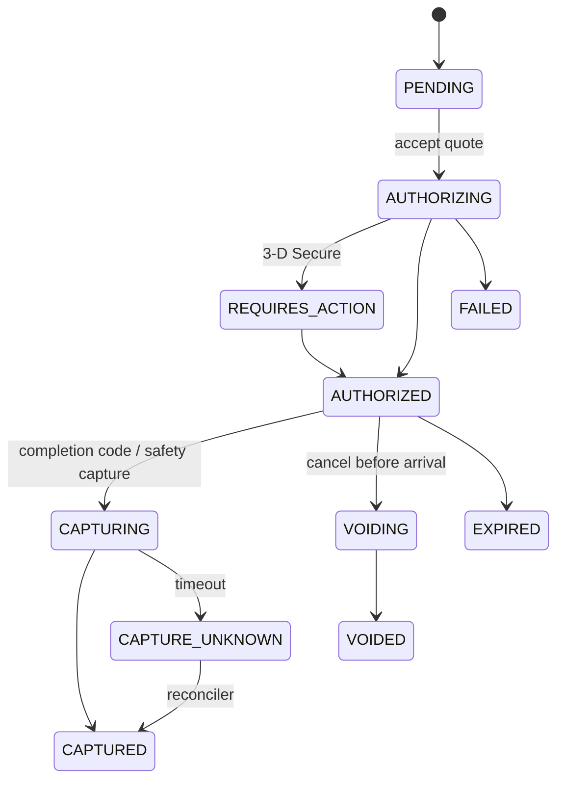
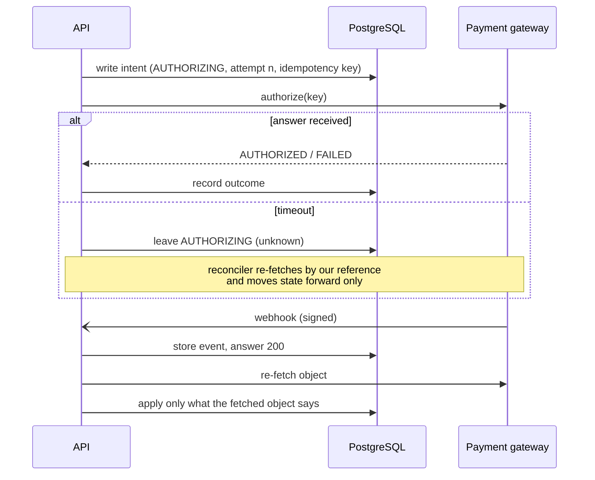

  <a href="README.md">English</a> · <b>العربية</b>

  
  
  
  
  
  
  

# سندلي: منصة خدمات عند الطلب في السعودية

**أي خدمة، في أي مكان.** يصف العميل ما يحتاجه، كتسريب في منزل أو مكيّف معطّل في مكتب أو عطل كهربائي في ورشة. ترسل المنشآت المرخّصة عروضاً مسعّرة، و**يُحجز المبلغ على بطاقة العميل ولا يُخصم** حتى تكتمل الخدمة.

[sandlee.sa](https://sandlee.sa) · iOS و Android والويب · العربية أولاً · **دوري: المهندس الرئيسي للمعمارية والخادم وتطبيقَي الجوال والويب والسحابة وخط النشر**

> **الشيفرة ملك للعميل وليست منشورة.** يسعدني شرح المعمارية أو قاعدة البيانات أو أي قرار مما يلي:
> **[HazemSalama108@gmail.com](mailto:HazemSalama108@gmail.com)** · [LinkedIn](https://linkedin.com/in/hazem-salama-290310310) · [hazemsalama.dev](https://hazemsalama.dev)

  
  
  
  
  

شاشات حقيقية من بيئة الاختبار: طلب الخدمة ← العروض ← حجز المبلغ ← تتبع الفني ← رمز الإتمام في تطبيق المنشأة

---

## نظرة سريعة

| | |
|---|---|
| **المنتجات** | تطبيق العميل · تطبيق المنشأة والفني · لوحة الإدارة · الموقع · واجهة برمجية واحدة خلفها كلها |
| **الخدمات** | 16 فئة و68 خدمة: سباكة وكهرباء وتكييف وتنظيف ونقل ومكافحة حشرات ومناسبات وغيرها |
| **الأماكن** | المنازل والمكاتب والورش ومواقع الشركات |
| **الخادم** | نحو 33 ألف سطر Node.js · 411 نقطة API · 93 وحدة خدمة · 69 نموذج بيانات · 59 ترحيلاً |
| **الجوال** | نحو 70 ألف سطر TypeScript في تطبيقين React Native · 86 شاشة · أكثر من 1800 نص مترجم في كل تطبيق |
| **الويب** | لوحة إدارة (34 صفحة) وموقع، كلاهما Next.js |
| **الجودة** | 377 اختباراً آلياً، وكل قاعدة مالية لها اختبار وحدة |
| **السحابة** | Oracle Cloud في الرياض خلف جدار حماية تطبيقات وموزّع أحمال · بيئة اختبار منفصلة على AWS · نشر مباشر من GitHub |

---

## المعمارية

### النظام

**نظام موحّد مقسّم إلى وحدات، عن قصد.** واجهة Node.js واحدة فيها 93 وحدة خدمة مجمّعة بحسب المجال (الطلبات والمدفوعات والبوابات وغيرها) فوق قاعدة PostgreSQL واحدة. المال وحالة الطلب والتسويات يجب أن تتغير معاً في معاملة واحدة، وتقسيمها إلى خدمات منفصلة في هذه المرحلة كان سيحوّل كل عملية دفع إلى معاملة موزّعة. الأعمال الخلفية (المؤقتات والالتقاط الوقائي ودورات التسوية والمسح الدوري) مهام BullMQ على الشيفرة نفسها، فتُكتب القواعد مرة واحدة.

### الشبكة والنشر

- **لا شيء خاص مكشوف للإنترنت.** الخادم وقاعدة البيانات في شبكات فرعية خاصة، والوصول الهندسي عبر جلسات Bastion قصيرة العمر.
- **عنوان خروج ثابت واحد** عبر NAT، لتضيفه مزوّدات الرسائل والدفع إلى قوائم السماح.
- **قاعدة البيانات لا تقبل إلا اتصالات مشفّرة، ومن شبكة الخادم وحدها.** والخادم يتحقق من شهادتها مقابل جهة إصدار مثبّتة، لا أي شهادة كانت.

### آلة حالة حجز المبلغ

### عملية مالية لا يمكن أن تخصم مرتين

---

## القرارات المعمارية

| # | القرار | بدلاً من | السبب | الثمن المقبول |
|---|---|---|---|---|
| 1 | **حجز المبلغ عند قبول العرض والتقاطه عند رمز الإتمام** | الدفع المسبق | العميل لا يدفع مقدماً لعمل لم يره، والمنشأة تحتاج ضماناً للجدية | الحجز ينتهي، فيُلتقط وقائياً قبل حدّ البنك بـ48 ساعة |
| 2 | **نظام موحّد مقسّم إلى وحدات مع قاعدة PostgreSQL واحدة** | الخدمات المصغّرة | المال وحالة الطلب والتسوية تتغير في معاملة واحدة | التوسع رأسي حالياً، والمجلدات بحسب المجال جاهزة للفصل |
| 3 | **واجهة `PaymentGateway` موحّدة، وكل حجز يعرف بوابته** | استدعاء حزمة بوابة واحدة مباشرة | بُدّلت البوابة بينما أكملت الحجوزات المفتوحة على القديمة مسارها | واجهة بالقاسم المشترك، مع أعلام قدرات لما يزيد |
| 4 | **تسجيل النية قبل كل نداء للبوابة، و«المجهول» حالة مستقلة** | إعادة المحاولة عند انتهاء المهلة | إعادة حجز انتهت مهلته قد تحجز البطاقة مرتين | مهمة مصالحة ومهمة مسح تحتاجان صيانة |
| 5 | **الإشعار من البوابة يطلق إعادة جلب فقط** | الوثوق بمحتوى الإشعار | الإشعارات تتأخر وتتكرر وتصل بغير ترتيبها | نداء إضافي لكل حدث |
| 6 | **قواعد المال والطلب دوال نقية تستقبل الوقت** | المنطق داخل معالجات المسارات | قابلة للاختبار حتى الهللة، وكل قاعدة تشير إلى البند القانوني الذي تطبقه | تمرير الوقت والإعدادات في كل نداء |
| 7 | **تثبيت العمولة عند الالتقاط، والتسوية في دورة أسبوعية تُراجع** | الصرف عند كل التقاط | مهلة للاعتراض والنزاع، واعتماد إداري واحد في الأسبوع | المنشأة تنتظر سبعة أيام ثم موعد الدورة |
| 8 | **مكالمات WebRTC مباشرة، والخادم ينقل الإشارات فقط** | مزوّد اتصال بأرقام مقنّعة | لا رقم جوال في أي مكان، ولا تكلفة بالدقيقة | عمل أصلي لـ CallKit وإشعارات VoIP، وخادم TURN |
| 9 | **موقع تقريبي حتى قبول العرض** | إظهار العنوان لكل من يقدّم عرضاً | الخصوصية: إزاحة ثابتة بمفتاح لا يمكن حساب الموقع الحقيقي منها | المنشآت تقدّر بالمسافة التقريبية لا بالمسار الدقيق |
| 10 | **محوّل تخزين يحفظ مفاتيح الملفات لا روابطها** | روابط وسائط ثابتة | نُقلت الوسائط إلى داخل المملكة دون كسر السجلات القديمة، ووثائق التحقق لا تُفتح إلا بروابط موقّعة ومسجّلة | سكربت لترحيل الملفات القديمة |
| 11 | **الإنتاج على Oracle Cloud في الرياض، والاختبار على AWS** | البقاء في AWS فرانكفورت | إقامة البيانات داخل المملكة | سحابتان للتشغيل، وخط النشر يختار الهدف بحسب الفرع |
| 12 | **نشر محميّ بالفرع على مشغّلات ذاتية** | النشر اليدوي عبر SSH | خادم الإنتاج لا يقبل إلا `main` ويرفض أي فرع آخر | صيانة المشغّلات |
| 13 | **اتصال لحظي مع إشعار لكل حدث مهم** | الاتصال اللحظي وحده | المنشأة التي تحتاج الطلب الجديد أكثر من غيرها تكون غالباً مغلقة للتطبيق | منطق لمنع تكرار الإشعارات |
| 14 | **توزيع الطلبات الجديدة بحسب المستوى عبر مهمة مؤجلة** | البث للجميع دفعة واحدة | أسبقية للمنشآت الأعلى مستوى | المستويات الأدنى ترى الطلب بعد قليل |
| 15 | **حزمة مشتركة `@sanad/shared` مثبّتة بمعرّف الإيداع** | نسخ الثوابت بين المشاريع | مصدر واحد للهوية والأنواع والقواعد بين الخادم والتطبيقين ولوحة الإدارة | تحديث التثبيت في كل مشروع |
| 16 | **الوثائق القانونية صفوف بإصدارات في قاعدة البيانات** | نصوص مكتوبة داخل التطبيقات | النص نفسه في كل واجهة، والموافقة تُطلب مرة واحدة عند كل إصدار جديد | أدوات إدارية لنشر الإصدارات |
| 17 | **تحديثات JavaScript عبر الهواء، وإصدار متجر للتغييرات الأصلية فقط** | إصدار متجر لكل إصلاح | الإصلاح يصل الأجهزة خلال دقائق | انضباط في تمييز ما هو JavaScript فقط |

---

## تفاصيل أعمق

<b>المدفوعات: الحجز والالتقاط الجزئي والتسوية</b>

- كل حجز يحمل قيمة الخدمة وضريبتها وخصم النقاط. نسبة العمولة **تُثبَّت عند الالتقاط**، فلا يتغير ما تستحقه المنشأة إن تغيّر مستواها أثناء العمل.
- الإلغاء بعد وصول موثّق **يلتقط رسوم الحضور فقط**، وتفكّ البوابة الباقي.
- مهمة **الالتقاط الوقائي** تعمل قبل أن يُسقط البنك الحجز بـ48 ساعة.
- كل حجز ملتقط ينتج سطر تسوية واحداً فقط، بقيد فريد في قاعدة البيانات لا بالاتفاق. ويُعاد فحص كل سطر عند الإرسال بحثاً عن نزاع مفتوح أو استرداد أو مطالبة ضرر.
- **الدورة الأسبوعية:** تنبيه للإدارة يوم الأربعاء، ثم مسودة دورة يوم الخميس يراجعها المشرف الأعلى فيستبعد أو يعتمد. نداء واحد للبوابة لكل سطر، ولا إعادة إرسال آلية.

<b>دورة حياة الطلب شيفرةٌ تُقرأ كالعقد</b>

- تمر خدمات الطلب بالحالات: جديد ← وصلت عروض ← اختيرت منشأة ← حُجز المبلغ ← في الطريق ← وصل ← بدأ العمل ← اكتمل ← أُغلق، مع فروع للإلغاء والنزاع.
- الطلب الواحد قد يضم **عدة خدمات**، لكل منها منشأتها وحجزها وحالتها.
- نافذة الوصول والتأخر والفني غير المسجّل وحجب رمز الإتمام والزيارة المجانية ومهلة الاعتراض كلها **قواعد نقية تستقبل الوقت**، تطبقها مهمة كل 15 دقيقة **دون أثر عند التكرار**.
- عمل نشط واحد لكل فني، يُفرض **داخل معاملة التسوية** لا في الواجهة فقط.

<b>الخصوصية والأمن</b>

- طبقة وسيطة تحذف أرقام الجوال من كل حمولة طلب وعرض ومحادثة ومكالمة.
- المحادثة تمنع أرقام الجوال حتى لو كُتبت بالأرقام العربية أو بالحروف، والصور تُفحص قبل وصولها.
- السجلات وتقارير الأعطال تُنقّى من الأرقام والآيبانات والإحداثيات والرموز.
- وثائق التحقق في حاوية مشفّرة بمفاتيح Vault، ولا تُفتح إلا عبر مسار موثّق ومسجّل.
- جدار حماية التطبيقات أمام موزّع الأحمال يصدّ حقن SQL وXSS وتنفيذ الشيفرة وتضمين الملفات. مسارات إشعارات الدفع مستثناة حتى تصل البوابة إليها دائماً.

<b>هندسة تطبيقات الجوال</b>

- تطبيقان Expo / React Native على المعمارية الجديدة، بوحدات أصلية **للمكالمات داخل التطبيق** (WebRTC وCallKit وإشعارات VoIP) و**النشاطات الحية في iOS** للطلب الجاري.
- العربية من اليمين إلى اليسار والإنجليزية في كل الشاشات، مع اتجاه يُدار في طبقة JavaScript فيتطابق السلوك في نسخ التطوير والمتجر.
- أرقام لاتينية موحّدة في العرض، والحقول تقبل الأرقام العربية أيضاً.
- تحديثات عبر الهواء لكل قناة، ويُختار خادم الاختبار أو الإنتاج وقت البناء.

<b>الانتقال من AWS فرانكفورت إلى Oracle Cloud الرياض</b>

- **بنية مبنية بسكربتات:** الشبكة الافتراضية والشبكات الفرعية ومجموعات أمن الشبكة وNAT وموزّع الأحمال مع جدار الحماية وBastion ومفاتيح Vault والحاويات بقواعد دورة حياة وسياسات الخوادم.
- **قاعدة البيانات:** PostgreSQL 18 على قرص مشفّر، تقبل الاتصال المشفّر وحده ومن شبكة الخادم وحدها، والخادم يتحقق من شهادتها مقابل جهة مثبّتة.
- **شهادة واحدة لستة نطاقات** على موزّع الأحمال، تتجدد آلياً.
- **نسخ احتياطية أسبوعية** إلى التخزين، تُحفظ ثمانية أسابيع.
- **خط النشر:** `main` يذهب إلى Oracle و`staging` إلى AWS. نُقل الإنتاج في يوم واحد.

---

## ما توليته

- **المعمارية ونموذج البيانات** للمنتجات الخمسة.
- **الخادم:** الواجهة البرمجية، والمدفوعات والحجوزات، ودورة حياة الطلب، والنزاعات، والتسويات، والإشعارات، والمكالمات، والمحادثة.
- **تطبيقا الجوال:** تطبيق العميل وتطبيق المنشأة، ومعهما الوحدات الأصلية للمكالمات والنشاطات الحية.
- **لوحة الإدارة والموقع.**
- **السحابة:** بناء Oracle Cloud والانتقال إليها، وبيئة الاختبار على AWS، والتشفير، وجدار الحماية، والنسخ الاحتياطي، وخط النشر، والمراقبة.
- **العمل مع المؤسسين على المتطلبات القانونية والمالية والتنظيمية،** وتحويلها إلى شيفرة.

---

<b>تريد النسخة الأعمق: قاعدة البيانات، أو معالجة الأعطال، أو كيف جرى الانتقال؟</b> 
<a href="mailto:HazemSalama108@gmail.com">HazemSalama108@gmail.com</a> · <a href="https://linkedin.com/in/hazem-salama-290310310">LinkedIn</a> · <a href="https://hazemsalama.dev">hazemsalama.dev</a>

