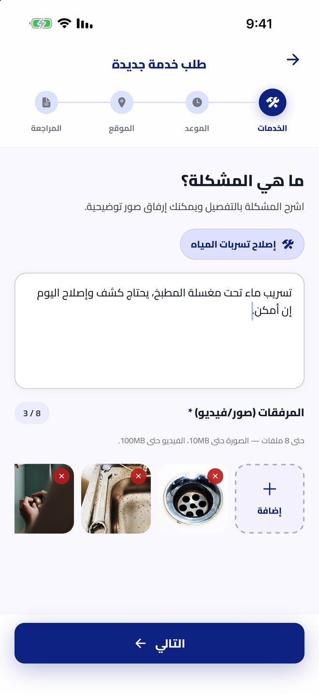
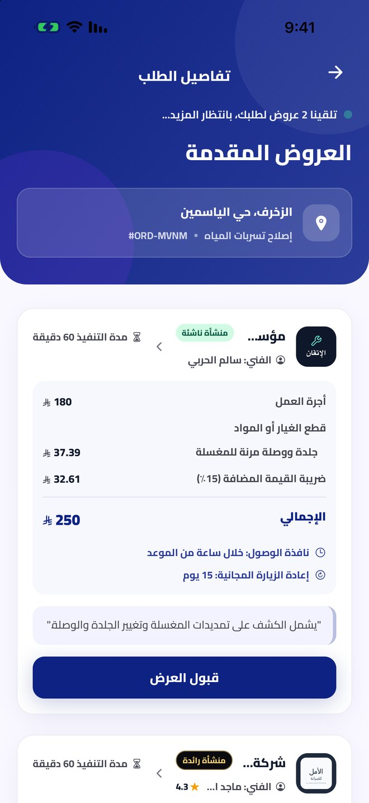
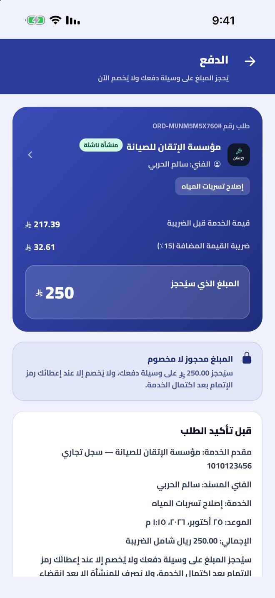
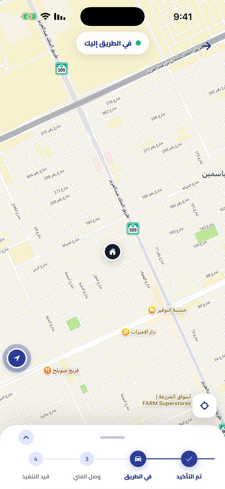
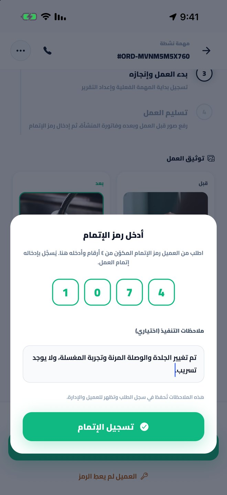
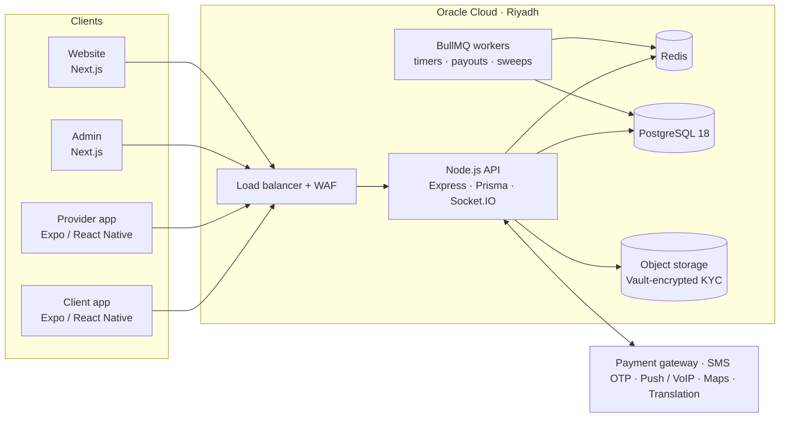
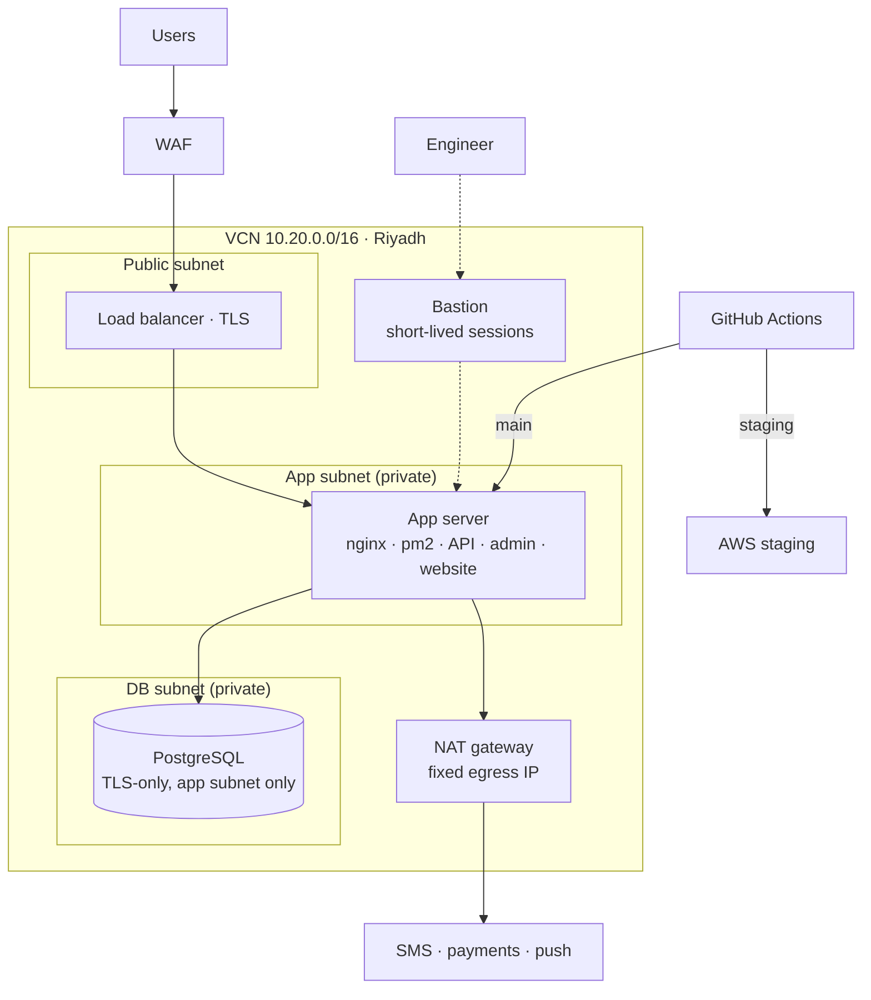
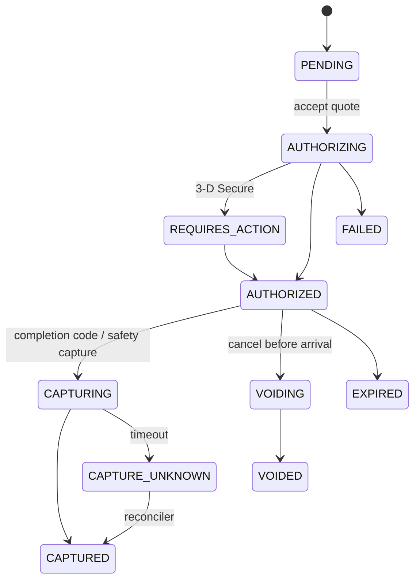
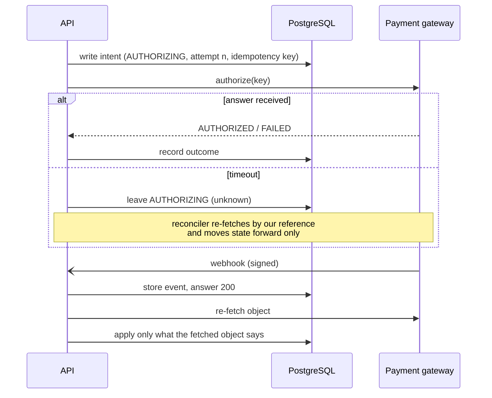

  <b>English</b> · <a href="README.ar.md">العربية</a>

  
  
  
  
  
  
  

# Sandlee — on-demand services marketplace, Saudi Arabia

**Any service, any place.** A client describes the job (a leaking pipe at home, a broken AC in an office, an electrical fault in a workshop), licensed companies send priced quotes, and the client's card is **held, not charged**, until the work is done.

[sandlee.sa](https://sandlee.sa) · iOS + Android + Web · Arabic-first · **My role: lead engineer — architecture, backend, both mobile apps, web, cloud and CI/CD**

> **The code belongs to the client and is private.** I'm happy to walk through the architecture, the schema or any decision below:
> **[HazemSalama108@gmail.com](mailto:HazemSalama108@gmail.com)** · [LinkedIn](https://linkedin.com/in/hazem-salama-290310310) · [hazemsalama.dev](https://hazemsalama.dev)

  
  
  
  
  

Real screens from the staging environment: request → quotes → card hold → live tracking → completion code (provider app)

---

## At a glance

| | |
|---|---|
| **Products** | Client app · Provider app · Admin dashboard · Website · one API behind all of them |
| **Services** | 16 categories, 68 services: plumbing, electrical, HVAC, cleaning, moving, pest control, events and more |
| **Places** | Homes, offices, workshops, company sites |
| **Backend** | ~33k lines of Node.js · 411 API endpoints · 93 service modules · 69 data models · 59 migrations |
| **Mobile** | ~70k lines of TypeScript across two React Native apps · 86 screens · 1,800+ translated strings per app |
| **Web** | Admin dashboard (34 pages) and website, both Next.js |
| **Quality** | 377 automated tests, with every money rule unit-tested |
| **Cloud** | Oracle Cloud, Riyadh region, behind a WAF and load balancer · separate AWS staging · deploys straight from GitHub |

---

## Architecture

### System

**A modular monolith, on purpose.** One Node.js API with 93 service modules, grouped by domain (`orderflow/`, `payments/`, `gateways/`, …), over one PostgreSQL database. Money, order state and payouts have to change together inside a single transaction. Splitting them into services this early would have turned every payment into a distributed transaction. Background work (timers, safety captures, payout cycles, sweeps) runs as BullMQ jobs on the same codebase, so the rules are written once.

### Network and deployment

- **Nothing private is reachable from the internet.** The app and the database sit in private subnets. Engineers get in through short-lived bastion sessions.
- **One fixed egress IP** (NAT), so SMS and payment providers can allowlist the platform.
- **The database only accepts TLS, and only from the app subnet.** The app verifies the server certificate against its own CA rather than trusting any certificate.

### Card hold state machine

### A money call that can't double-charge

---

## Architecture decisions

| # | Decision | Instead of | Why | Trade-off accepted |
|---|---|---|---|---|
| 1 | **Authorize at acceptance, capture at the completion code** | Charging up front | Clients won't prepay for unseen work, and companies need proof of commitment | Holds expire: a safety capture runs 48 h before the bank's limit |
| 2 | **Modular monolith + one PostgreSQL** | Microservices | Money, order state and payouts change in one transaction | Scaling is vertical for now, with domain folders ready to split |
| 3 | **`PaymentGateway` interface; each hold remembers its gateway** | Calling one gateway's SDK directly | Swapped gateways while open holds on the old one finished normally | Lowest-common-denominator API, with capability flags for the rest |
| 4 | **Write intent before every gateway call; "unknown" is a state** | Retry on timeout | Retrying a timed-out authorize can hold the card twice | A reconciler and a sweep job to maintain |
| 5 | **Webhooks only trigger a re-fetch** | Trusting webhook bodies | Webhooks arrive late, twice or out of order | One extra API call per event |
| 6 | **Money and order rules as pure functions taking `now`** | Logic inside route handlers | Testable to the halala, and each rule cites the legal clause it implements | More plumbing to pass time and settings in |
| 7 | **Commission locked at capture, payouts in a weekly reviewed cycle** | Paying out on every capture | Leaves room for objections and disputes, and one admin approval per week | Providers wait up to 7 days plus the cycle |
| 8 | **WebRTC peer-to-peer calls, server only relays signalling** | A masked-number telephony provider | No phone numbers anywhere, no per-minute cost | CallKit / VoIP-push native work, and a TURN server |
| 9 | **Approximate location until a quote is accepted** | Showing the address to everyone who quotes | Privacy: a keyed, stable offset can't be averaged back to the pin | Companies quote with distance ranges, not exact routes |
| 10 | **Storage adapter (`cloudinary` or `s3`) storing object keys, not URLs** | Hard-coded media URLs | Moved media in-Kingdom without breaking old rows; KYC files only via signed, logged links | A migration script for old files |
| 11 | **Oracle Cloud Riyadh for production, AWS for staging** | Staying in AWS Frankfurt | Saudi data residency | Two clouds to run; CI picks the target by branch |
| 12 | **Branch-guarded deploys on self-hosted runners** | Manual SSH deploys | Production can only run `main`, and a server refuses any other branch | Runner upkeep |
| 13 | **Realtime plus push for every important event** | Sockets only | The provider who needs a new order most has the app closed | Notification de-duplication logic |
| 14 | **Tiered fan-out of new orders (delayed BullMQ job)** | Broadcasting to everyone at once | Rewards higher-tier companies with a head start | Lower tiers see orders a little later |
| 15 | **Shared package (`@sanad/shared`) pinned by commit** | Copy-pasted constants | One source for brand, types and rules across the API, both apps and the admin | Bumping a pin in every consumer |
| 16 | **Legal documents as versioned database rows** | Text hard-coded in the apps | Same words on every surface; re-consent only when a version changes | Admin tooling to publish versions |
| 17 | **Over-the-air JS updates, store builds only for native changes** | A store release for every fix | Fixes reach phones in minutes | Discipline about which changes are JS-only |

---

## Deep dives

<b>Payments: holds, partial capture and payouts</b>

- Each hold carries base, VAT and points discount. The commission rate is **locked at capture**, so a company changing tier mid-job can't change what it earns.
- Cancelling after a verified arrival triggers a **partial capture** of the attendance fee. The rest of the hold is released by the gateway.
- A **safety capture** job runs 48 hours before the bank would drop the hold.
- Each captured hold produces exactly one payout line (a unique constraint, not a convention). Lines are re-checked at send time for open disputes, refunds or damage claims.
- **Weekly cycle:** Wednesday alerts the admins; Thursday opens a draft cycle; a super admin reviews, excludes or approves; there is one gateway call per line and no automatic resend.

<b>Order life cycle as code that reads like the contract</b>

- The services within an order move through `NEW → QUOTES_RECEIVED → PROVIDER_SELECTED → PAYMENT_HELD → EN_ROUTE → ARRIVED → WORK_STARTED → WORK_COMPLETED → CLOSED`, with cancellation and dispute branches.
- One order can hold **several service jobs**, each with its own company, hold and status.
- Arrival windows, late arrival, wrong technician, withheld completion code, free revisits and objection windows are **pure rules taking `now`**. A 15-minute timer job applies them **idempotently**.
- One live job per technician is enforced **inside the settlement transaction**, not just in the UI.

<b>Privacy and security</b>

- Middleware strips phone numbers from every order, quote, chat and call payload.
- Chat blocks phone numbers even when typed in Arabic-Indic digits or spelled out in words. Chat images are checked before delivery.
- Logs and crash reports are scrubbed of phones, IBANs, coordinates and tokens.
- KYC documents sit in a bucket encrypted with Vault-managed keys and are served only through an authenticated, logged route.
- The WAF in front of the load balancer blocks SQL injection, XSS, remote-code and file-inclusion attacks. Payment webhook paths are excluded so the gateway can always reach them.

<b>Mobile engineering</b>

- Two Expo / React Native apps on the new architecture, with native modules for **in-app calls** (WebRTC + CallKit + VoIP push) and **iOS Live Activities** for the active job.
- Arabic (RTL) and English throughout, with direction handled in a JavaScript layer so behaviour is identical in development and store builds.
- Consistent Latin digits on screen, while inputs also accept Arabic-Indic digits.
- Over-the-air updates per channel (staging / production backends selected at build time).

<b>The move from AWS Frankfurt to Oracle Cloud Riyadh</b>

- **Built with scripts:** VCN, subnets, NSGs, NAT, load balancer with WAF, bastion, Vault keys, buckets with lifecycle rules, and instance policies.
- **Database:** PostgreSQL 18 on an encrypted volume, accepting TLS only, from the app subnet only. The app verifies the server's certificate against a pinned CA.
- **One certificate across six hostnames** on the load balancer, renewed automatically.
- **Weekly backups** to object storage, kept for 8 weeks.
- **CI/CD re-pointed:** `main` deploys to Oracle and `staging` to AWS. Production moved over in a single day.

---

## What I owned

- **Architecture and data model** across all five products.
- **Backend:** API, payments and holds, order life cycle, disputes, payouts, notifications, calls and chat.
- **Both mobile apps:** client and provider, including the native call and Live Activity modules.
- **Admin dashboard and website.**
- **Cloud:** the Oracle Cloud build-out and migration, staging on AWS, TLS, WAF, backups, CI/CD and monitoring.
- **Working with the founders on legal, payment and compliance requirements,** and turning them into code.

---

<b>Want the deeper version: the schema, failure handling, or how the migration was run?</b> 
<a href="mailto:HazemSalama108@gmail.com">HazemSalama108@gmail.com</a> · <a href="https://linkedin.com/in/hazem-salama-290310310">LinkedIn</a> · <a href="https://hazemsalama.dev">hazemsalama.dev</a>

