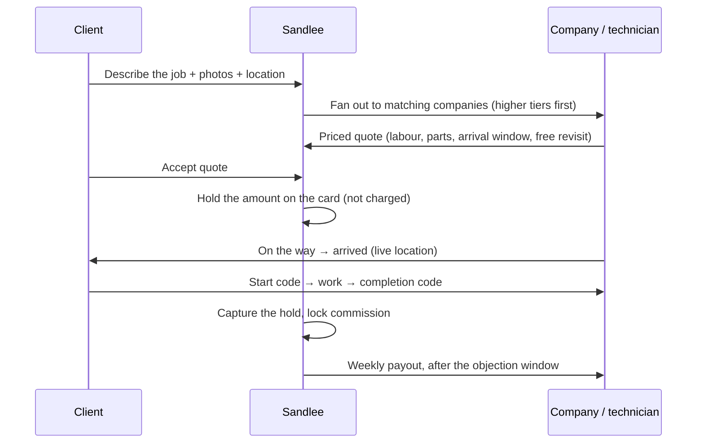
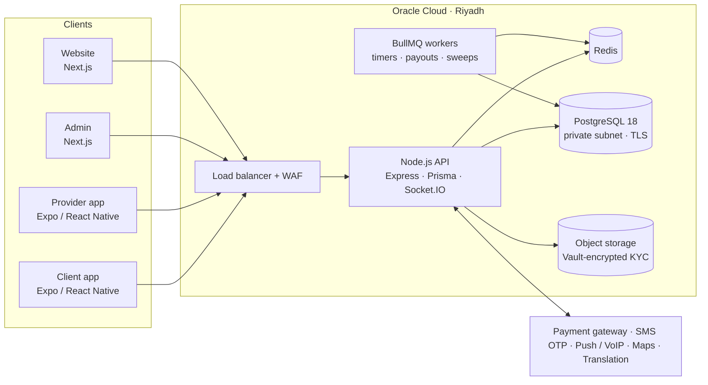

# Sandlee — on-demand services marketplace, Saudi Arabia

**Any service, any place.** A client describes the job (a leaking pipe at home, a broken AC in an office, an electrical fault in a workshop), licensed companies send priced quotes, and the client's card is **held, not charged**, until the work is done.

[sandlee.sa](https://sandlee.sa) · iOS + Android + Web · Arabic-first · **My role: lead engineer — architecture, backend, both mobile apps, web, cloud and CI/CD**

> The code belongs to the client and is private. I'm happy to walk through any of it, the architecture, or the decisions below:
> **[HazemSalama108@gmail.com](mailto:HazemSalama108@gmail.com)** · [LinkedIn](https://linkedin.com/in/hazem-salama-290310310) · [hazemsalama.dev](https://hazemsalama.dev)

---

## At a glance

| | |
|---|---|
| **Products** | Client app · Provider app · Admin dashboard · Website · one API behind all of them |
| **Services** | 16 categories, 68 services: plumbing, electrical, HVAC, cleaning, moving, pest control, events and more |
| **Places** | Homes, offices, workshops, company sites |
| **Backend** | ~33k lines of Node.js · 411 API endpoints · 93 service modules · 69 data models · 59 migrations |
| **Mobile** | ~70k lines of TypeScript across two React Native apps · 86 screens · 1,800+ translated strings per app |
| **Web** | Admin dashboard (34 pages) and website, both Next.js |
| **Quality** | 377 automated tests, with every money rule unit-tested |
| **Cloud** | Oracle Cloud, Riyadh region, behind a WAF and load balancer · separate AWS staging · zero-touch deploys from GitHub |

---

## The product in 30 seconds

---

## Architecture

**Stack:** Node.js · Express · Prisma · PostgreSQL · Redis · BullMQ · Socket.IO · WebRTC · Expo / React Native (new architecture) · TypeScript · Next.js · Oracle Cloud (VCN, LB, WAF, Vault, Bastion, Object Storage) · AWS · GitHub Actions · Sentry

---

## Engineering decisions worth talking about

### 1. Hold the money, don't take it
Clients in this market don't trust paying up front for a job they haven't seen. So the card is **authorized at acceptance and captured only when the client hands over a completion code**.
- Every hold runs through an explicit state machine: `PENDING → AUTHORIZING → AUTHORIZED → CAPTURING → CAPTURED`, plus a void branch.
- A **safety capture** fires 48 hours before the bank would drop the hold.
- Cancellation after the technician has arrived uses a **partial capture** for the attendance fee only.

### 2. Gateway-agnostic payments
Payments sit behind a single `PaymentGateway` interface (authorize, capture, void, refund, split, verify webhook). That let me **migrate to a new Saudi payment gateway while open holds on the old one finished normally**. Each hold remembers which gateway it belongs to.

### 3. "Unknown" is a real outcome
Network timeouts on money calls are where double charges come from. So:
- Every gateway call is written to the database *before* it's sent, with an idempotency key per attempt.
- A timeout becomes `PENDING_UNKNOWN`, never "failed".
- A reconciler re-fetches the truth from the gateway.
- A sweep voids any card authorization that no order knows about.

### 4. Webhooks are hints, not commands
A payment webhook is verified (HMAC), stored, and answered with 200. Then the system **re-fetches the object from the gateway** and only moves state forward. A webhook can never capture, refund or split money by itself.

### 5. Money math as pure functions
VAT, tier commission, gateway fees, points discounts, attendance fees and dispute splits all live in **side-effect-free, unit-tested functions**, with halala-exact rounding. The commission rate is locked at capture, so a company changing tier mid-job can't change what it earns.

### 6. Business rules that read like the contract
The order life cycle (arrival windows, late arrival, cancellation, wrong technician, withheld codes, revisits) is a set of **pure rule functions that take `now` as an argument**. Each one cites the clause of the legal terms it implements. The tests pin the clock, so the legal text and the code can't quietly drift apart.

### 7. Privacy by design
- Before a quote is accepted, a company sees only the client's first name and an **approximate area**: a circle offset from the real pin with a keyed hash, so it can't be averaged back to the address.
- Phone numbers are **stripped from every order, quote and chat payload** by middleware.
- Calls are **WebRTC peer-to-peer** with server-side signalling only. Nobody ever sees a number.
- Chat blocks phone numbers even when written in Arabic digits or spelled out in words.
- Logs and crash reports are scrubbed of phones, IBANs, coordinates and tokens.

### 8. Data residency: AWS Frankfurt → Oracle Cloud Riyadh
Saudi data-protection rules pushed the platform in-Kingdom. I rebuilt it on Oracle Cloud Riyadh:
- a VCN with public, app and database tiers, NAT, and a bastion-only path to the servers;
- a load balancer with WAF rules;
- PostgreSQL with verified TLS;
- KYC documents encrypted with Vault-managed keys;
- weekly backups with lifecycle rules.

Production moved over in a day. AWS stayed on as an isolated staging environment.

### 9. Two-branch CI/CD with guard rails
- `main` deploys to Oracle production and `staging` deploys to AWS, through self-hosted GitHub runners.
- Each server knows which branch it is allowed to run and **refuses a deploy from the wrong one**.
- Every deploy is recorded for the ops dashboard.

### 10. Real-time without losing anyone
- **Socket.IO** handles live order updates, tracking and chat.
- Every important event also goes out as a **push notification**, because the provider who needs a new order most is the one with the app closed.
- New orders **fan out by tier**: higher-tier companies get a head start, then a delayed BullMQ job opens the order to everyone else.

### 11. Companies, not just individuals
- Saudi rules required jobs to go through registered establishments. So a **company** quotes, assigns the job to one of its technicians, and the technician has to accept the assignment.
- A company climbs a **tier ladder** driven by pooled rating, completed jobs, cancellation and dispute rates. Its tier sets the commission on every team job.
- Notifications **fan in** to the company owner, with de-duplication so the owner gets one copy per event.

### 12. Arabic-first mobile, one codebase
- Arabic (RTL) and English are fully supported, with direction handled in a JavaScript layer. The same screens therefore behave the same in development builds and in store builds.
- Dates and amounts use consistent Latin digits.
- Inputs accept Arabic-Indic digits as well.
- JS-only fixes ship **over the air in minutes**; native changes go through store builds.

### 13. Legal terms as data
The platform's nine legal documents are **versioned rows in the database**, shown word for word on every surface. Every acceptance is recorded (document, version, time, device). When a document gets a new version, users see a single "read and agree" step.

---

## What I owned

- **Architecture and data model** across all five products.
- **Backend:** API, payments and holds, order life cycle, disputes, payouts, notifications, calls and chat.
- **Both mobile apps:** client and provider, including native modules for calls (CallKit / VoIP push) and iOS Live Activities.
- **Admin dashboard and website.**
- **Cloud:** the Oracle Cloud build-out and migration, staging on AWS, TLS, WAF, backups, CI/CD and monitoring.
- **Working with the founders on legal, payment and compliance requirements,** and turning them into code.

---

*Want the deeper version: schema, state machines, failure handling, or how the migration was run? [Email me](mailto:HazemSalama108@gmail.com).*
